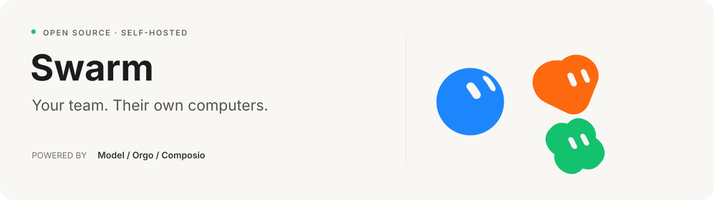

<p align="center">
  
</p>

<p align="center">
  A self-hosted Grok Bot clone with computer use, connected apps, memory, and voice.<br>
  Built with the public Grok API, Orgo, and Composio.
</p>

<p align="center">
  <a href="#quick-start">Quick start</a> ·
  <a href="#what-you-can-do">Features</a> ·
  <a href="docs/ARCHITECTURE.md">Architecture</a> ·
  <a href="#development">Development</a> ·
  <a href="https://github.com/nickvasilescu/grokbot-clone/issues">Issues</a>
</p>

---

Give a Bot a job, connect the apps it needs, and follow its work in chat. Each Bot has a name, a look, its own memory, and a desktop you can watch or take over. Bots can work together, run recurring tasks, and talk with you over voice.

Grokbot Clone recreates the Grok Bot experience with a runtime you can run and modify yourself. You bring your own API keys; conversations, settings, and agent state live in a local SQLite database.

## What you can do

- **Give every Bot a role.** Set its instructions, appearance, thinking effort, skills, and memories. Make one your primary point of contact.
- **Put it to work on a computer.** Bots browse websites in a Chrome browser on your own PC, or use a full Linux desktop with a shell through Orgo. Watch live, take control, and find saved work in the Library.
- **Connect your apps.** Google sign-in and app connections run through Composio. Read actions run automatically; Composio write actions pause for approval, with an option to remember your choice.
- **Add custom MCP tools.** In Settings → MCP servers, connect a remote HTTP/SSE server or local stdio command, test its tools, and choose which agents can use it. Also accessible through Connect Apps → Custom MCP; no Composio key required.
- **Build a team from chat.** Tell your primary Bot what a new teammate should own. It creates a permanent Bot with a focused brief, identity, `AGENTS.md`, resources, handoffs, and its own browser. Bots delegate work, start temporary subagents, and join group chats with @mentions.
- **Keep work moving.** Schedule routines, react to app events, and let your primary Bot check in proactively.
- **Keep context.** Bots retain durable memories, recall earlier facts, and compact long conversations.
- **Run it by text.** Sign up by texting a number with an invite, then talk to every Bot from one iMessage or SMS thread: @mention a Bot, get results and routine updates, approve actions, answer questions, connect apps, and send voice notes or photos. See the [messaging guide](docs/messaging.md).
- **Talk it through.** Realtime voice calls hand tasks to the same Bot runtime. Voice selection, speed, previews, and push-to-talk dictation are included.

Bots' computers come from a pluggable provider (`COMPUTER_PROVIDER`):

- **`desktop`**: your own computer's full desktop, through the same companion. Bots see your real screen, use the mouse and keyboard and any app, open websites in your default browser, and run commands in a shell as you. All Bots share the one desktop and take turns: while one Bot is acting on it, the others wait. macOS and Linux (X11).
- **`local`**: a Chrome browser on your own PC, through a small companion program. Each Bot gets its own browser profile. Browser only: no desktop apps and no shell.
- **`orgo`**: each user's Bots share one Orgo cloud VM, with up to four separate Bot desktops active at once. Idle computers can sleep and wake when needed.

## Custom MCP servers

Open **Settings → MCP servers → Add MCP server**. Enter a name and either a **Streamable HTTP** URL, a legacy **SSE** URL, or a **local stdio command** with one argument per line. Expand authentication for a bearer token/custom headers, or environment settings for local process variables and a working directory. **Save & test connection** performs the MCP handshake and lists all advertised tools. Use **Test connection** again after the server changes its tools.

Choose all your agents (including future agents) or selected agents. Active agents receive the tools on their next turn; onboarding agents remain limited to setup tools. Tools ask for approval by default, with the same Allow/Always allow/Don't allow controls as connected apps. Disabling, removing, or changing a connection blocks old tool calls, including pending approvals; changing an endpoint or credentials invalidates previous approvals. Settings → Permissions lets you revoke permanent tool permissions.

Custom connections are managed by the server owner, and are scoped to that account. Local commands run on the machine hosting Grokbot, independently of the browser/VM provider. Commands receive only a small standard environment plus explicitly configured variables, not the app's API keys. Connection secrets are stored in the app's local SQLite database and omitted from settings responses and model tool schemas. They are not encrypted at rest; protect database files and backups like the app's saved API keys. Per-agent MCP sessions close after five idle minutes or when the connection is changed/removed.

This integration supports MCP **tools**, including text, structured results and images. Interactive OAuth login, MCP resources and prompt templates are not yet supported; use provider-issued tokens or headers for authenticated remote servers. A successful test of a server with zero tools is shown explicitly. Tests: `npm run build && npm run test:mcp`.

## Quick start

### 1. Get the project

Install **Node.js 22.22 or newer**, then:

```bash
git clone https://github.com/nickvasilescu/grokbot-clone.git
cd grokbot-clone
npm ci
cp .env.example .env
```

### 2. Configure your keys

Generate `SESSION_SECRET` (below). Provider keys can go in `.env`, or you can paste them into the running app under **Settings → API keys**: they are checked with the provider before saving, stored encrypted with `SESSION_SECRET`, take effect without a restart, and override `.env`. Only the server's owner (the first account, or `ADMIN_EMAILS`) can change them.

Values for `.env`:

| Variable | Purpose |
| --- | --- |
| `OPENROUTER_API_KEY` | Models from OpenRouter: Grok, Claude, GPT, Gemini and more with one key (recommended) |
| `XAI_API_KEY` | Grok directly from xAI; also needed for voice calls |
| `COMPOSIO_API_KEY` | Optional: app connections, tool catalog, and Google sign-in (without it, use the dev email sign-in) |
| `SESSION_SECRET` | Secret used to sign sessions |
| `COMPUTER_PROVIDER` | `desktop` (your PC's full desktop and a shell), `local` (a private browser on your PC) or `orgo` (cloud VMs) |
| `ORGO_API_KEY`, `ORGO_WORKSPACE_ID` | Only for `COMPUTER_PROVIDER=orgo` |

Generate a session secret with:

```bash
openssl rand -hex 32
```

Paste the result into `SESSION_SECRET`. You need at least one model key: OpenRouter or xAI. With an OpenRouter key, Bots run on OpenRouter by default (`x-ai/grok-4.7` unless you pick another model); choose the provider and default model in **Settings → API keys**, and give any Bot its own model in its settings. Models that can't see images get a warning, since browser work relies on screenshots. Voice calls always use xAI's realtime API.

### 3. Start the app

Run the API in one terminal:

```bash
npm run dev -w server
```

Run the frontend in a second terminal:

```bash
npm run dev -w web
```

Open **[localhost:5173](http://localhost:5173)**. The frontend proxies API requests to port `8787`.

Use **Sign in with Google**, or use the local email form with `DEV_LOGIN=1` (enabled in `.env.example`). Your account starts with a primary Bot. Create another Bot, give it a role, and send it a task.

With `COMPUTER_PROVIDER=desktop` or `local`, connect your PC before giving Bots computer work (see below). With `orgo`, the first computer task provisions an Orgo VM. Model calls, app actions, and computers use your provider accounts and may incur charges.

### 4. Connect your PC (local computers)

In Grokbot, open **Settings → Computer → Connect your PC** and run the command it shows on the PC whose browser your Bots should use. It needs **Node.js 22+** and **Google Chrome**, and looks like:

```bash
curl -fsSL http://localhost:8787/api/companion/script -o grokbot-companion.mjs \
  && node grokbot-companion.mjs --server http://localhost:8787 --token gbc_...
```

Keep it running while your Bots work. The companion connects out to the server, so the PC needs no open ports, and it starts a separate Chrome for each Bot with its own profile under `~/.grokbot-companion`; your everyday Chrome profile is never touched. Chrome runs headless (watch it from the Bot's computer panel in Grokbot) unless you add `--headed`.

Guard rails, enforced on your PC: Bots get a browser only (no shell, no files from your PC), only `http(s)` pages, no downloads or file uploads, and local-network addresses such as `localhost` or `192.168.x.x` are blocked unless you add `--allow-private-network`. The token in the command is a secret: anyone who has it can connect their PC as your Bots' browser. **Disconnect** in the same settings page revokes it.

From a clone of this repository you can also run `npm run companion -- --server <url> --token <token>`.

#### Full desktop (`COMPUTER_PROVIDER=desktop`)

With `desktop`, **Settings → Computer → Use this computer** (or the connect command, which then ends in `--desktop`) gives Bots the whole machine instead of a private browser:

- **Screen, mouse and keyboard.** Bots see your real screen (the main display, scaled to 1280 px wide) and click, type, scroll and press shortcuts in any app. Use `cmd` in key combinations on macOS, e.g. `cmd+space`.
- **Browser.** When a task needs a website, `open_browser` opens it in your default browser, with your own logins, and brings it to the front.
- **Shell.** Bots run commands in your login shell, as you, starting in your home folder.
- **One Bot at a time.** There is one mouse and keyboard, so a Bot holds the desktop while it's working (up to a minute after its last action) and other Bots wait their turn. Shell commands don't wait.
- **You stay in charge.** Watch from a Bot's computer panel, **Take control** at any time, and press **Stop** in Settings → Computer (or Ctrl+C in the companion) to cut Bots off. Resetting a Bot's screen never closes your windows.

Requirements:

- **macOS:** allow the app that runs Grokbot (Terminal, iTerm, Conductor…) in System Settings → Privacy & Security → **Accessibility** (to click and type) and **Screen & System Audio Recording** (to see the screen). macOS asks once to let it control **System Events**, which is used for typing. Restart Grokbot after granting.
- **Linux:** an X11 session (Wayland isn't supported yet) with `xdotool` and ImageMagick (`import`) or `ffmpeg`.
- Windows isn't supported in desktop mode yet. Use `local` there.

Bots act as you in this mode. They can read and change your files, use your signed-in accounts and run any command, so use it on a computer you're comfortable handing over, and keep approvals on for actions that matter.

### 5. Run it by text (optional)

The server owner adds an [Inkbox](https://inkbox.ai) key in **Settings → Messaging** and selects **Set up line**; Inkbox needs to reach `SERVER_URL` over HTTPS. Then share an invite link (`/join/<code>`): people enter their number, tap **Text Grokbot**, and their account is created when the text arrives. Existing web users connect their phone with a link code. Details in the [messaging guide](docs/messaging.md).

### Run a built version

```bash
npm run build
npm start
```

The API serves the built app at **[localhost:8787](http://localhost:8787)**. Set both `APP_URL` and `SERVER_URL` to that address, or to your public HTTPS URL when hosting it, so sign-in redirects return to the right place. Disable `DEV_LOGIN` before exposing the server to other users.

## How it works

| Layer | Implementation |
| --- | --- |
| Web app | React, TypeScript, Vite, and Zustand |
| Server | Node.js, Hono, SQLite, and Server-Sent Events |
| Agent runtime | Grok Responses API with streaming, tools, memory, and approval handling |
| Computers | Pluggable providers: your PC's full desktop (CoreGraphics on macOS, xdotool on Linux) or a browser on your PC (Chrome DevTools protocol), both through the companion, or Orgo VMs with per-Bot desktops; noVNC viewer through the server |
| Connected apps | Composio catalog, sessions, authentication, tools, and triggers |
| Voice | Grok realtime sessions with a relay into the text agent's task loop |

The server owns the agent loop. It builds context, streams a model response, executes tools, pauses for approvals when required, and continues until the task is done. Voice hands work to that same loop.

For the details, read the [architecture guide](docs/ARCHITECTURE.md), [Orgo integration guide](docs/orgo-builder-guide.md), and [Grok and Composio integration guide](docs/xai-and-composio.md).

## Development

```bash
npm run typecheck       # Check the server and frontend
npm run build           # Build both workspaces
```

The main source directories are:

```text
server/src/     API routes, agent runtime, tools, and integrations
web/src/        Chat, Bot settings, app connections, computer viewer, and voice
web/artwork/    Original design assets used to generate Bot avatars
web/public/     Static UI assets
tests/          Playwright integration and voice scripts
docs/           Architecture and integration guides
```

### Integration tests

`npm run test:bots` checks teammate creation with an isolated database and mock model, including a real local Chrome companion. It verifies creation from the master chat, handoffs, setup downloads, fresh-chat persistence, replication, separate browser profiles, access checks, offline retries, and VM screen allocation. It does not use your provider keys or existing accounts.

With the server running and `DEV_LOGIN=1`:

```bash
node tests/e2e.mjs http://localhost:8787
```

The suite creates a temporary Bot and exercises chat, computer tools, the live viewer, search, app connections, voice sessions, groups, and settings. Set `E2E_EMAIL` to choose the test account. It calls real providers and requires Google Chrome at `/usr/bin/google-chrome`.

#### Local computers, without an xAI key

`tests/mock-xai.mjs` stands in for the Grok API so you can test the computer flow end to end. Start it, point the server at it, and run the local-computer suite:

```bash
npm run mock:xai &                         # listens on :8790
# in .env: COMPUTER_PROVIDER=local, XAI_BASE_URL=http://localhost:8790/v1, DEV_LOGIN=1
npm run dev -w server & npm run dev -w web &
npm run test:local                         # node tests/local-computer.mjs
```

The suite serves a small test website, pairs a fresh companion, and checks real effects on that site: Bots opening pages, clicking, typing, keys, scrolling, new tabs, dialogs, history, the guard rails, Library files, and the live viewer including **Take control**. With the mock running you can also try it by hand: a chat message containing a URL makes the Bot open it, and a message like `mock: open_browser {"url":"https://example.com"} | computer_screenshot {} | say Done` runs those steps. Remove `XAI_BASE_URL` to use the real Grok API.

`tests/desktop-computer.mjs` does the same for `COMPUTER_PROVIDER=desktop` on a Linux X display (for example Xvfb with `xdotool` and ImageMagick). It drives the real desktop through **Use this computer**, opens pages in the default browser, and checks clicks, keys, scrolling, the shell, turn-taking between two Bots, the live viewer and **Take control**. See the comments at the top of the file for the setup.

The separate `tests/voice-call.mjs` script is a development harness for two-way audio. It currently contains machine-specific paths and needs adapting before use on another system.

### Creating and replicating teammates

Give the primary Bot a concrete brief, for example: “Create Nia to research three qualified leads each week, cite sources, never send outreach, and report to Quinn.” The master uses the relevant specifications and corrections in your chat to save the teammate’s mission, responsibilities, boundaries, success criteria, resource references and handoffs. It asks for clarification if the job is missing. Creation itself does not invent or activate schedules; ask for those explicitly.

Every new teammate starts a **setup interview in its own chat**. Acting as a setup consultant, it asks focused questions about the actual functions, inputs, outputs, workflows, exceptions, action boundaries and handoffs. It uses the master’s existing brief and saves substantive answers rather than asking the user to repeat known details. Questions focus on decisions that affect the work; optional tone, cross-agent handoffs, resources or schedules are discussed only when relevant. A simple personal task can return results in chat without inventing a handoff process.

Open **Configuration** in the right side panel for four essentials: **What it does**, **What you get**, **When it works**, and **Actions & limits**. Empty sections and app-generated placeholder requirements are omitted. **More details** expands the workflow steps, resources, handoffs, working style and standing instructions. The panel updates when the agent saves a draft. Once the specification is complete, it changes to **Ready for your review**; **Activate agent** confirms that exact revision. During the interview, the runtime exposes and permits only setup tools. Browser, shell, app actions, delegation and schedules cannot execute until activation. Any initial assignment from the master is held until then. **Refine setup** reopens the interview for an existing agent; existing agents are not automatically paused by this update.

The collapsed **Setup files** section displays the full contents of `AGENTS.md`, `SOUL.md`, `WORKFLOWS.md`, `IDENTITY.md`, `CONTEXT.md`, `RESOURCES.md`, `HANDOFFS.md`, and `bot-setup.json`, with downloads. They are also available under **Library → Setup**. `SOUL.md` defines communication style and working principles; `WORKFLOWS.md` defines triggers, steps and outputs. Both are incorporated into the charter loaded by the runtime. The charter is loaded on every turn and survives a fresh chat. The selected master-chat messages and cited interview answers are preserved with the brief. Downloaded files are generated views of the saved configuration; edit through the setup conversation, rather than changing a downloaded file. Canonical files are stored beside the database in `bot-setups/<bot-id>/`; Orgo also receives copies in the Bot’s VM Library. Setup downloads remain available when its computer is offline.

Ask the master to “replicate Nia as Nia Two” to reproduce the saved role and model/voice settings with a new identity and browser profile. Replicas start their own interview so the new role can be reviewed before activation. Alternatively, import the downloaded manifest with `POST /api/bots/import` and a JSON body `{ "manifest": <contents of bot-setup.json>, "name": "Nia Two" }` using your authenticated session. Credentials, browser sessions, live tasks, schedules, learned memories and conversation history are not cloned. Resource references are preserved; referenced files and account access must be available on the destination computer.

If computer setup fails, the Bot and its full brief are still saved. Reconnect the computer and ask the master to retry that Bot’s setup. Orgo supports four simultaneous screens on the shared VM; creation waits for capacity rather than taking an active teammate’s screen. Local computers use a separate Chrome profile for each Bot on the connected machine.

For the Mac/local launcher, run `./scripts/local.sh` after updating: it rebuilds changed source and restarts an older running build. `/api/health` reports `features.botCreation` and `features.botSetupVersion: 2` and `features.guidedSetup` for this version.

### Contributing

Bug reports, improvements, and pull requests are welcome. For a bug, include the steps to reproduce, expected behavior, Node version, and relevant logs with secrets removed. For larger changes, open an [issue](https://github.com/nickvasilescu/grokbot-clone/issues) first to discuss the approach.

Keep changes focused, run the typecheck and build, and describe how you verified the affected flow. Never commit API keys, `.env` files, databases, or screenshots containing personal information.

## Project status

This is an experimental project. The core workflows are implemented, but it has not undergone a security audit. Bots within an account share a VM; Composio write approvals do not cover every possible action a Bot can take through its browser or shell.

Planned work includes more computer providers (for example Docker containers or Firecracker microVMs on your own servers), a faster executor inside each VM, file-based skills and task recording, and meeting support.

Configuration options for idle suspension, memory consolidation, and history compaction are described in the [architecture guide](docs/ARCHITECTURE.md). Start with [`.env.example`](.env.example) for connection settings.

## License and credits

Project code is available under the [MIT license](LICENSE). Third-party artwork and trademarks retain their owners' rights; see [third-party notices](THIRD_PARTY_NOTICES.md).

Inspired by Grok Bot. Built with [Grok](https://x.ai), [Orgo](https://orgo.ai), and [Composio](https://composio.dev). This is an independent project, unaffiliated with xAI or Cursor/Anysphere.
