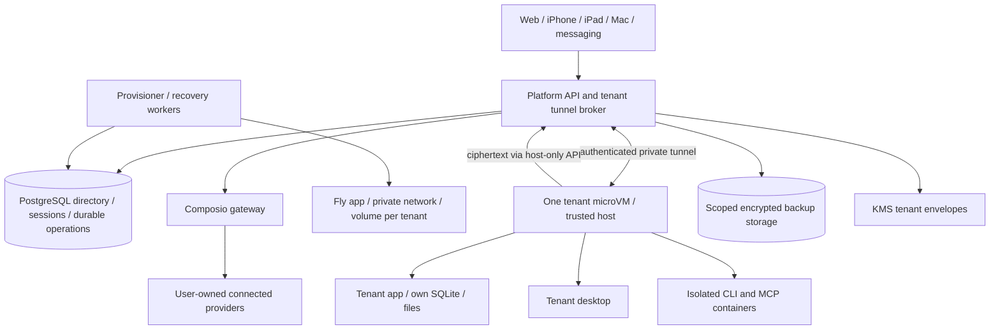

# Swarm: 2,000-user public release and scaling execution prompt

Use this entire document as the implementation and qualification handoff. It contains the inherited baseline, additions, current constraints, remaining work, required evidence and release criteria. It is not authorization to spend money, mutate production, use customer accounts, publish a native app or declare a release qualified.

## 1. Objective and evidence boundary

Deliver the existing Swarm product to **2,000 registered users, with fewer simultaneously active users**. This population definition was explicitly confirmed by the owner after the initial audit. Each hosted account retains its independent data/credential/computer boundary. Establish a measured path beyond 2,000 registered users.

The owner has **not yet specified peak concurrency**. Use **250 simultaneously active users steady / 500 active during burst** as a proposed initial engineering scenario (12.5% / 25% of registrations), with a 24-hour soak and sensitivity cases at 100, 250, 500 and 1,000 concurrent users. These concurrency numbers are recommendations for sizing/tests, not owner-approved requirements or measured capacity. Final release acceptance requires an agreed peak-active target, workload and maximum running-computer envelope. **2,500 registered accounts** is optional 25% inventory/growth headroom, not a requirement for 2,500 simultaneously active users.

Distinguish **R = registered accounts**, **H = running tenant computers (including idle ones)** and **A = users actively doing work**. Usually A ≤ H ≤ R for hosted accounts, but H depends on warm-idle policy, background routines/events and reconnects. Current isolated code lacks automatic idle suspension, so **R=2,000 and A=250 can still leave H=2,000**. Do not assume low active concurrency automatically reduces VM, polling or backup costs. Model registration/data capacity and active execution capacity separately.

Preserve the product: web, iPhone/iPad and Mac; hosted ChatGPT/Codex and Claude subscriptions; API/OpenRouter models; agents and helpers; browser/desktop/file work; connected apps and custom MCP; voice and messaging; approvals; durable work; user-owned data and credentials. The Mac ships as a direct, Developer ID signed/notarized download. iOS ships through the App Store.

### Source snapshot

- Audit date: 2026-11-11.
- Original commit 1: `9e21ecdd2f22c183fc8e604b27d8b545060beb5d` — initial open-source release.
- Original commit 2: `960c7e966ad71e0ff24a8849025d773e34219e0a` — restore artwork, avatars and icons.
- **Comparison baseline, original commit 3:** `7ee6a7ed8464311dbb467bb9ee7c76d9286e56be` — README/banner/quick start.
- **Audited application HEAD:** `7e67b384b6ecccf17f322b61a2a10e4de5a3d1d8` — native Swarm MCP for subscription CLIs.
- Local application checkout was clean when this audit began. The handoff documents added by this task are not application implementation changes.
- Between baseline and audited HEAD: **136 commits**, **575 changed paths**, **70,460 insertions / 2,766 deletions**, including tests, lockfiles and generated/resources files. There are 171 tracked files at baseline and 666 at audited HEAD. The change classifications are 497 added, 75 modified, 2 deleted and 1 renamed. These counts are a scope inventory, not a quality or capacity score.
- [Full changed-path inventory](2000-user-change-inventory.tsv). Reproduce with `git diff --name-status 7ee6a7ed8464311dbb467bb9ee7c76d9286e56be 7e67b384b6ecccf17f322b61a2a10e4de5a3d1d8`.
- Additions below mean changes **since the third original commit**, including merged branches/upstream development and multiple agents. They are not an authorship claim by one session.

### Status vocabulary

| Label | Meaning |
| --- | --- |
| Implemented | Concrete source exists at the audited commit. |
| Locally validated | A named test/build/probe passed for a specified source/configuration. |
| Confirmed defect | Current code or a bounded reproduction demonstrates an incorrect behavior. |
| Incomplete implementation | The required adapter, worker, integration or release path is absent/unfinished. |
| Configuration missing or unverified | Code exists but required accounts, secrets, resources or settings lack current receipts. |
| Unqualified | No adequate live/device/failure/load evidence establishes the claim. |
| Design limit | An intentional bound or architecture that constrains the supported workload. |

**Current verdict: source completion and passing fixture suites do not establish public release or 2,000-user readiness.** There is no reviewed qualification of a 2,000-account dataset at an agreed active/running-computer mix in the evidence inspected. The older 2,000/2,500-active calculations are retained only as clearly labeled all-running stress/sensitivity cases, not the launch requirement. There are both implementation gaps and live qualification gates.

Refresh HEAD, worktree state, production release/image, infrastructure inventory, provider configuration and evidence timestamps before executing this plan. Do not deploy the audit SHA merely because it appears here. Attach every future receipt to the exact application/runner/host/desktop image digests, schema, region, test configuration and time.

## 2. What the original three commits already provided

Do not rebuild or take credit for these inherited features:

1. React/TypeScript/Vite/Zustand web interface: sidebar, conversations, Bot settings, activity/tasks/library, computer viewer and voice UI.
2. Node/Hono backend, shared SQLite in WAL mode, per-user server-sent events and server-owned agent execution.
3. Grok/xAI Responses API integration: streamed replies, tool loops, per-Bot context/history, compaction, durable memories and recall.
4. Agent collaboration: primary Bot, `send_to_bot`, temporary subagents, group conversations and mentions.
5. Scheduled/event routines, proactive check-ins, tasks, skills/resources and approval cards with saved policies.
6. Orgo computers: one VM per user, up to four Bot desktops/screens, idle suspension/wake, server-side VNC authentication and watch/control relay.
7. Composio catalog/connections/tools/triggers and the original Google sign-in path through a managed Gmail connection.
8. xAI realtime voice, TTS/STT/dictation and voice handoff into the text-agent loop.
9. Original design artwork, avatars and icons, plus development setup and initial integration harnesses.

The original README explicitly described the project as experimental and not independently security-audited. Computer/shell actions were not comprehensively governed by Composio approval cards. The original deployment was not an independently contained application/runtime per account.

Evidence: `git show 7ee6a7ed:README.md`, `git show 7ee6a7ed:docs/ARCHITECTURE.md`, and that commit's tree. Baseline `tests/` had 3 tracked files; audited HEAD has 114. Test file count is not test completeness.

## 3. What was added or materially extended

### 3.1 Product, account and client capabilities

| Area | Added since baseline | Main source/evidence | Remaining boundary |
| --- | --- | --- | --- |
| Swarm identity and UI | Swarms.so branding, compatibility for legacy names/paths/cookies, Paper styling, responsive navigation/settings/dialogs, mobile composer, connected-app rows, task-board, per-Bot activity/time-saved analytics and usage presentation. | `web/src`, `assets`, `tests/rename-compat.test.mts`, `tests/mobile-layout.mjs`, `tests/tasks-layout.mjs`, `server/src/analytics.ts` | Browser layout fixtures do not qualify physical devices or every accessibility flow. Time-saved analytics use fixed-rate estimates, not measured productivity. |
| Onboarding and agent creation | Chat-created permanent teammates, role/setup loading, agent files/resources/handoffs, configuration stages, isolation-aware async registration and provisioning. | `server/src/bot-setup.ts`, `server/src/agent`, `tests/onboarding.test.mts`, `tests/bot-creation.test.mts` | Execute the complete first-account-to-useful-task journey in isolated production-like staging. |
| Models and API keys | OpenRouter and compatible direct providers, shared admin-managed encrypted settings, per-account private OpenRouter connection/sign-in, model favorites/capabilities/effort controls, image-input guards and billing-source display. | `server/src/lib/llm.ts`, `server/src/routes-models.ts`, `server/src/auth/openrouter.ts`, `server/src/settings.ts`, `web/src/components/ComposerModelMenu.tsx` | Actual model availability, quotas, image behavior and provider charges vary by account. Isolated private-direct model discovery has the specific D23 integration defect. |
| ChatGPT/Claude subscriptions | Official Codex/Claude CLI runners, account-private hosted profiles, browser terminal login, optional personal bridge, model/effort/quota discovery, concurrent requests, credential mutation locks, session/recent-auth checks, explicit no-API-fallback behavior. | `server/src/cli`, `companion/cli-bridge.mjs`, `server/src/runtime/subscription-client.ts`, `docs/cli-subscriptions.md` | Provider permission for hosted use, current real account entitlement/quota and full tenant deployment remain qualification work. |
| Native CLI tools, latest increment | Per-generation authenticated loopback MCP with exact Swarm tools; native shell/file/plugin/unrelated MCP access disabled; owner-bound callbacks over hosted/bridge/supervisor transports; tools can complete within a single CLI generation; approval stops and exact stored-action resume; cancellation and duplicate-ID handling. | `docs/cli-native-mcp.md`, `server/src/cli/native-tools.ts`, `server/src/cli/tool-callback.ts`, `companion/cli-bridge.mjs`, `server/src/runtime/runner-client.ts` | Real provider inference on the newest native tool path is not established by control-only CLI probes or fixture MCP tests. Final assistant text is still buffered. |
| Usage and plan UX | Per-account token/request/cost reporting, per-Bot/model/day/activity breakdowns and CSV, API versus subscription attribution, model catalog/usage picker and usage bubble. Latest work preserves partial/unavailable token accounting rather than fabricating zero. | `server/src/usage.ts`, `server/src/routes-usage.ts`, `web/src/components/config/UsageSection.tsx`, `tests/usage.test.mts` | Provider subscription fees/extra charges and authoritative remaining quota are not inferred from token records. This is not a Swarm payment/entitlement system. |
| Google identity | Direct OIDC verification; later standalone Composio-backed login restored with Google's immutable subject, verified mailbox/identity checks and cleanup of temporary authorizations. | `server/src/auth/google.ts`, `server/src/routes.ts`, `tests/google-auth.test.mts`, `tests/google-composio-auth.test.mts`, PR #39 | Test direct and Composio modes separately. Do not assume the standalone fallback is also wired into the isolated platform auth route. |
| Apple/native authentication | Native Apple sheet, browser OAuth callback with PKCE/state/one-use exchange, Apple identities/linking/deletion/revocation, origin and account/session boundaries, OpenRouter native handoff. | `server/src/auth/apple.ts`, `server/src/native-auth.ts`, `apple/Swarm`, `docs/apple-sign-in.md` | Real signed-device new/returning/Hide My Email/link/delete flows still need receipts. |
| Session/admin/security policy | Hashed sessions, expiry/recent-auth/revocation checks after async waits, immutable admin IDs/roles, durable one-time legacy phone-to-admin mapping, isolated tenant cookie derivation and role-specific boot. | `server/src/accounts.ts`, `server/src/lib/auth.ts`, `server/src/platform/tenant-sessions.ts`, `server/src/deployment.ts`, `tests/admin-access.test.mts` | Retest cross-role/API compatibility and actual deployment configuration; never reinstate phone/email as a standing administrator grant. |
| Signup/invitations/waitlist | Explicit administrator signup roles, private invites, verified-contact waitlist, revision/recent-auth policy controls, fresh proof after approval and metadata retention. | `server/src/platform/signup.ts`, `signup-routes.ts`, `docs/platform-signup-operations.md` | Production transport, abuse controls and launch admission policy require qualification. |
| Messaging | Inkbox iMessage/SMS/WhatsApp signup and routing, Bot mentions, attachments/audio, approve/answer/connect via messages, durable replay protection, transactional ownership, revisions/tombstones, dispatch/revocation checks and tenant event delivery. | `server/src/messaging`, `server/src/platform/messaging.ts`, `messaging-store.ts`, `docs/messaging.md` | Real line/channel/provider throughput, identity/linking/revocation behavior, operational quotas and user support remain unqualified; verify each advertised channel separately. |
| Connected apps | Project/identity validation, catalog pagination/ranking, selected/default/multiple connections, native callbacks, owner/revision checks, durable dispatch outcomes, fresh execution authorization and setup read-only verification. | `server/src/composio.ts`, `server/src/platform/composio-service.ts`, `composio-policy.ts`, `app-discovery.ts`, PR #36 | Default text-tool approval classification remains a confirmed defect; provider metadata/permissions and actual integrations need live qualification. |
| Custom MCP | HTTP/SSE and local stdio, agent selection, discovery/testing, revocation, recent-auth credential changes, isolated local process supervision, restricted Library folder grants, remote URL/network defenses and OAuth/PKCE/resource checks. | `server/src/mcp`, `server/src/runtime/mcp-folders.ts`, `server/src/security/network.ts`, `tests/mcp*.mts` | Real mount/kernel behavior and remote provider OAuth/revocation. Some README descriptions predate encrypted/OAuth support; source and current tests take precedence. |
| Agent execution/recovery | Durable jobs and dispatch journal/reconciliation, browser interruption/login/challenge recovery, bounded ineffective-action loops, no blind replay of uncertain writes, explicit external-browser consent. | `server/src/agent/jobs.ts`, `browser-access.ts`, `browser-recovery.ts`, `loop.ts`, `docs/browser-recovery.md` | Fault recovery and long-running work need live load/chaos tests. Per-Bot ordering and exclusive control of a physical desktop remain intentional. |
| Operation visibility/latency | Actual app-tool labels, queued/running/error/completed states and elapsed time, removal of remote catalog waits from labels/approvals, shared catalog RPCs and scoped caches; native MCP reduces repeated CLI tool-round restarts. | `server/src/tool-activity.ts`, `docs/interaction-latency.md`, `web/src/components/Transcript.tsx` | No measured end-to-end latency SLO for production or 2,000 users; native MCP does not make model inference instantaneous or assistant text truly streaming. |
| Voice | Platform voice-key configuration, primary-agent shortcut path, call-bound idempotent native controls, agent/team actions, delegation/results/approval feeds and connected-app actions. | `server/src/voice.ts`, `server/src/agent/platform-state.ts`, `web/src/voice`, `docs/platform-voice.md`, `tests/voice-*.mts` | Real microphone/audio routes, subscriptions versus separately billed voice, live multi-agent/provider calls and limits. |

### 3.2 Computers, Apple apps and operational platform

| Area | Added since baseline | Main source/evidence | Remaining boundary |
| --- | --- | --- | --- |
| Local/desktop computers | Outbound companion, per-Bot Chrome profiles, local browser-only mode, desktop mode, shell/files capability separation, viewer/readiness/latency improvements and guarded existing-browser attachment. | `companion/swarm-companion.mjs`, `server/src/computers`, `docs/mac-control.md` | Physical OS permissions and existing-browser preservation require installed-device checks. |
| Legacy Fly computers | Pluggable cloud driver, per-user VM/volume provisioning, per-Bot screens, retries, startup/bootstrap, idle suspend/archive/wake, per-Bot memory sizing and account cleanup. | `server/src/computers/vm`, `server/src/computers/cloudvm.ts`, `infra/vm-image`, `fly.toml` | A separate desktop VM does not isolate the shared application or hosted CLI process for that account. |
| Native iOS/iPadOS/Mac | SwiftUI/WebKit client, native sign-in/return, media/files/downloads, server settings and resume, iOS Talk to Swarm AppIntent/Action Button integration. | `apple/Swarm`, `apple/project.yml`, `docs/apple-apps.md` | iOS is a hosted client, not a local desktop agent. Physical device/TestFlight/App Store qualification remains. |
| Native Mac control | Computer-only branded settings, separate action permissions, account/server/session-bound consent, Keychain token handoff, bundled Node/Playwright host, process-group cleanup and Stop/Disconnect. | `apple/Swarm/MacControl*.swift`, `apple/MacControl/control-host.c` | The final branded build lacks current installed-device/TCC/auth evidence; permissions cannot be auto-granted. |
| Mac public release tooling | Protected tagged workflow, identity/profile validation, narrow entitlements, nested hardened signing, notary acceptance, stapling, Gatekeeper, ZIP/checksums/provenance, credential-free PR dry run and cleanup. | `.github/workflows/release-mac.yml`, `scripts/mac-release`, `docs/mac-distribution.md`, PR #25 | Real Developer ID/profile/notary credentials and first signed release are still required. No custom updater/DMG. |
| Isolated control plane | Separate platform/provisioner/Composio gateway roles, PostgreSQL directory, owner/generation credentials and routing, dedicated session-revocation LISTEN, KMS envelopes and role-specific APIs. | `server/src/platform`, `server/src/deployment.ts`, `infra/platform` | Code exists; a working, qualified multi-tenant deployment and fleet are not established. |
| Isolated tenant execution | One Fly app/private network/encrypted volume/microVM per tenant; root host supervisor; isolated app/desktop/CLI/MCP containers; signed release policy; host hold/run and fresh application/companion readiness; credential refresh/restart recovery. | `server/src/runtime`, `server/src/platform/fly-tenants.ts`, `infra/tenant-host` | Real cgroup/network/mount/browser/container containment and exact signed images remain launch gates. |
| Lifecycle and deletion | Durable leased/fenced jobs, resource creation intents, lost-response reconciliation, delayed create/delete races, one writer, revocation before teardown and cleanup of owned resources. | `lifecycle-worker.ts`, `directory.ts`, `host-control.ts`, `environment-operations.ts` | Simulated cloud tests do not establish actual quota/API/network failure behavior at fleet size. |
| Backups and recovery | Per-tenant authenticated encrypted bundles, directory-preserving manifest v2 with v1 reads, host-only schedule/upload journal, S3 versions/multipart cleanup, recovery into unpublished directories, fresh readiness and consent reset. | `platform/backup*.ts`, `runtime/backups.ts`, `server/src/platform/host-installations.ts`, `server/src/runtime/install-environment.ts`, `docs/tenant-recovery-operations.md` | Backup throughput/retention/size/scratch-disk limits and real restore/PITR/RPO/RTO are unresolved or unqualified. |
| Migration components | Ownership-audited SQLite export, file/CLI inventory, credential rewrap, encrypted transfer, destination reservation, target held install/activation/checkpoint, rollback credential preparation and one-writer state machine. | `platform/migration*.ts`, `legacy-*.ts`, `docs/legacy-migration-implementation.md` | Full source process/filesystem freeze, safe live-source restore/resume, routing rollback and retirement integration remain incomplete. |
| Operator capacity | Owner-bound usage sample validation, capacity policies, reviewed resize/volume-growth plans, fenced machine replacement and provider outcome reconciliation. | `platform/tenant-capacity.ts`, `capacity-cli.ts`, `environment-operations.ts`, PR #21 | Trusted automatic collector, idle policy and unattended scheduler do not exist as a qualified end-to-end system. |
| Monitoring and qualification | Token-authenticated aggregate Prometheus exporter, alerts, image build/scan/sign tooling, actual-host containment harness, provider witness harness and digest-bound release-gate recorder. | `platform/operations-metrics.ts`, `infra/monitoring`, `infra/tenant-host/qualification`, `scripts/qualify-providers.mjs`, `release-gates-cli.ts` | Examples/harnesses are implemented; deployed collection, delivered alerts, approved evidence and fleet drills are separate. |
| CI and regression coverage | Apple/shared-app, isolated PG tests, provider-harness tests, tenant image workflow, Mac release workflow, many targeted race/security/UI suites. | `.github/workflows`, `scripts/test-isolation.mjs`, `tests` | CI is neither a penetration test nor proof of live provider, hardware or 2,000-user throughput. |

## 4. The three deployment modes must not be conflated

### Current standalone architecture

`fly.toml` selects `SWARM_ROLE=standalone`: one application process with shared SQLite/files and centralized agent/CLI work, plus legacy per-user computer VMs. The committed service size is shared-cpu-1x / 1 GB. The separate desktop machines do not make application credentials, hosted CLI execution and process memory independently isolated.

The latest production receipt inspected in the coordinator's record says **v27 / `68d5c4d` passed health after deployment**. Audited HEAD is newer. Treat the current production version and rollout of the latest CLI/Google changes as **unverified until fresh inventory confirms them**. Do not state that source HEAD is deployed simply because it is on main.

### Intended isolated architecture



This design keeps platform/KMS/Fly/Composio project credentials outside tenant workloads. It still has control-plane bottlenecks and live qualification gates.

### Local computer / personal bridge

Local Mac/browser companions and personal CLI bridges act on the consenting user's machine. They are useful product modes, not replacements for hosted tenancy capacity. Physical desktop control is intentionally serialized and shares that desktop. The selected computer and the selected CLI execution host are different settings. Test both hosted and bridge paths; do not silently switch billing or execution mode when one is unavailable.

## 5. Current blockers and defects to resolve

The following is a release worklist, not a claim that every other path is defect-free. Preserve already-correct fail-closed behavior; a rejected unqualified image or unavailable provider is not something to bypass.

| ID | Classification and finding | Required resolution and evidence |
| --- | --- | --- |
| D01 | **Confirmed inherited approval defect, still present:** `composio.ts` matches GET/LIST/SEARCH/CHECK/etc anywhere in a slug; `policyFor()` uses it to auto-allow an unset policy. `GITHUB_CREATE_A_CHECK_RUN` matches `_CHECK_`. Setup/voice provider metadata checks do not repair ordinary text defaults. | Use pinned trustworthy read/write metadata for default authorization and ask on unknown/conflicting metadata. Preserve explicit saved policies/revocation. Cover API text, native CLI MCP, voice, onboarding and pending approval/resume. Prove no provider invocation for a newly discovered write until approved. |
| D02 | **Design limit blocking safe horizontal serving:** `TunnelBroker` stores runtime ownership/sockets in process-local maps. A request landing on another platform process has no route to that tenant. Current manifest explicitly requires one serving machine. | Implement owner-aware routing/forwarding with leases/fencing and reconnect/revocation semantics; prove two serving replicas, restart, partition and stale-owner behavior. Sticky routing alone must not hide owner loss. |
| D03 | **Capacity mismatch:** app and desktop each have 1,536 MiB ceilings; each runner/MCP has 768 MiB; default host is 4,096 MiB. Two simultaneous helpers put the ceilings above the entire host before overhead. | Measure realistic overlapping working sets, startup peaks, host/kernel/dockerd/page-cache and backup overhead. Choose compatible VM/container policy and resize timing. Preserve permitted Bot/helper concurrency; do not conceal OOMs behind new account-generation queues. |
| D04 | **Backup retention throughput limit:** host DB snapshots target every four minutes, while a provisioner invokes a single prune sweep each minute and the catalog selects at most 100 backups. | Prove sustainable deletion rate above arrivals with bounded concurrency, leases, pagination/draining and fairness; isolate failures so one object/tenant cannot indefinitely stall others. Preserve migration/recovery retention, version deletion and in-flight-upload safety. |
| D05 | **Storage-growth/backup mismatch:** volume policy can allow up to 10,000 GiB, but bundle code caps selected contents at 12 GiB, about 100,000 inventory entries and depth 64; storage catalog bounds also apply. | Establish a supported data envelope. Either enforce a safe capacity policy compatible with recoverable data and scratch space, or implement/qualify a larger bounded snapshot format before allowing growth. Do not just remove bounds. |
| D06 | **Backup interruption and scratch-space risk:** full snapshots stop app/desktop/runners; encrypted bundles and SQLite snapshot staging share tenant storage; pending uploads survive failures. | Measure user-visible pause and peak disk, preflight free-space reserve, jitter schedules, bound retries and preserve pending recovery material. Demonstrate backup and restored copies fit at the supported storage ceiling. |
| D07 | **Incomplete automation:** trusted live capacity collection, unattended resize policy and isolated idle suspension are not wired/qualified. Legacy idle settings do not automatically apply to tenant hosts. | Implement a host/provider-trusted sampler, persisted usage/freshness and decision state, cooldown/spend policy, safe idle detection/wake and observable maintenance. Or explicitly operate a measured manual policy with staffing/SLOs; claim no automatic savings. |
| D08 | **Incomplete legacy migration:** database and current-process/desktop drain receipts cannot prove every writer/file is frozen. | Complete approved source maintenance enforcement, exact checkpoint, source merge/restore/resume and lost-response reconciliation, rollback routing and source-retirement/deletion adapter. Alternatively launch only clean new tenants and obtain an explicit existing-account migration/relink plan. |
| D09 | **Image/infrastructure qualification missing:** container smoke cannot run with the required cgroup controllers in the development sandbox. Historical scans blocked image publication on HIGH/CRITICAL findings. | Rebuild/re-scan exact images; remediate fixable findings; independently review any residual exception with expiry and compensating evidence. Publish signed immutable digests, then qualify actual Fly network/cgroup/seccomp/mount/browser behavior. Never relax controls to get a pass. |
| D10 | **Operational stack incomplete/unverified:** credentials/services, deploy topology, alert destination, collector/dead-man path, PITR and recovery receipts are not a complete operational system. | Refresh inventory, complete staged secrets/roles, test alert delivery/ack/escalation, independently restore the platform DB and tenant backups, prove deletion and runbooks. |
| D11 | **Provider qualification incomplete:** the new native MCP path has fixture and installed-CLI control-probe evidence; it does not establish live plan permission/inference, all quota semantics or production multi-account behavior. | Complete owner-provided real-account matrix and independent provider witnesses for reads/writes, auth/expiry/revocation/cancel, exact selected models/efforts/images and no billing fallback. Obtain provider/Fly limits appropriate to 2,000 users. |
| D12 | **Native public delivery incomplete:** no demonstrated final signed iOS TestFlight/App Store release or real Developer ID/notary Mac release; iOS XCTest target not run by existing Apple test command. | Add/run iOS tests, produce release archives, qualify physical devices, complete signing/privacy/store metadata, pass Apple review and publish qualified Mac assets. |
| D13 | **Documentation/evidence drift:** several docs still say no staging PG/apps exist or target 1,000/1,250; README has old MCP claims; old Mac docs point at incomplete signing helper. | Reconcile docs against current code and fresh dated infrastructure facts; update targets to 2,000 registered plus agreed active/running-computer concurrency, clarify role parity and point to the reviewed Mac workflow. Do not overwrite historical receipts as though they were rerun. |
| D14 | **Unmeasured UX latency:** final subscription assistant text remains buffered; cold model/catalog/provider/desktop paths and selected high reasoning effort can dominate long tasks. | Instrument stage timings, qualify the exact native MCP path on real tasks, report p50/p95/p99 by model/effort and warm/cold state. Add validated incremental text if required by the product; no guessed progress or hidden model downgrade. |

Independent review found additional concrete release defects beyond the earlier readiness checkpoints:

| ID | Classification and finding | Required resolution and evidence |
| --- | --- | --- |
| D15 | **Confirmed new backup scheduling defect:** when a full environment snapshot is overdue and fails (for example on a symlink, special file or insufficient disk), the scheduler retries it ahead of every DB-only snapshot. The one pending upload slot can also block newer snapshots. | Separate database protection from full-profile failure with a bounded durable schedule/journal that preserves current upload ownership. An exact-source synthetic probe repeatedly selected environment and never advanced DB time. Test invalid profile files, disk pressure and stuck full uploads while proving fresh SQLite backups continue within the supported RPO. |
| D16 | **Confirmed tenant file parity gap:** app Library lives at `/files`, while the desktop receives only `/home/agent`; there is no Library bind or transfer RPC in those paths. The `save_file` description promises a different `/root/swarm/files/...` location. | Provide an owner-bound file exchange/mount design and truthful paths: uploaded/Library files usable by permitted desktop tools, desktop outputs downloadable through Library, with grant/revoke and path/symlink tests. Never expose app SQLite/credentials or another tenant's files by mounting all app data. |
| D17 | **Confirmed native Google-linking code-path defect:** web `intent=link` is detected, but the native client prepares an authenticated ticket only for OpenRouter; Google starts ordinary sign-in without linking intent/session. | Implement secure account-bound Google native linking in both supported server roles. Test phone/Apple account → Google link, existing-account collision, session switch/revocation and cancellation. Do not solve it by email-based account merging. |
| D18 | **Confirmed isolated native linking code-path defect:** Apple completion and OpenRouter native exchange use new ephemeral HTTP sessions without the initiating WebKit session cookie; the platform requires that session for a link. | Carry and revalidate the initiating-session binding through the native client/server exchange. Apple rejects before linking, but OpenRouter can already be durably linked with key delivery queued before final native exchange fails; reconcile that partial success on retry/cancel. Test success and changed/expired/revoked sessions without weakening server checks. Source-confirmed; no physical-device reproduction claimed. |
| D19 | **Confirmed platform account/status mismatch:** platform `/auth/me` omits `googleLinked`, which the account UI uses; an already linked user can still see “Connect Google.” Gmail-access disclosure also appears for configurations that use OIDC-only scopes. | Align role response contracts and render provider/mode-accurate status and consent text. Test linked/unlinked state on standalone and platform after refresh/restart/link/delete. |
| D20 | **Missing shared-voice parity:** isolated `voiceProvider()` reads only the tenant's private voice key; shared platform settings are unavailable and tenant environments correctly reject a global xAI key. The standalone “one admin key for all users” experience is not wired for isolated tenants. | Implement a trusted, scoped platform voice-token/transport service with tenant authorization, quota/usage attribution and revocation, or explicitly agree on per-user BYOK voice. Keep the shared key outside tenants. Prove the advertised new-user voice flow without silently charging a different credential. |
| D21 | **Trusted-operator evidence weakness:** runtime image admission checks five gate names, matching image, approval time and nonempty URI, while only the separate operator verifier requires evidence digest/reviewer. | Make provenance validation a mandatory deployment/admission gate (and test missing/malformed/revoked/stale evidence), without inventing approvals. This is not a demonstrated tenant bypass or evidence that deployed rows are invalid; live rows were not inspected. |
| D22 | **Persistent metadata growth:** object cleanup marks backups deleted but retains backup/part rows; no ordinary catalog-row pruning or expiry/state index was found in the inspected source. Aggregate monitoring scans grow with history. | Define minimal audit retention, index/partition the measured query patterns and safely prune/archive unreferenced metadata with recovery/migration holds intact. At four-minute cadence, each running host creates about 360 catalogs/day: ~90,000 catalogs/day at H=250 or ~720,000 at H=2,000, with at least twice as many part rows until safely retired. Qualify aged data and autovacuum/WAL/monitoring latency. |
| D23 | **Confirmed isolated direct-key model catalog gap:** inference reads the tenant's private direct key, but `/api/models` discovers direct models only using `env.directKey` from shared settings; shared credentials/settings are unavailable in tenant mode. | Make direct BYOK save/select → model discovery → selected-model inference use the same owner-bound credential/base-URL contract. Test two tenants, rotation/revocation, empty/error catalogs and no billing fallback. This does not imply personal OpenRouter or CLI catalogs fail. Admin-funded shared API text, like shared voice, needs an explicit trusted delivery and billing design. |

These are bounded code-review findings. Native linking, direct-key catalog and Library parity still require regression/device/integration verification after a fix; they are not speculative reports that every login, model or file operation fails.

Browser/shell/desktop access can perform external writes outside the Composio API. Document this consent boundary accurately. Fixing D01 does not imply every possible browser or shell action has a per-operation approval prompt.

## 6. Exact capacity constraints and planning arithmetic

### 6.1 Resource and connection limits

All per-host background formulas below use **H (running computers)**, not registered users or people currently typing. User-triggered inference/viewer demand uses **A** and the workload mix. The H=2,000 cases are useful default-behavior/stress bounds because automatic isolated idle suspension is missing; they are not the owner's active-user target.

| Layer | Current behavior | Implication for 2,000 registered accounts and growth |
| --- | --- | --- |
| Tenant fleet | One Fly app + custom private network + encrypted volume + machine per tenant. Default 2 shared vCPU, 4,096 MiB, 10 GB. | If all accounts are provisioned, 2,000 apps/networks/volumes/machine records; optional inventory headroom 2,500 plus control-plane/rollout/recovery resources. Running-machine and compute quotas depend separately on H, with idle/wake surge margin. Confirm actual organization/API/regional limits with Fly; old soft-cap estimates are not account-specific approval. |
| Aggregate allocation | Compute = H × 2 shared vCPU and H × 4 GiB; persistent volume capacity = R × 10 GB for provisioned accounts. | At R=2,000: 20,000 GB volume capacity. H=250 means 500 shared vCPU / 1,000 GiB; H=500 means 1,000 vCPU / 2,000 GiB. H=2,000 all-running stress/default case is 4,000 vCPU / 8,000 GiB (~7.81 TiB). Shared CPU is not dedicated throughput; stopped resources still have storage costs. |
| Memory overlap | App + desktop = 3,072 MiB; one runner = 3,840 MiB total; two = 4,608 MiB; eight = 9,216 MiB. | These are ceilings, not measured simultaneous RSS. With one runner only 256 MiB remains at the ceilings; even 8 GiB does not cover the eight-runner ceiling plus host overhead. Measure and set an honest supported workload. |
| Runner isolation | Per runner: 768 MiB, 1 CPU, 128 PIDs, 1,024 FD ulimit, read-only root, bounded tmpfs; app/desktop each 512 PIDs and 2 CPU ceilings. | These bounds remain independent of VM resizing. Increasing VM RAM alone does not fix a single runner hitting its own limit. Retest Node/CLI/browser versions at their real resource peaks. |
| Platform serving | One process-local tunnel broker; platform manifest uses one performance-2x / 4 GB serving machine. | Single failure domain and unmeasured relay ceiling. Safe multi-replica routing is engineering work, not a Fly machine-count setting. |
| PostgreSQL pools | Each `Directory` instance uses max 20 connections, 5-second acquisition timeout, 10-second statement timeout; LISTEN holds one from the platform pool, leaving 19 for ordinary work. | One platform/provisioner/gateway can require up to 60 connections, plus other jobs/admin reserve; tenants use local SQLite rather than one PG pool each. Session-capable/direct pooling for LISTEN; no transaction pool on that channel. Load-test locks, pool waits and failover. |
| Background polling | Host policy and runtime event polling each run about every 5 seconds, even with no event; refresh/readiness renewal about every 180 seconds. | At H=250: ~100 HTTP requests/s and ~400 SQL statements/s; at H=500: ~200/800; at H=2,000: ~800/3,200 (including transaction control) for the two five-second loops alone, before tunnel/auth/backup/user work. This is code-derived healthy-loop demand, not observed throughput. Runtime exchange also calls KMS decrypt (~H/180 per second, or ~11.1/s at H=2,000). Measure and safely reduce/batch/jitter polling. |
| Tunnel revalidation | Per runtime, 15-second heartbeat plus session/companion checks for pending requests. | Query work grows with tenants **and active streams per tenant**, not just user count. For k open requests per running host, the per-request check component is roughly H×k/15 checks/s, plus runtime/readiness checks. Measure actual SQL fanout. |
| Tunnel envelopes | 32 pending streams/requests per tenant; 10 MiB HTTP body; 8 MiB socket payload, 12 MiB framed payload, 16 MiB buffered send threshold; base64/JSON framing. No fleet-wide byte budget. | Multiple devices/tabs, SSE, viewers and companions consume slots. In the 2,000-concurrent-request stress case, one maximum HTTP body per tenant is ~19.5 GiB; runtime WebSocket buffers alone near their send threshold represent ~31.25 GiB; client/companion buffers, encoding copies and framing are additional. This is neither measured allocation nor a hard aggregate cap. Add global memory-safe admission/backpressure; qualify 0/10/100% viewers and slow consumers. |
| Provisioner | Committed staging template sets concurrency **2**; code fallback is **8**, allowed 1–64, with one-second refill and per-tenant lifecycle lease/fence. | If a slot occupies τ seconds/job, ideal throughput ≤ C/τ jobs/s (also at most C admissions per one-second tick), before dependencies. At C=2, 2,000 hypothetical 60-second jobs take ~16.67 hours; at C=8 ~4.17 hours. These are illustrative, not measurements. Lifecycle backlog is preferred over environment recovery/update work, so fairness needs explicit work. |
| DB backup cadence | Four-minute target, minute host tick; full environment approximately every 23 hours; health thresholds 5 minutes / 24 hours. | Nominal arrivals H/4 per minute: 62.5 at H=250, 125 at H=500, 500 at H=2,000. Daily catalogs ~360H. Stopped accounts must have a verified pre-stop checkpoint and durable wake/event handling; they do not keep taking host snapshots while stopped. A timer is not a completed-backup RPO guarantee. |
| Retention | One sweep/minute/provisioner, at most 100 unordered candidates/sweep, sequential processing; no batch drain or multiworker claims. | H=250 yields nominal 62.5 arrivals/minute below the ideal 100/minute cleanup ceiling; H=500 yields 125 and sustained backlog. The theoretical H=400 boundary has zero margin. At H=2,000 backlog can grow ~576,000/day after expiry stabilizes. Held candidates and early failures can starve cleanup even at low H; adding workers without claims can select the same rows. |
| Backup transport | Host sends ciphertext through the platform to S3; each source file is one encrypted object, multipart queue size 1 per upload, 8 MiB upload buffers, ~120-second storage deadline. | No aggregate transfer budget: In a 2,000-concurrent-upload stress case, 8 MiB multipart buffers alone represent ~15.6 GiB demand; actual concurrent uploads need a separate budget at every H. A 12 GiB single object needs >102.4 MiB/s to finish within 120 seconds, excluding overhead. Measure and separate/bound data transfer; direct storage requires scoped authorization and verified completion. |
| Backup data | 12 GiB total selected contents, ~100k inventory entries, depth 64, bounded manifest; encrypted archive + snapshot scratch + live data on volume. | A grown volume is not automatically recoverable. Bound file count, size, scratch reserve and restore envelope together; account for large browser/CLI caches and retained partial uploads. |
| Per-tenant data | Local SQLite and one active tenant app/writer; durable work and replay state. | Appropriate for many modest isolated accounts, not proof of arbitrary activity within one account. Measure write lock/checkpoint/compaction/retention pressure; do not casually replace it with a shared DB or run concurrent writers. |
| Execution policy | API-mode jobs serialize across one account and cap queued/running jobs at 64. Subscription mode bypasses those account limits, retaining per-Bot ordering. Supervisor permits up to 20 MCP runners; no equivalent aggregate CLI memory budget. | Do not claim identical parallelism across API and subscription modes. Decide/measure the intended API behavior, preserve the promised subscription concurrency, and keep physical desktop exclusivity. Raising an MCP count is not memory capacity. |
| Login/admission bounds | Standalone native attempts and Google attempt tables each have a 2,000-pending-row admission check; individual attempts expire. | This is a pending-login bound, not a 2,000-total-user cap. Burst/retry and cleanup behavior need load tests, especially when Google cleanup records also occupy the attempt table. Do not remove abuse controls to pass an onboarding burst. |
| MCP/product bounds | Up to 20 configured MCP connections, 200 tools/connection; folder mounts up to 8; routines default to 10/Bot, 25/account, minimum 15 minutes and 100 runs/account/day. | Document and test advertised workload limits; distinguish optional limits from true fleet capacity. High tool counts and synchronized routines can multiply provider/CPU work. |
| SSE/history | In-memory fan-out, up to 1,000 queued events/client then abort; reconnect rehydrates app state rather than replaying a durable SSE log. Jobs/dispatches and metadata persist. | Test slow clients, reconnect/resume and aged datasets. Another app replica cannot safely share the same SQLite/process-local scheduler/locks without additional coordination. |
| Provider quotas | Independent API/project/subscription/app/line limits; hosted CLI catalog/usage visibility can be unavailable. | Capacity cannot be inferred from VM count. Budget inference/tool/SMS/voice/OAuth fanout and shared-egress behavior. Missing quota is unknown, not unlimited. |

### 6.2 Cost model, not a current price quote

The existing capacity document used historical Fly prices: shared-2x preset $4.39/month including 512 MiB, extra RAM $6/GB-month, volume $0.15/GB-month. On that **unreverified assumption**:

- Per always-running default tenant compute: `$4.39 + 3.5 × $6 = $25.39/month`.
- Default volume: `10 × $0.15 = $1.50/month`.
- Tenant subtotal: `$26.89/month`.

For **R=2,000 registered, provisioned accounts**, volume capacity remains allocated even when computers are stopped. The following H values represent a month-equivalent average running-host count, not the number of distinct people who visited during a month:

| Average running computers H | Share of 2,000 accounts | Compute/month | All 2,000 default volumes/month | Subtotal before stopped-rootfs and all other services |
| --- | ---: | ---: | ---: | ---: |
| 100 | 5% | $2,539 | $3,000 | **$5,539** |
| 250 | 12.5% | $6,347.50 | $3,000 | **$9,347.50** |
| 500 | 25% | $12,695 | $3,000 | **$15,695** |
| 1,000 | 50% | $25,390 | $3,000 | **$28,390** |
| 2,000, all running | 100% | $50,780 | $3,000 | **$53,780** |

These are scenarios using unverified historical unit rates, not a launch quote. Lower-H costs require actual stopped hosts and qualified idle/wake scheduling; fewer active users alone does not achieve them. The existing document estimated stopped rootfs at about $0.15–$0.30 per stopped machine/month, additional to its volume; reverify the actual rule and image size. At H=250, that historical range adds ~$262.50–$525 for 1,750 stopped machines. Warm-idle dwell time and background work can make H substantially exceed A.

If the registered fleet later grows to 2,500, default volumes become ~$3,750/month; compute still depends on H. The all-2,500-running sensitivity is $67,225/month compute + volumes, **not a required launch budget**. A short burst must be priced by its actual running hours, not as a full month. Do not assume the old ~$363 control-plane/Postgres planning subtotal is sufficient; size it from the measured H/A/traffic/dataset mix.

Reprice and add: properly sized/redundant control plane, PostgreSQL/storage/PITR, retained/recovery volumes, image storage/transfer, backups/object versions/requests, egress/viewer bandwidth, KMS calls/keys, Composio, Inkbox/telephony, voice, model APIs/provider extra usage, monitoring and support. This excludes taxes and commercial commitments.

Registered-user model: `R × persistent volume cost + sum(host running hours × compute rate) + stopped-rootfs + operational/provider costs`. Do not book idle-suspension savings until that isolated lifecycle feature exists and its wake behavior passes. Growth from 4 to 8 GiB adds about `$24/tenant-month` under the historical RAM rate: ~$6,000/month at H=250, ~$12,000 at H=500 or ~$48,000 at H=2,000, before other changes. Memory policy materially affects product economics.

### 6.3 Bandwidth and storage formulas to measure

- Database backup traffic: `H × mean encrypted DB snapshot bytes / 240 seconds`. At H=250/500/2,000 and 100 MiB/snapshot, this is ~104.2/208.3/833.3 MiB/s (the last is ~6.99 Gbit/s) averaged across the platform path, before retransmissions/protocol overhead. **100 MiB is an example, not a measured database size.** At 10 MiB/snapshot these rates are ten times lower (~10.4/20.8/83.3 MiB/s). Measure realistic data ages and retention.
- Viewer traffic: `A × viewer_fraction × measured mean stream bitrate`; then add framing and observe p95/p99 spikes. Example only: 250 viewers at 1 Mbit/s is 250 Mbit/s raw (~333 Mbit/s on the base64 tunnel leg); 500 viewers is 500/~667 Mbit/s. A 2,000-viewer stress case is 2/~2.67 Gbit/s, beyond the proposed initial active scenario.
- Retained storage depends on cadence × successful snapshots × mean size × retention window, plus unfinished migration/recovery holds, versions and multipart remnants. Do not equate 10 GB live volume with 10 GB backup cost.
- Scratch disk must cover live data, SQLite snapshot staging, encrypted pending bundle, install/restore staging, image/runtime files and safety reserve. Test the combined worst case; copying a nearly full 10 GB volume onto that same volume cannot be assumed safe.

## 7. Implementation work packages

Each package must produce a focused PR, regression evidence and an updated readiness record. Merge sequencing must preserve the latest native MCP, account/session boundaries, admin marker, Mac consent guards and encrypted migration invariants. Do not mix all packages into one unreviewable change.

### WP0 — Establish a release candidate and current inventory

**Work:** reconcile main/open PRs/uncommitted owner work, freeze exact candidate source, build application + CLI runner + host/desktop images as a compatible set, record manifests/hashes and schema. Refresh production/staging inventory without printing secrets. Confirm actual public origins, auth mode, current app release and supported client versions. Create a matrix mapping each feature to standalone/platform/tenant/host/bridge/client behavior.

**Accept when:** candidate manifests are stable; all ownership changes are integrated; source/image/config provenance is recorded; no historical test result is attributed to later source; rollout/rollback plan identifies migrations and irreversible effects.

### WP1 — Close authorization and account-isolation findings

**Work:** fix D01 across all execution paths; default unknown actions to approval; maintain explicit deny/revoke precedence, provider revision binding and exactly-once/uncertain outcome semantics. Test simultaneous users, same-user multiple connections, stale saved policies, pending approval after revocation and native callback cancellation. Review account deletion, login CSRF/replay/link takeover, passwordless code abuse, body-size/egress/SSRF and cross-tenant secret boundaries.

**Accept when:** regression reproduces the original write auto-allow and fails before the fix; independent review passes; provider witnesses show zero execution before approval or after revoked dispatch. Browser/desktop consent scope is accurately presented. No blanket tool allowlisting or substring-based permission inference remains.

### WP2 — Finish and qualify the isolated deployment foundation

**Work:** deploy reviewed platform/provisioner/gateway services plus a separate schema-migration job using the migration database role into approved dedicated staging; use managed PG with TLS, separate migration/application grants and direct/session LISTEN; configure KMS encryption-context IAM, private versioned storage and Ed25519 identities. Keep Fly/KMS/project credentials out of tenants. Resolve image vulnerabilities with an explicit reviewed policy; publish immutable signed images and exact SBOM/scan/attestation records. Run real host preflight, namespace/cgroup/resource/seccomp/firewall, metadata/IPv6/private-network and read-only mount tests.

**Accept when:** a new synthetic account progresses through provisioning, bootstrap, refresh, application + authenticated companion readiness, usable UI/CLI/desktop and backup; a second tenant cannot reach/read/impersonate the first even from a compromised workload. No release-gate row is populated from fixture receipts. Approved release evidence is bound to the actual image; rebuilds requalify affected gates.

### WP3 — Remove the single-serving-platform bottleneck

**Work:** design and implement tenant tunnel ownership discovery and forwarding, lease expiry/fencing, streaming backpressure, safe reconnect and session-revocation propagation. Define LB behavior for HTTP/SSE/viewer/companion connections and rolling deploys. Keep authorization authoritative; read replicas or caches must not make revoked access valid. Add admission/queue/FD/event-loop/GC/connection metrics and test realistic traffic fanout.

**Accept when:** for the HA/horizontal-routing package, at least two serving replicas work for tenants connected to either; killing one, PG listener loss, split ownership, delayed reconnect and a rolling deploy cause bounded failures without cross-user routing, duplicate unsafe writes or permanently stranded sessions. Demonstrate recovery and meeting the chosen availability target. A measured single-replica deployment may serve an approved lower-concurrency launch only with an explicit availability/maintenance exception; it is not HA, and adding a replica is not safe until this routing work is done.

### WP4 — Budget tenant resources and operational scaling

**Work:** measure H separately from A, implement the idle/wake policy required by the chosen registered-user economics, and capture trusted per-host/contained-workload CPU/RSS/pressure/PIDs/FD/disk signals with current machine/generation/volume ownership, monotonic sample windows and bounded cardinality. Test 1/2/4/8 concurrent helpers, multi-Bot/browser workloads, MCP overlap and backup/recovery. Choose initial guest/container limits from data. Wire or explicitly staff capacity operations, cooldown, safe maintenance notification and spend/storage ceilings. Implement isolated idle suspension only after proving routine/event/voice/viewer/CLI activity and durable wake rules.

**Accept when:** expected workloads complete without unexplained OOM/cleanup leaks, unsupported workloads fail transparently, resizing/growth preserves exact ownership and durable work, sleep/wake does not lose accepted work, and operator decisions are auditable. Volume growth never exceeds the recoverable-data envelope. No hidden API billing fallback or account-wide generation serialization is introduced.

### WP5 — Make backups, retention and recovery sustainable

**Work:** repair D04–D06, D15 and D22; scale cleanup beyond steady-state creation with fair leased work and independent retries; stagger snapshots; make backup transport capacity explicit; measure shutdown/quiescence time and disk reserve. Preserve upload ownership tokens and old/new generation bindings. Qualify KMS failure/rotation, S3 version/multipart semantics, corrupt/missing/partial data, lost acknowledgements, canceled restore, retention holds and deletion. Complete platform PG PITR as a separate recovery path from tenant SQLite bundles.

**Accept when:** target-rate churn runs long enough to reach retention steady state without growing expired backlog; every live tenant remains within declared snapshot age; a sampled real encrypted restore verifies data/hash/owner and resets sensitive grants as designed; account deletion removes all relevant object versions, credentials and retired resources with durable pending visibility on failures. Measure RPO/RTO and pause/disk peaks. Do not equate a successful upload/status timestamp with a verified restore.

### WP6 — Complete safe migration or explicitly exclude legacy migration from launch

**Work:** get approved source host/image/volume/root/writer inventory; decide enforceable source-wide maintenance pause versus genuinely enforced per-tenant boundary. Integrate database hold, background/provisioner/inbox/MCP/CLI drain, real cloud stop, file-descriptor/remote-writer quiescence and a complete source checkpoint. Complete record/file restoration, reverse credentials, lost resume reconciliation, routing rollback, source retirement and deletion. Reconcile unknown/foreign legacy ownership; re-link credentials that cannot be proven owned.

**Accept when:** synthetic staged end-to-end migration, rollback, crash at every transition and deletion all preserve one authoritative writer and current data; independent source/target receipts are derived from observed enforcement. No database-only/process-only/desktop-only receipt is promoted into a full freeze. A new-account-only launch explicitly leaves old accounts on a documented path rather than claiming migration complete.

### WP7 — Qualify real provider flows and product parity

**Work:** use supplied disposable accounts and subscription plans. Validate hosted Linux login and private profile reuse from two devices; both CLI providers and supported versions; exact model/effort/image/native tool execution; unavailable/partial usage; entitlement/rate/policy failure; no fallback. Exercise configured Google OIDC/Composio modes, Apple, phone and OpenRouter. Use two tenants and two provider accounts for one tenant; execute explicit/default connection selection, OAuth expiry/refresh/disconnect/provider-side revocation and MCP pending-approval cancellation. Supply real independent witness services expected by the harness. Fix D16–D20 and D23; test isolated direct BYOK model discovery/inference and cover messaging, attachments/audio, truthful Google state/disclosures, shared voice and native-link callbacks through the actual isolated roles. Qualify Library → desktop input and desktop → downloadable output without sharing credentials or app databases.

**Accept when:** fixture and real-provider evidence are separate; provider-side call identity/outcome is recorded; no foreign connection/profile is usable; quotas and hosted-use support are confirmed without bypassing provider restrictions; every advertised entrypoint works on the deployed role topology. Earlier API/legacy CLI success does not certify the latest native MCP path.

### WP8 — Finish operational metrics, alerts and support

**Work:** deploy authenticated local collectors and approved central storage/Alertmanager destination; add control API latency/error denominators, task admission stages, tunnel/DB pool pressure, provider throttles, lifecycle backlog, backup/retention throughput, disk/host pressure and cost indicators. Keep sensitive data and high-cardinality tenant IDs out of metrics. Add an independent dead-man monitor, on-call escalation, incident/cancellation/credential-revocation runbooks, restore drills and user-facing maintenance communications.

**Accept when:** real injected failures page the destination, get acknowledged/escalated and resolve; collector/notification outage is independently detected; an operator can identify affected scoped accounts without exposure to unrelated data; dashboards support every SLO in the load plan. Installed alert YAML alone is not completion.

### WP9 — Qualify iOS and Mac public release

**Work:** fix and regression-test D17/D18 native linking/session propagation, run the iOS XCTest target on a simulator, then signed device/TestFlight tests; create a repeatable iOS archive/export/upload process. Complete App Store listing, screenshots, privacy/data/retention disclosures, support URL, reviewer access, account-deletion evidence and actual pricing/payment model review. Use the existing protected Mac release workflow with valid Developer ID/profile/notary credentials; run signed install/upgrade/auth/TCC/voice/phone-control tests on advertised architectures. Publish a versioned public ZIP/checksum URL and retain rollback assets.

**Accept when:** physical iPhone/iPad and Mac receipts identify version/build/server; Action Button/mic/audio/cold start/resume/files/auth/pairing/cancel/revoke flows pass; App Store approval is obtained and Mac notarization/staple/Gatekeeper checks pass on the actual download with quarantine intact. Do not distribute ad-hoc/development artifacts or claim Intel runtime coverage from an arm64 runner's signature inspection.

Push, offline chat, background voice and a custom Mac updater are currently absent and may remain explicit v1 limitations. They are not prerequisites unless advertised or required by the agreed launch scope. The App Store client is a hosted SwiftUI/WebKit product; build success does not predict Apple's review decision.

### WP10 — Qualify 2,000 registered users at the agreed concurrent workload

**Work:** build a reproducible, inventory-limited traffic generator with real auth/routing/tenant lifecycle, independent invariants and controllable model/provider fixtures. Include real contained workloads and separately bounded live-provider samples. Establish SLO definitions, dataset ages/file counts, per-user Bots/helpers, device/connection mix and cold/warm states. No expensive test starts until resource count, spend ceiling, regions, identities, writes and cleanup inventory are approved.

**Accept when:** the staged ramp/burst/soak/fault matrix below passes at the exact candidate; raw data, logs and invariant results are retained; independent review signs off; all resources are reconciled and cleanup is demonstrated. Results from 25 registered tenants are not extrapolated into a 2,000-account dataset pass; neither 2,000 idle rows nor 250 empty synthetic accounts establishes the registered fleet plus active workload.

## 8. Reproducible load and failure plan

### Workload contract to record before running

Record these as numeric configuration, not prose alone:

- Registered accounts, running tenants, simultaneously active accounts, active Bots/account and overlapping helpers/Bot.
- Hosted Codex/Claude/API fractions; model/effort/input/context/image distributions; fixture versus live-provider traffic.
- Turn arrival distribution and think time; routine/event/inbox rates; setup/new account rate; approval duration/cancel rate.
- Number of devices/tabs/SSE streams and viewers per account; 0%, 10% and 100% viewing scenarios; slow/disconnected clients.
- Mean/p95/p99 database, file/profile, file-count and cache sizes; young and aged accounts; full versus database snapshot mix.
- Warm running, sleeping, cold provisioned, newly created and recovering accounts; simultaneous wake/refresh/login surges.
- Region, client-network latency/loss, exact machine/container sizes, versions and all provider quota/error settings.

### Staged execution

| Phase | Population / workload | Required result |
| --- | --- | --- |
| A | One synthetic tenant on a real qualified host | Complete first-user journey; all safety controls and recovery checks work. |
| B | Two isolated tenants, two provider identities, multiple connections for one user | Zero cross-tenant access; revocation/ownership/metadata/network/mount attacks rejected with independent evidence. |
| C | Seed 2,000 registered accounts with representative aged data/identities; optionally 2,500 for inventory-growth headroom | Prove directory/listing/retention/query/index behavior and isolated ownership at full population. Use real resources where needed; simulated inventory is only a separate control-plane test. |
| D | With R=2,000, ramp A=25 → 100 → proposed 250 steady; record H throughout | At least 30 minutes per early plateau, proposed one hour at the agreed steady target. Rotate active users across the registered population; include cold wakes, background work, backups and real workload data. |
| E | Proposed A=500 burst with R=2,000 | Proposed 30 minutes, then drain back to the agreed steady target. Measure how long H remains elevated. A=1,000 is an optional growth/sensitivity test, not an approved launch promise. |
| F | R=2,000, agreed steady A and approved H ceiling, 24-hour soak | Include full-backup/retention cycles, idle-stop/wake, scheduled work, token refresh and controlled deploy. Verify lower activity actually reduces H/cost; also model/test the all-running control-plane floor before accepting that failure mode. |
| G | Controlled failures and recovery | Kill a serving platform/worker/tenant; break LISTEN or PG; lose/duplicate/delay cloud/provider responses; interrupt object upload/restore; revoke credentials and connections mid-flight; exhaust bounded resources; recover without unsafe replay. |
| H | Rollout/rollback/cleanup | Canary and rolling app/runner/image update; rollback compatible versions; prove source retirement where applicable; reconcile every created app/network/machine/volume/object and remaining cost. |

Concurrency and plateau/burst durations above are proposed qualification settings, not results or approved product commitments. Replace 250/500 with the agreed active target before the release decision. R=2,000 is owner-confirmed; H must be measured and bounded. Add longer aging tests if retention or recurrence cycles exceed the window. Do not run 24 hours only against empty databases or with all models returning instant strings.

### Acceptance criteria

These carry forward existing proposed product targets for the owner-confirmed registered population and the separately agreed active/running-computer mix. Obtain owner acceptance or explicit replacements before using them as release promises.

| Measure | Proposed pass condition |
| --- | --- |
| Tenant/account isolation | Zero unauthorized cross-user reads, writes, credentials, callbacks, viewers or tool selection; any violation aborts the release. |
| Tool approval/revocation | No default auto-authorization of connected-app writes or unknown/conflicting metadata; honor explicit saved grants and current browser/desktop/MCP consent scope. No dispatch after revocation; uncertain writes reconciled, never blindly repeated. |
| Control-plane latency | p95 <500 ms for defined authenticated control operations, excluding external model/tool duration and separately classified cold startup. Also report p99 and failure rate. |
| Warm task admission | p95 <2 s from accepted turn to first model request on a ready tenant. This is not model completion latency. |
| Platform errors | <1% unexpected platform failures in each specified steady-state workload; distinguish expected auth/policy/provider refusals and report them separately. Do not remove them from user-experience reporting. |
| Durable work | Every acknowledged accepted job accounted for after crash/restart, without duplicate unsafe effects. |
| Database recovery point | Tenant DB RPO ≤5 minutes under the declared supported workload. |
| Files/profiles recovery point | For running/changing environments, full environment/profile snapshot age ≤24 hours; stopped accounts must retain a verified snapshot covering all pre-stop changes, with durable external events and tested wake reconciliation. State the paused-account freshness semantics explicitly. |
| Single-tenant restore | Proposed ≤30 minutes with a specified dataset, excluding owner-held approval time; also define and measure fleet outage recovery. A per-tenant timeout is not fleet RTO. |
| Backlog stability | Lifecycle/backup/retention/event work drains faster than steady-state arrivals with measured headroom; no indefinite failed-tenant starvation. |
| Resources | Bounded memory/FD/PIDs/disk/queue growth; zero unexplained OOMs within the supported profile; pressure failures visible and contained. |
| Availability | Owner-approved monthly SLO, on-call cover, incident budget and tested failover. Choose this explicitly; no availability percentage has been qualified by this audit. |
| Economics | Measured cost per active user/day and per workload within approved budget; no silent charge-source switch. |

Attach histograms, raw counters, time series, invariant output, hardware/region/image metadata, failure timeline and cleanup report. A screenshot of a green dashboard or `/api/health` response is insufficient.

## 9. Beyond 2,000 users: what to elevate

1. **Shard control-plane traffic by stable tenant ownership.** First make two replicas correct, then scale across measured cells/regions. Use bounded failure domains, per-cell directory/worker/tunnel capacity and an explicit home-region/migration model. Do not spread sockets across replicas that cannot forward them.
2. **Separate bandwidth-heavy data paths.** Backups, viewer/video, large uploads and model traffic should not saturate the same Node process that authenticates and revokes sessions. Evaluate dedicated services or scoped direct-storage transfer, retaining integrity/ownership and safe cancellation.
3. **Scale durable operations from measured arrival rates.** Partition/claim fair work for provisioning, recovery, backup deletion and events; add pool-aware concurrency, rate-limit handling and idempotent reconciliation. Isolate recovery/update capacity from lifecycle signup backlog and keep failed/pinned cleanup fair. Bounded infrastructure work queues are appropriate; avoid unrequested serialization of account model generations.
4. **Make resource sizing economical and recoverable.** Use trustworthy observed workload data, per-class initial shapes, safe growth and explicit idle policy. Keep provider/CLI/container limits aligned with supported workloads, backups and cost. A shared-host pooling redesign would change the security boundary and requires a new threat model and independent qualification.
5. **Keep PostgreSQL predictable.** Profile query/lock plans with production cardinalities, partition/prune append-heavy tables where justified, budget connections and WAL/PITR, test failover and LISTEN resubscription. Do not serve security decisions from lagging replicas without a sound revocation design.
6. **Bound per-tenant growth.** Age transcripts/events/dispatches safely, manage browser/CLI caches, support large-file storage and backup formats, measure SQLite compaction/checkpoints and promote heavy accounts to a measured shape. Isolation does not eliminate per-tenant hotspots.
7. **Handle regional/provider failures.** Obtain reserved quotas/capacity and contractual limits, stagger wakes/refreshes, define provider degradation and user communication. Never promise unlimited subscription usage or automatically spend through another API when a plan stops.
8. **Operationalize fleet upgrades.** Canary signed immutable images, schema compatibility windows, health-qualified batches, rollback and retirement accounting. Track app/runner/desktop/client compatibility and prevent a new native tool protocol from reaching an old runner unnoticed.
9. **Make evidence and cost continuous.** Requalify security-sensitive image/runtime changes, run regular restore/deletion drills and realistic load tests, track error budgets and per-user economics, and support incidents with sanitized audit trails.
10. **Reassess the commercial model.** Current usage reporting does not sell/collect/enforce a Swarm subscription. If public signup includes paid hosted compute/voice, implement and test entitlement/payment/refund/cancellation and spending policy appropriate to the actual channels. Do not assume connecting a user's ChatGPT/Claude subscription pays for Fly, storage, voice or support.

## 10. Exact owner inputs and decisions

| Input | Needed for |
| --- | --- |
| **Confirmed:** 2,000 registered users. **Still to agree:** steady/burst A, maximum/average H, workload and availability targets (proposed initial A=250/500). | Honest capacity/SLO/cost contract; account count alone does not fix compute capacity. |
| Approved monthly budget, test spend ceiling, burst duration and cleanup inventory | Fleet quota request and controlled load/soak. |
| Fly organization/regions and confirmed apps/networks/machines/volumes/API limits; staging inventory | Inventory for 2,000 provisioned accounts (optionally 2,500 growth headroom) plus spares; separately confirm the approved running-machine/wake surge capacity H. |
| AWS account/IAM/key and bucket or approved alternative with code/qualification | KMS tenant wrapping and private scoped backups. Current S3/KMS clients share the AWS credential chain; Tigris is not a configuration-only substitute. |
| Managed PG plan, direct/session endpoint, application/migration grants and verified PITR/restore capabilities | Platform directory, revocation and recovery. Refresh existing staging PG inventory instead of recreating it from stale docs. |
| Image publishing environment, signing key custody, vulnerability remediation/exception policy | Qualified immutable host/app/desktop/runner images. |
| Platform/gateway origins and staged Google/Apple/OpenRouter/Inkbox/Composio credentials | Advertised auth and messaging/provider features. Credentials go through secret storage, never the prompt or logs. |
| Controlled real Claude/ChatGPT subscriptions; two tenants and two app accounts for one tenant; scoped witness fixtures | Live native MCP/tool, model/quota, connection selection and revocation tests. |
| Approved legacy source topology, maintenance/relink choice, ownership policy and retention/deletion policy | Complete safe migration and retirement. |
| Capacity tiers, spend/storage ceiling, idle/maintenance and notification policy | Operator/automatic scaling without surprising users. |
| Alert destination, on-call ownership and incident/recovery contacts | Delivered operational response and launch support. |
| Apple Developer/App Store Connect access, distribution signing/profiles, notarization keys, device testers | iOS TestFlight/App Store and Mac signed public release. See `docs/mac-distribution.md` for exact protected secret names. |
| Public download/support/privacy URLs, release version/build, actual pricing and data-retention/provider disclosures | Website/store delivery and honest product terms. |

The inspected coordinator record says staging PG and role apps were created after older documents said none existed. It also recorded unresolved KMS/storage/provider/image/alert gates. This is historical evidence, not a fresh account inventory. Verify present resources and credentials by names/status only; do not copy production secrets into test environments or infer secrets from logged values.

## 11. Execution order and definition of done

Work in parallel where dependencies allow. These are responsibility roles for assignment, not a claim that an existing agent is currently working:

| Package | Accountable role | Main dependency / handoff |
| --- | --- | --- |
| WP0 | Release coordinator | Stable source and inventory before attributing any release evidence. |
| WP1 | Security + agent/tool owner | Can start immediately in isolated branches; independent review before provider writes. |
| WP2 | Infrastructure + runtime owner | Approved staging inventory, key/storage/provider accounts and image policy. |
| WP3 | Platform/control-plane owner | WP0 architecture contract; deterministic multi-replica tests can precede live staging. |
| WP4 | Runtime/capacity owner | WP2 actual-host measurements; no dependency on a full 2,000-tenant fleet for initial work. |
| WP5 | Backup/data/recovery owner | D04/D05/D15/D22 fixes can begin offline; real storage/PITR drills require WP2. |
| WP6 | Migration owner | Reviewed source topology/enforcement decision; target qualification from WP2/WP5. |
| WP7 | Auth/integrations/product owner | D16–D20/D23 source fixes can begin immediately; live matrix needs WP1/WP2 and test identities. |
| WP8 | SRE/on-call owner | Instrumentation can begin immediately; delivery drills need actual collectors/destination. |
| WP9 | Apple/release owner | Linking fixes and CI can begin now; real distribution needs credentials, devices and Apple review. |
| WP10 | Performance + independent security reviewer | Qualified infrastructure, observability, stable candidate and approved resource/budget envelope. |


- **First:** WP0 source/inventory and WP1 approval/security fix; WP7 role-parity fixes; WP2 real staging/images; WP9 native-linking/iOS tests and credential-free release preparation.
- **Then:** WP3 routing/HA, WP4 measured resource policy, WP5 backup throughput/recovery and WP8 metrics/alerts. These are prerequisite to a credible large ramp.
- **In parallel after containment:** WP7 live providers/parity; WP6 migration if existing accounts are in scope.
- **Finally:** WP10 full ramp/burst/soak/failover, independent security review, native release-candidate qualification and controlled rollout.

For every package deliver: changed paths, linked PR, exact commit/image/config, tests and zero-skip status where required, failures/limitations, rollout/rollback procedure and an explicit owner. Update a single current checklist; keep historical artifacts immutable. Do not hide a blocked external prerequisite by claiming that mocked tests completed it.

The public 2,000-registered-user launch is ready only when:

- All in-scope confirmed critical/high security defects are fixed and independently reviewed.
- Required user journeys work on deployed isolated roles and public signed clients.
- Every advertised isolation/credential/approval guarantee has actual evidence.
- Backup/recovery/deletion and operational alerting work at the target data volume and churn rate.
- The approved **2,000-registered / agreed steady-and-burst A / bounded H / 24-hour soak** protocol passes on exact release images and configuration, including cold-account and background-work behavior.
- Provider/infra capacity, cost and on-call ownership are confirmed.
- iOS distribution approval and Mac public-signing/delivery gates pass if those channels are launching.
- Legacy accounts have a tested migration plan or an explicit separate launch policy.
- A signed release decision identifies remaining accepted limitations, rollback triggers and accountable owner.

Do not issue a “100%” or “200% ready” declaration from source completeness. State exactly which populations, workloads, regions, client versions and failure modes were qualified.

## 12. Audit evidence and reproducibility

### Code locations supporting the findings

Line references are for audited application HEAD; use `git show <SHA>:<path>` if the checkout later changes. The independent reports include the corresponding exact-source probes.

| Finding / constraint | Source anchors |
| --- | --- |
| D01 text/native CLI approval | `server/src/composio.ts:280`, `server/src/agent/tools.ts:641`, `server/src/agent/loop.ts:274`, `server/src/platform/composio-policy.ts:5` |
| D02 platform ownership routing | `server/src/platform/tunnel.ts:16`, `server/src/platform/tunnel.ts:200`, `infra/platform/fly.platform.toml:56` |
| D03 runner/VM memory | `server/src/platform/fly-tenants.ts:58`, `server/src/runtime/host.ts:122`, `server/src/runtime/container-policy.ts:23` |
| D04/D22 cleanup throughput and history | `server/src/platform/provisioner.ts:35`, `server/src/platform/backups.ts:95`, `server/src/platform/directory.ts:134`, `server/src/platform/operations-metrics.ts:84` |
| D05/D06 storage/backup envelope | `server/src/platform/tenant-capacity.ts:28`, `server/src/platform/backup.ts:11`, `server/src/platform/backup.ts:60`, `server/src/runtime/install-environment.ts:93` |
| D07 operator-only resize/idle | `server/src/platform/capacity-cli.ts:1`, `server/src/computers/local.ts:588`, `server/src/platform/provisioner.ts:29` |
| D08 source migration boundary | `server/src/platform/migration-coordinator.ts:5`, `server/src/platform/legacy-process-drain.ts:15`, `server/src/platform/legacy-cloud-drain.ts:9`, `docs/legacy-migration-implementation.md:136` |
| D09/D21 image evidence | `infra/tenant-host/release-images.mjs:50`, `infra/tenant-host/qualification/finalize.mjs:14`, `server/src/platform/release-policy.ts:3`, `server/src/platform/release-gates-cli.ts:78` |
| D10 observability | `server/src/platform/operations-metrics.ts:168`, `infra/monitoring/prometheus.example.yml:28`, `server/src/platform/composio-gateway.ts:21` |
| D11 latest native transport | `server/src/cli/native-tools.ts:14`, `server/src/cli/tool-callback.ts:23`, `server/src/runtime/subscription-client.ts:7`, `docs/cli-native-mcp.md` |
| D12 native build/distribution gap | `scripts/apple.sh:20`, `.github/workflows/apple.yml`, `.github/workflows/release-mac.yml`, `docs/mac-distribution.md` |
| D15 full-backup starvation | `server/src/runtime/backups.ts:59`, `server/src/runtime/backups.ts:83`, `server/src/platform/backup.ts:39` |
| D16 app/desktop files | `server/src/runtime/host.ts:125`, `server/src/runtime/host.ts:129`, `server/src/agent/tools.ts:193`, `server/src/computers/local.ts:645`, `companion/swarm-companion.mjs:1612` |
| D17 native Google link intent | `apple/Swarm/AppModel.swift:212`, `apple/Swarm/AppModel.swift:374`, `apple/Swarm/SignInAttempt.swift:23`, `server/src/native-auth.ts:82`, `server/src/auth/google.ts:87` |
| D18 isolated linking cookies | `apple/Swarm/AppModel.swift:262`, `apple/Swarm/AppModel.swift:323`, `apple/Swarm/AppModel.swift:338`, `server/src/platform/auth.ts:106`, `server/src/platform/auth.ts:120` |
| D19 Google status/disclosure | `server/src/platform/auth.ts:36`, `server/src/routes.ts:47`, `web/src/components/config/AppSettings.tsx:709`, `web/src/components/config/AppSettings.tsx:736` |
| D20 isolated shared voice | `server/src/lib/voice-provider.ts:7`, `server/src/providers/private-keys.ts:9`, `server/src/runtime/host.ts:123`, `server/src/deployment.ts:19` |
| D23 private direct-key catalog | `server/src/routes-models.ts:49`, `server/src/lib/llm.ts:27`, `server/src/providers/routes.ts:37`, `server/src/env.ts:55`, `server/src/settings.ts:63` |
| Background floor / DB pool | `server/src/platform/directory.ts:7`, `server/src/platform/session-notifications.ts:17`, `server/src/runtime/events.ts:14`, `server/src/platform/runtime-operations.ts:9`, `server/src/runtime/host.ts:141` |
| API/CLI/MCP concurrency | `server/src/agent/jobs.ts:16`, `server/src/agent/loop.ts:102`, `server/src/runtime/supervisor.ts:93` |


Current-source validation completed for this audit: server/web typecheck and both builds **PASS**; CLI **211/211**, zero skips, plus hosted/bridge native-MCP HTTP fixture smoke **PASS**; selected Google/Apple/native-auth/app-readonly/app-connections/Composio/deployment/admin tests **90/90**, zero skips. Three independent reviews inspected exact-SHA source; their findings above are not repaired by these passing suites. The full PostgreSQL isolation suite, macOS/iOS device builds, live providers and fleet tests were **not rerun by this audit**.

No Apple or Mac-release source path changed between the prior Apple audit at `68d5c4d` and this audit HEAD. Its source-preservation/build evidence remains relevant to those files; its missing device/distribution qualifications remain missing, and the newly identified client/server linking mismatches need fixes.

The following local files are audit receipts, not production proof:

- `.context/readiness-2000/source-inventory.json` and `changed-files.tsv`: exact baseline/HEAD and path counts.
- `.context/readiness-2000/typecheck.log`, `build.log`, `cli.log`, `auth-apps-deployment.log`: current-source commands run for this audit; use completed exit status and final totals.
- `.context/readiness-2000/history-audit.md`, `scale-audit.md`, `defects-audit.md`: three independent scoped reviews against the same SHA; findings incorporated after source verification. They initially used 2,000-active stress arithmetic before the owner clarified 2,000 registered; this document rescales those formulas by H/A and supersedes their target assumption. The additional `handoff-review.md` identified D23 and refined partial-link success, approval scope and memory-bound wording; those corrections are incorporated. It reviews the report, not a repaired implementation.
- `.context/apple-completion-audit/report.md`: prior Apple ownership/source audit at `68d5c4d`; Apple/release paths must be diffed before applying those receipts to later source.
- `.context/native-accounting-reconciliation.json`: latest native CLI accounting follow-up identifies `7e67b38`; its evidence is scoped, not a full load result.
- `.context/program/status.md`: coordinator historical deployment/staging/image status; topmost reconciliation supersedes older sections, and current inventory still needs refreshing.

Useful non-production checks, run with locked dependencies in a clean candidate checkout:

```bash
npm ci
npm run typecheck
npm run build
npm run test:deployment
npm run test:cli
npm run test:google-auth
npm run test:apple-auth
npm run test:native-auth
npm run test:composio
npm run test:models
python3 -m unittest discover -s scripts/mac-release -p 'test_*.py' -v
node --test tests/provider-qualification.test.mjs
```

`npm run test:isolation` additionally requires `TEST_DATABASE_URL` pointing to an explicitly disposable PostgreSQL database. It intentionally fails if that prerequisite is absent. Do not point it at production. Native Xcode tests/builds run on macOS; the current `scripts/apple.sh test` selects the Mac scheme and must be extended or complemented to execute iOS tests. External device/provider/Fly/S3/PITR/load checks need separately reviewed fixtures and authorization; none is implied by the commands above.

Final handoff from the implementing team must include: current GO/NO-GO verdict, exact release manifest, completed work-package matrix, remaining accepted limitations, capacity/cost results, independent security findings, real provider/device/recovery receipts, and the next safe rollout action. If any prerequisite is missing, identify the exact missing input and complete independent work instead of fabricating evidence.
