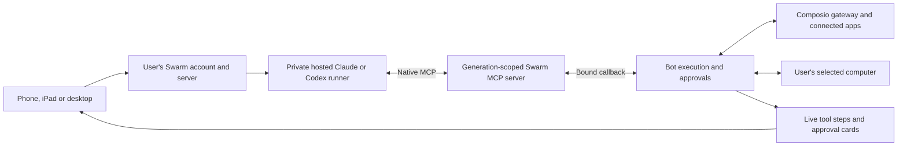

# Native MCP for hosted subscription CLIs

Queued Bot turns using Claude or Codex register the current Swarm function tools as native MCP tools. The CLI can discover a connected app, execute an allowed read, inspect its result, and continue within one generation. It no longer needs to encode each action in a final JSON response and start a new CLI process to receive the result.

The MCP server is a loopback HTTP endpoint inside the CLI runner, with a random bearer token and the exact tool manifest for that generation. Its calls return over the existing authenticated bridge or private tenant supervisor connection. Composio credentials stay in the application/gateway. Swarm validates the requested tool name and arguments, retains the Bot's owner and selected-computer context, and invokes the existing execution path. Actual app authorization, setup read restrictions, write approvals, dispatch journaling and live operation labels remain in that path.

The hosted subscription is bound to the user's account and server profile, not the browser that starts the login. Another authenticated phone, iPad or desktop session for the same account can use it. Hosted execution is the default; a personal computer bridge remains an explicit advanced choice. The CLI host and the selected computer for browser/file tools are separate settings. A user who wants their desktop to be unnecessary should use hosted subscription execution and the server computer.

## Turn lifecycle

- Ordinary tool results return to the running CLI over MCP. Final user text remains validated structured output; this change does not implement token-by-token assistant-text streaming.
- Tools emit the same queued, running, completed and error activity rows as API-mode calls, while the CLI is still working.
- A write requiring approval is recorded durably and stops the current CLI generation. Approval resumes the exact stored action once, then starts a continuation with its result in history. Waiting does not leave a CLI process or model request running.
- Questions, explicit end-turn tools and browser recovery stop the current generation at the appropriate boundary. Recovery starts a new generation so already planned sibling actions cannot use stale page state.
- Native callbacks are ordered within a Bot and independently scoped across Bots and users. Repeated request IDs share one result; a changed payload under the same ID fails. Runner IDs are never used directly as durable dispatch IDs.
- Cancellation or disconnection prevents queued callbacks from starting. An action already executing is allowed to record its outcome before the Bot queue is released. Uncertain external writes are never automatically replayed.
- Generation deadlines, tool step limits and message size limits still apply. Sessions are ephemeral across user turns and approval boundaries; account credentials remain in their existing private persistent profile.
- Normal completions retain provider-reported token usage. Intentional stops at an approval or handoff preserve any already observed counters as partial usage; when no counters arrived, usage is unavailable. Those subscription requests remain counted, with unknown token fields excluded from totals and left blank in CSV exports. Usage shows when token accounting is incomplete. Missing counters are never invented or charged as API usage, and stops do not wait for a final usage event.

Structured-only requests such as memory extraction retain their supplied output schema and do not get native tool capabilities. Callers outside the Bot execution context retain the existing structured action adapter. A personal bridge must advertise native MCP support before it can receive a native-enabled Bot request; an old bridge gets an update instruction rather than silently losing tools.

## Isolation and deployment

Only Swarm's fixed, temporary MCP endpoint is registered. Native shell, local file, plugin and user-configured MCP access remain disabled. Claude's native path uses restricted mode and an exact MCP allowlist: safe mode disables explicit MCP servers, so it is retained only for structured-only requests. Codex uses isolated configuration with only the Swarm server enabled. Each invocation rechecks subscription authentication; failures never switch to API billing.

Deploy the updated application and CLI runner together. Tenant deployments must use the updated runner image as well as the application image. Existing hosted profiles remain valid. Personal bridge users need the latest downloaded script and a restart; the inline MCP implementation requires no companion files or new dependencies.

The application tests use fixture CLIs/providers and real HTTP MCP, WebSocket, approval and Bot execution paths. They cover one-generation setup verification, approval/resume without a second write, cross-account context, cancellation, profile/runtime preferences, and downloaded single-file bridge packaging. Installed official Claude and Codex CLIs have also loaded the generated Swarm MCP configuration in control-only probes without provider inference. Phone and iPad layout checks use browser emulation. These checks do not establish production rollout, live provider entitlement or end-to-end production latency. After rollout, verify a connection and one approved write on a signed-in account from two devices, checking the actual tool steps and server runtime.

Configuration references: [Codex MCP](https://developers.openai.com/codex/mcp/) and [Claude MCP](https://code.claude.com/docs/en/mcp).
