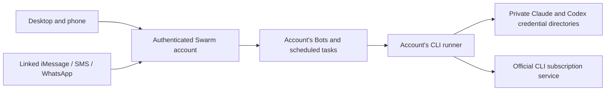

# Use a ChatGPT or Claude subscription

Swarm can run model requests through the official Codex or Claude Code CLI using the account holder's subscription. **The default is a private CLI profile on the Swarm server for each Swarm account.** Sign in once in the embedded terminal and all of that account's Bots can use the connection from desktop, phone, and linked messaging channels. A personal computer does not need to remain online.

Use a ChatGPT account eligible for Codex, or a Claude account eligible for Claude Code (including Max). ChatGPT and Claude have different plan names and allowances. This integration uses the account's existing CLI entitlement; it does not convert a chat subscription into API credits or remove usage limits.

## Connect in the app

1. Open **Settings → Subscriptions**, select **Claude Code** or **Codex**, and click **Login**. Swarm starts the official CLI in a real terminal embedded in the page.
2. Open the official HTTPS sign-in link printed in the terminal. Codex uses device authorization; Claude uses its subscription login. Complete the provider's browser flow and paste a code into the terminal if prompted. Keep the terminal open until sign-in finishes. Closing it cancels the login process.
3. Swarm checks the CLI's authentication status. A verified subscription login becomes the selected provider for the account. An API-key or unverified login is rejected.
4. Use any of your Bots. Chat, tasks, routines, tool calls, bot handoffs, history summaries, and memory use the selected CLI's default model. Per-Bot API model and thinking-effort overrides are inactive while a subscription is selected.

Your phone, desktop, and messaging identity must belong to the **same Swarm account**. Link your number in Messaging settings before using iMessage, SMS, or WhatsApp. Messaging transport still needs its own configured integration. Each Bot keeps its conversations and approvals; all Bots share the subscription's allowance and rate limits.

You can authenticate both providers and choose which saved connection the account uses. **Disconnect subscription** stops pending login and generation processes and deletes both saved CLI profiles for the account. It leaves the selected subscription blocked; changing to API billing always requires **API providers**.

## Server architecture and deployment



The server bundles both official CLIs. Hosted login is supported on Linux and requires Python 3 with POSIX PTY support; the Docker image includes it. Credentials persist in `cli-profiles/<hashed-user-id>/` beside the SQLite database, or under `CLI_PROFILES_DIR` when configured. Persist this directory with the database across deployments. Each account gets private `HOME`, `CODEX_HOME`, `CLAUDE_CONFIG_DIR`, and XDG directories with `0700` permissions. Hosted Codex uses file credentials in that profile. Server API keys and the server owner's CLI environment are not inherited by child processes.

Only the authenticated account can read or write its terminal. Output is held in bounded server memory, marked `no-store`, and removed when the terminal closes or expires. Login is limited to one process per account, 16 globally, six starts per account in five minutes, and ten minutes per session. Generation permits four concurrent jobs per account and 32 globally. These limits protect the server; they do not increase a provider's allowance.

**Deployment boundary:** this implementation separates account credentials and routing within a single Swarm server process. It does not create a container or VM for each user, encrypt the CLI credential files itself, or isolate the server operating-system user from those files. For a service serving unrelated users, run each account's CLI worker in a dedicated container or VM with a private persistent volume and a restricted service identity. Keep the web/API layer separate and dispatch by the authenticated account ID; share that worker across the account's Bots. Use encrypted storage and backups. A Bot's computer must not expose the server's credential volume.

Login sessions, runner limits, and status caches are currently process-local. Run one Swarm server instance for this deployment. Horizontal scaling needs an account-to-worker assignment and shared job/session coordination; a load balancer alone is insufficient. Saved credentials survive a restart; use **Refresh status** to re-check them in the UI.

Operator settings:

- `CLI_PROFILES_DIR`: persistent root for account CLI profiles; defaults beside `DB_PATH`.
- `SWARM_CLI_SERVER_LOGIN=0`: disable hosted CLI login and generation, retaining the advanced computer bridge.
- `SWARM_CLI_CODEX_PATH`, `SWARM_CLI_CLAUDE_PATH`: optional absolute executable paths instead of bundled CLIs.
- `SWARM_CLI_PYTHON_PATH`: optional absolute path to Python 3; defaults to `python3` on `PATH`.

Use HTTPS outside localhost. No provider credential is sent to the web client; provider authorization codes and login links appear in the account's terminal as part of the official login flow.

## Advanced: connect your own computer

Use **Advanced · connect your own computer** if you prefer keeping credentials on your own computer. This replaces server execution with the local bridge for the entire Swarm account. The bridge computer must remain awake and online. Existing bridge connections keep this mode after upgrading.

1. Install Node.js 22.22+ and a current official CLI on the computer that will stay connected to Swarm:

   ```sh
   npm install -g @openai/codex
   codex login
   ```

   Or:

   ```sh
   npm install -g @anthropic-ai/claude-code
   claude auth login
   ```

   Choose your subscription account during login, rather than an API key or Claude Console. For a headless Codex installation, use `codex login --device-auth` if enabled for your account.

2. Open **Settings → Subscriptions → Advanced** in Swarm. Generate a bridge command and run it on the same computer as the CLI. The command downloads Swarm's bridge and pairs it to your current Swarm account. A new pairing command expires after ten minutes if unused. Once paired, its token allows reconnection until you revoke or replace it. Treat the command like a password.

3. Refresh the connection status, then choose **ChatGPT via Codex** or **Claude via Claude Code**. Swarm checks subscription authentication before allowing the selection, and the bridge checks again before every request.

4. Leave the bridge running. Your Bots now use the selected CLI's default model, including text conversations, tool calls, tasks, routines, bot handoffs, history summaries and learned memory. Per-Bot API model and thinking-effort overrides are inactive while a subscription is selected.

For remote Swarm servers, `SERVER_URL` must be a URL your computer can reach. Use HTTPS outside localhost and allow WebSocket upgrades for `/api/cli-bridge` through the reverse proxy. The bridge connects outward; no inbound port is needed on your computer. The bridge runs independently of the computer companion, so CLI model access can be combined with local or cloud Bot computers.

## Billing and capabilities

- Swarm does not use model API keys when a subscription is selected. Missing authentication, rate limits, an unavailable runner, and CLI failures stop the request. **API providers** is an explicit user action; disconnecting a server profile or revoking a bridge does not enable API mode.
- Subscription limits and any provider-enabled extra usage or purchased credits still apply. Manage those settings in your provider account. Swarm cannot report an exact remaining subscription allowance. Its usage report records CLI token counts with zero Swarm model API charges and `subscription` as the cost source; it does not measure subscription fees or provider extra usage charges.
- Tool requests return through Swarm's existing execution and approval system. Both runner modes disable native CLI tools and do not grant the model an extra shell. Browser/computer tools, connected apps, and MCP tools still run through Swarm.
- Screenshots and uploaded images are passed to the CLI. Provider-hosted search tools are unavailable in this mode; Bots can use configured browser or MCP tools for research.
- CLI output is validated as a complete structured response before being displayed or executed, so text arrives after each model step rather than token by token.
- Realtime voice, speech synthesis and transcription are provided by [platform voice](platform-voice.md) when the admin adds an xAI key. This applies even while a CLI subscription is selected, and voice is billed to the platform's xAI account. Without platform voice, voice APIs remain blocked in subscription mode. Text conversations continue to use the selected CLI subscription. Cloud computers, messaging services, Composio and other external services keep their own requirements and charges.

Use this connection for the account holder's trusted Swarm installation. The server can send your conversation and tool definitions to the CLI and, in hosted mode, stores its credentials. Provider availability and usage rules remain those of your account.

## Troubleshooting

- **Terminal cannot start:** check that the server has Python 3 and the bundled CLI dependencies. Review any executable-path overrides. macOS and Windows servers can use the computer bridge, or run Swarm in its Linux Docker image. Hosted macOS login is disabled because deleting the credential directory would not remove a Claude Keychain entry.
- **Browser login on another device:** open the link from the embedded terminal on that device, complete authorization, and return to the terminal. Paste the provider's code when requested. Codex device authorization may need to be enabled in the provider account.
- **CLI missing on a bridge:** install the current official CLI and restart the bridge with the CLI on its `PATH`.
- **Wrong authentication:** run `codex login status` or `claude auth status` in your terminal. Sign out and back in with your subscription account if necessary. The bridge removes API-key and alternate-provider environment settings from child CLI processes and rejects unknown or API authentication modes. Claude Code must also report a recognized subscription plan; update older CLIs that cannot confirm it.
- **Server restarted:** refresh the status to discover saved logins. If the profile volume was not persisted, sign in again.
- **Bridge offline:** restart the bridge with its existing command, or generate a replacement pairing command. Scheduled work also requires the bridge computer to be awake and connected.
- **Usage limit:** wait for your allowance to reset or manage your plan with the provider. Swarm will not silently charge an API key.
- **Unsupported CLI flag or output:** update the CLI and download a fresh bridge command. Unknown authentication/output formats fail explicitly.
- **Revoke access:** disconnect a server profile to remove its saved credentials, or revoke a bridge to invalidate its pairing token. Bridge revocation does not log you out of the CLI on your computer. Account deletion removes the hosted profiles as well. Remove any provider-side authorization separately in the provider account if needed.

Official references: [Codex authentication](https://developers.openai.com/codex/auth/), [Codex non-interactive execution](https://developers.openai.com/codex/noninteractive/), [Claude Code authentication](https://code.claude.com/docs/en/authentication), and [Claude Code CLI reference](https://code.claude.com/docs/en/cli-reference).

Run `npm run test:cli` for isolated fake-CLI, real PTY, authenticated HTTP, and WebSocket integration tests. These tests do not spend subscription allowance or API credits; live login and inference require the account holder's authenticated CLI.
