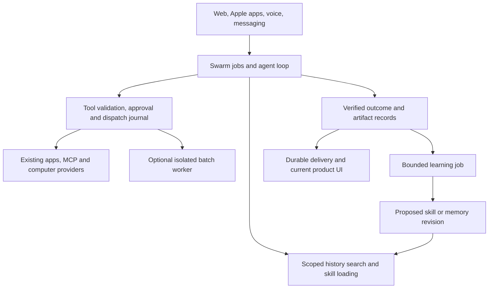

# Improving Swarm with Hermes Agent

**Product and engineering assessment · 11 November 2026**

**Recommendation: bring Hermes’s learning, retrieval, and workflow mechanisms into Swarm’s existing runtime. Start with reusable skills, source-linked recall, and on-demand context. Evaluate a separate Hermes worker only after those improvements have measurable results.**

Swarm already has the foundation of an always-on teammate product: persistent Bots, guided setup, computers, app connections, approvals, API and subscription execution, delegation, routines, voice, messaging, and native clients. The opportunity is to make those teammates more dependable and better at repeated work. Adding another general-purpose agent loop would create substantial integration work before delivering that benefit.

The product promise this could support is: **“Teach your team once. It remembers the evidence, reuses the procedure, and returns the finished work wherever you are.”** This is a proposed direction, not a claim about current performance.

## Evidence and scope

- Swarm source reviewed: [`068cfd2dca174b32e7cd863dbefad51ff4131e13`](https://github.com/agenticwizzard007/grokbot-clone/tree/068cfd2dca174b32e7cd863dbefad51ff4131e13), the assessment snapshot.
- Hermes source reviewed: [`e845643a739aa525b47715116fa65d6a5accc7e6`](https://github.com/NousResearch/hermes-agent/tree/e845643a739aa525b47715116fa65d6a5accc7e6). Upstream links below are pinned to this revision because its capabilities and packaging are changing quickly.
- This is a source and documentation assessment. Neither Hermes nor an integrated prototype was executed. No latency, quality, savings, deployment-readiness, or production-capacity claim has been validated here.
- Existing product release and qualification work remains a separate dependency. This report does not award completion scores or treat planned fixes as completed implementation.
- Current source takes precedence over older documentation. For example, Swarm’s README says MCP OAuth is unsupported, but [OAuth handling](../server/src/mcp/oauth.ts), [routes](../server/src/mcp/routes.ts), and [client integration](../server/src/mcp/client.ts) exist. OAuth is therefore an existing capability to qualify, not a Hermes feature we need to build from scratch.

“Learning” here means saving and improving instructions, memories, and procedures. It does not mean automatically retraining the underlying model.

## Where Hermes adds the most value

| Priority | Improvement | Swarm today | Hermes mechanism to adapt | Expected user benefit |
|---|---|---|---|---|
| First | Reusable procedures that improve with experience | Skills can be created and edited manually; their full bodies enter the prompt | Standard skill packages, on-demand loading, post-task skill review, provenance and curation | Teach a workflow once, inspect what was learned, reuse it across selected teammates. [S1][s-skills] [S2][s-prompt] [H1][h-skills] [H2][h-review] |
| First | Recall with evidence | Durable fact memories, keyword matching, relevance-ranked prompt memory, history compaction | Search across prior sessions, retrieve surrounding messages, attach session links | “Use the assumptions from last month” can retrieve the actual source rather than depend on a short remembered summary. [S3][s-memory] [S4][s-tools] [H3][h-search] |
| First | Smaller, more relevant context | All saved skill bodies and assigned MCP schemas are exposed; custom MCP assignment is capped at 448 tools | Skill summaries plus load-on-demand; tool search, describe, and dispatch bridge | Less irrelevant context; a path to larger connector catalogs without overwhelming the model. [S2][s-prompt] [S5][s-mcp] [H4][h-tool-search] |
| Next | Goals and reliable team workflows | Persistent jobs and dispatch journals; task UI has working, needs-input, and done; subagents report by message | Persistent goals, explicit completion contracts, task dependencies, structured child results | Users can follow a multi-step outcome, see what is blocked, and distinguish completion from an unverified claim. [S6][s-jobs] [S7][s-tasks] [H5][h-goals] [H6][h-kanban] [H7][h-delegation] |
| Next | Finished deliverables and dependable routines | Library, cron/event routines, messaging replies, and audio already exist | Document skills, artifact delivery, run history, independent execution/delivery outcomes | A weekly report arrives as a usable file with a traceable run and an obvious retry when delivery fails. [S8][s-routines] [S9][s-messaging] [H8][h-artifacts] [H9][h-cron] |
| After foundations | Efficient bulk work | Shell, browser, app tools, and independent calls exist | Programmatic tool calls with intermediate results kept outside model context | Process a large dataset without making every intermediate record part of the conversation. [S4][s-tools] [H10][h-code] |

These are improvements to existing product surfaces. They should appear in Configuration, Skills, Memory, Tasks, Library, Usage, and the current messaging flows.

## 1. Turn Skills into a learning system

### What changes for the user

After a successful task, the Bot can offer **Save this method**. The proposed skill explains when to use it, required inputs, steps, expected outputs, and exceptions. The user can edit it, assign it to selected Bots, lock it, and restore an earlier revision. Later corrections produce a visible proposed revision rather than silently changing a standing business procedure.

Example: the user corrects a weekly sales report to exclude test accounts and use a particular definition of pipeline. Swarm saves that reporting method. The next report uses the same definitions and records which skill revision produced it.

### Integration

1. Extend the existing `skills` storage and [Skills settings](../web/src/components/config/BotSettingsModal.tsx) with immutable revisions, origin, scope, lifecycle status, dependencies, and execution requirements.
2. Support the Agent Skills package layout: `SKILL.md` plus optional references, scripts, templates, and assets. Treat import/export compatibility separately from tool compatibility: a Hermes skill may mention tools or filesystem assumptions Swarm does not provide.
3. Change [prompt assembly][s-prompt] to include a bounded name/description index. Add scoped `search_skills` and `read_skill` tools; load only the relevant body and supporting files. A manifest is necessary so the model knows a capability exists before it searches.
4. Introduce a bounded learning job after a verified outcome or an explicit correction. It proposes a new skill or patch, cites the source run, and records its model usage. It cannot change permissions or invoke business actions.
5. Start with user-reviewed proposals. Allow automatic updates later only for explicitly opted-in skills, with version history and rollback. This review policy is a proposed Swarm product choice; it is not a requirement imposed by Hermes.
6. Add usage and outcome tracking before automatic curation. Preserve pinned skills and skills referenced by routines; archive recoverably. Hermes’s curator distinguishes pinning from locking and leaves its costly LLM consolidation pass off by default. [H11][h-curator]

**Important adaptation:** Hermes’s background review writes into its memory and skill stores and can run in a daemon thread. Swarm should use an owner-scoped durable job and revision checks so a crash, concurrent correction, or Bot deletion cannot silently lose or misapply the update. [H2][h-review] [S6][s-jobs]

**Done when:** a corrected workflow produces a reviewable revision, survives restart, is reused in a fresh conversation, can be rolled back, and cannot grant new tool access. Revocation must affect the next execution, including routines and CLI tool callbacks.

## 2. Give memory sources, scope, and corrections

Swarm already consolidates memories and ranks relevant facts within a prompt budget. Its `recall` tool searches saved fact text; this is different from searching prior conversations. Starting a new conversation increments a generation while older transcript rows remain stored. The global search UI currently searches Bots rather than full session history. [S3][s-memory] [S4][s-tools] [history storage](../server/src/store.ts) [search UI](../web/src/components/modals/SearchModal.tsx)

Hermes provides a useful layered pattern: bounded persistent notes, a separate user profile, and searchable session history. Its session search supports discovery, reading, and surrounding-message retrieval. Its optional external memory providers are an additional integration, not a prerequisite for this pattern. [H3][h-search] [H12][h-memory] [H13][h-memory-providers]

The current `session_search` implementation returns actual database messages without an LLM call, despite older README wording about summarization. Keep initial retrieval deterministic; an optional summary can be a separate, metered operation.

### Integration

- Add a rebuildable SQLite FTS5 index over eligible transcript text, with `user_id`, `bot_id`, `generation`, message sequence, timestamp, and source identifiers. Test FTS5 support in the actual shipping SQLite build.
- Enforce ownership and sharing filters before returning results or summarizing them. Begin with the requesting Bot’s history; expose other Bots’ work only through an explicit account-level sharing rule.
- Add `search_history` and `read_history` tools that return excerpts and stable links to the original messages. Support old-generation views in the UI; a link to a current chat alone cannot identify an archived source.
- Separate user-approved shared preferences from private Bot notes and project knowledge. A shared timezone or reporting preference need not be copied independently into every Bot’s memory.
- Add source, last-confirmed time, superseded revision, and correction history to durable facts. Define whether Forget removes a fact only, the source too, or creates a suppression record that prevents automatic relearning. Apply the same contract to indexes, exports, and backup restoration.
- Preserve recent corrections during compaction. Cache stable instruction blocks where useful, but refresh changed memory and permissions explicitly. Copying Hermes’s frozen session-start memory snapshot literally would delay Swarm’s visible corrections. [H12][h-memory]

Start with FTS5 and citation quality. Evaluate semantic retrieval or an external memory provider only if measured misses justify its cost and data handling. At the reviewed Hermes revision, Honcho is a separately installed plugin; it is not bundled core functionality. [H13][h-memory-providers]

**Done when:** the Bot retrieves the right old conversation, cites it, prefers a later correction, does not retrieve another account’s data, and cannot resurrect forgotten facts from an index or restored backup.

## 3. Load tools and context only when needed

Swarm’s app tools already use discovery through `SWARM_APPS_SEARCH` and exact execution metadata. The missing opportunity is to extend that approach consistently to saved skills and large custom MCP catalogs. The current MCP ceiling is a deliberate admission check, not evidence that extra tools can simply be enabled safely. [S2][s-prompt] [S5][s-mcp] [app policy][s-policy]

Adapt Hermes’s `search → describe → call` design in TypeScript. Keep common core tools available directly. Present a small per-server capability summary, load exact schemas on demand, and rebuild or invalidate discovery when a connection, assignment, or revision changes. [H4][h-tool-search]

Every bridge invocation must unwrap into the real underlying tool **before** schema validation, ownership checks, approval, dispatch journaling, activity reporting, and usage attribution. An approval for a generic “call tool” wrapper must never authorize arbitrary actions. Treat each element of a batch as a separately governed dispatch.

This requires an explicit policy change: Swarm’s current `policyFor` automatically allows tools in its built-in `toolMap`. Merely registering a new generic executor as a built-in would not provide the required inner-action approval contract. [S10][s-policy]

Apply the same contract to the API runtime and both subscription CLI transports. Keep the current 448-tool cap until discovery, compatibility, and execution tests prove a replacement limit is safe. Raising the cap alone is not this feature.

For long conversations, adapt Hermes’s model-aware context budgeting and compression ideas to Swarm’s existing compaction system. Account for instructions, tools, images, recalled material, and output reserve together. Keep API context management and CLI-owned context management explicit; a server cannot assume it controls a CLI’s internal cache or compression. [S3][s-memory] [H14][h-compression]

**Done when:** large catalogs remain discoverable, prompt size is bounded, tool selection quality holds, and disabled or changed tools cannot execute using cached schemas or approvals.

## 4. Make Tasks represent an outcome, not just an activity label

Swarm already has durable `agent_jobs` and `tool_dispatches`, including an `uncertain` state after interrupted execution. Preserve that behavior. The user-facing `Task` type has only three states and is not itself a dependency graph or a completion contract. [S6][s-jobs] [S7][s-tasks]

Borrow three distinct Hermes concepts:

- **Persistent goal:** objective, acceptance criteria, bounded continuation, pause, and explicit waiting. Hermes also supports deterministic gates before judging completion. [H5][h-goals]
- **Task dependencies:** readiness, assignment, review, and durable worker ownership. [H6][h-kanban]
- **Structured delegation:** the parent supplies a focused brief and expected result schema; a child result can be complete yet schema-invalid. Preserve that distinction. [H7][h-delegation]

### Integration

Connect the existing task UI to jobs through explicit IDs. Introduce a goal record, parent/child relationships, acceptance evidence, resource budgets, and states for queued, running, waiting, review, failed, cancelled, uncertain, and completed work. Present these in readable groups rather than exposing every internal state as a separate board column.

Current scheduling serializes non-subscription work per account as well as per Bot; subscription Bots have a different concurrency path. A coordinator must yield its queue slot while waiting for children. True parallel API subtasks require a deliberate bounded scheduling change, not just a fan-out tool. [queue implementation](../server/src/agent/loop.ts)

Account for the entire task tree: child jobs, background learning, verification calls, tools, and computer time. Propagate cancellation and prevent circular delegation. A child receiving different instructions must not inherit broader app or filesystem access.

Use deterministic checks for things that can be verified: file exists and opens; spreadsheet schema is valid; expected records were produced; provider receipt exists. A model judge can assist with subjective quality, but a confident final response is insufficient evidence. A routine retry or goal continuation must never blindly repeat an uncertain external write.

Require the schema validator in the shipping image. Hermes’s inspected delegation validator accepts parsed JSON if its optional `jsonschema` import is unavailable; Swarm should report validation as unavailable or fail the contract instead of calling that a validated result. [validator implementation][h-output-schema]

Hermes’s kanban documentation describes a trusted local, single-host design, and tenant labels are soft filters. Its board/profile organization must not replace Swarm’s tenant enforcement. Likewise, conversation undo or a filesystem checkpoint cannot undo an email already sent. [H6][h-kanban]

**Done when:** a coordinator can run parallel subtasks, reconcile results, request review, stop the whole tree, and recover from interruption without falsely marking success or replaying an uncertain effect.

## 5. Finish the routine-to-deliverable experience

Swarm already supports timezone-aware cron, event triggers, run limits, manual runs, proactive check-ins, and background messaging. The useful Hermes delta is deeper run lifecycle and delivery management: skill-backed jobs, execution history, failure incidents, catch-up policy, and separate delivery failure. [S8][s-routines] [routine limits](../server/src/routine-limits.ts) [H9][h-cron]

Add a durable routine-run record that pins the skill revision and input references, records the resulting job/artifacts, and separately tracks delivery attempts. Make missed-run handling an explicit choice: skip, one bounded catch-up, or manual recovery. Avoid generating an unbounded backlog after downtime.

Separate **produce the result** from **deliver the result**. If uploading a report fails, retry delivery from the saved artifact rather than repeating the analysis or business action. Capture a provider receipt when available, and expose delivery uncertainty truthfully.

Hermes’s artifact delivery is a useful UX reference, but Swarm should use explicit artifact records rather than interpret arbitrary absolute paths in model prose. Extend the current [messaging adapter contract][s-messaging], which currently models text and optional audio, with controlled attachments. Resolve only owner-scoped Library artifacts; verify content type, size, access, and retention before delivery. [H8][h-artifacts]

Bundle a small, reviewed set of document workflows: a cited research brief, CSV/spreadsheet analysis, weekly operations report, and meeting action list from a supplied transcript. Audit each skill’s license and execution dependencies before reuse. Live meeting attendance is a separate feature and should not be implied by a transcript-processing template.

**Done when:** a scheduled report has a run history, reproducible inputs, a verified downloadable artifact, and delivery status; a delivery retry does not rerun completed work.

## 6. Add programmatic execution where bulk work warrants it

Hermes’s `execute_code` keeps intermediate results in a script and returns selected output to the model. At this revision its RPC allowlist includes web search/extract, file read/write/search/patch, and foreground terminal execution. It is not a ready-made RPC bridge for every Swarm app connection. [H10][h-code]

A Swarm version could fetch many records, normalize them, compute aggregates, and return a compact table plus a Library artifact. It would require:

- Execution inside an appropriately isolated tenant workload; never arbitrary model-generated code inside the Node control-plane process.
- Short-lived, run-bound tool access. The script receives scoped RPC handles rather than platform secrets or unrestricted connector credentials.
- The same inner-tool approvals, revocation, idempotency/uncertainty handling, and audit records as interactive execution.
- CPU, memory, wall-clock, output, tool-call, network, and spend limits; cancellation that terminates the script and fences future calls.
- Small samples before bulk processing; structured output and bounded logs; complete authorized data processing when the task requires it.

Pilot read-only data preparation first. Adopt writes only after approval suspension, resume, cancellation, and partial failure work correctly. Hermes’s “zero-context-cost” wording refers to intermediate results being omitted from the model context; code generation, final output, tool calls, and compute still cost resources.

**Done when:** a representative bulk workflow uses less model context at equal output quality, with correct per-tool authorization and no cross-tenant or control-plane access.

## Coverage across the entire product

The feature IDs below cover Swarm's 12 product areas. These additions complement the product's existing release requirements.

| Product area | Keep and extend | Hermes-inspired improvement | Priority and boundary |
|---|---|---|---|
| F01 · Persistent teammates | Guided setup, charter, fact memory, manual skills | Skill packages, learned revisions, sourced history, shared preferences | First. Do not silently turn learned content into standing authority. |
| F02 · Team coordination | Permanent Bots, subagents, rooms, durable jobs | Goal contracts, dependency tracking, structured child outputs, shared budgets | Next. No separate worker scheduler until ownership/recovery semantics are unified. |
| F03 · AI connections | API/OpenRouter, official CLI subscriptions, model/effort settings | Explicit auxiliary-model routes for recall, compression, learning, and verification | Later optimization. Keep the chosen billing source; unavailable subscription access must not silently switch to paid API usage. [H15][h-routing] |
| F04 · Computer/browser work | Provider interface, live viewer, human takeover, recovery | Scoped batch execution, artifact mounts, optional headless compute for file/data jobs | Pilot after isolation checks. Hermes’s terminal backends are not drop-in replacements for Swarm’s desktop/viewer protocol. [computer interface](../server/src/computers/types.ts) [H16][h-tools] |
| F05 · Apps and MCP | Composio accounts, exact metadata checks, MCP OAuth and tool discovery | Deferred schemas; selective MCP resources/prompts; curated skill dependencies | Deferred tools first; resources/prompts later. A resource or prompt is untrusted input, not an instruction authority. [H17][h-mcp] |
| F06 · Permissions | Approval cards, connection revisions, native callback validation | Real-tool checks underneath wrappers; scoped skill execution; auditable changes | Prerequisite for every new execution path. Hermes’s local trust model does not solve hosted authorization. [S10][s-policy] |
| F07 · Recurring/event work | Existing cron/events and limits | Skill revisions, outcome history, bounded catch-up, independent delivery retries | Next, using the existing scheduler and job system. |
| F08 · Voice | Realtime voice, dictation, durable assignment to the text loop | “Remember this” and “save this method”; spoken progress with linked evidence/artifacts | Reuse the text implementation. Preserve the existing voice coordinator rather than introducing a second voice stack. [voice](../server/src/voice.ts) |
| F09 · Messaging | Inkbox channels, identity linking, durable inbox, token-bound approvals | Slack/Telegram/Discord adapters; richer file delivery and thread continuity | Pilot one demanded channel. An app connector is distinct from using that app as Swarm’s conversational transport. [S9][s-messaging] [H18][h-gateway] |
| F10 · Tasks and Library | Task board, saved files, setup downloads | Goal progress, review/evidence, artifact previews/versioning, run-linked results | First artifact slice, then task graph. Show actual outcome state. |
| F11 · Web/Mac/iPhone/iPad | Shared server-backed interface and native clients | Skill review, cited history, attachments, pause/resume, deep links across clients | Deliver through current UI. Hermes Desktop/TUI/mobile installation support does not replace Apple signing, device validation, or distribution. |
| F12 · Usage/admin | Provider usage, per-Bot/account costs, CSV, runtime operations | Cost per verified outcome, learning cost, skill success trends, diagnostics, replay evaluation | Instrument before optimization. Retain unknown/partial usage labels; “hours saved” remains an estimate. [usage](../server/src/usage.ts) [analytics](../server/src/analytics.ts) |

### Onboarding and distribution

Curated role packs can combine a teammate brief, a few reviewed skills, required connections, sample inputs, and a first useful deliverable. This can shorten setup without removing Swarm’s activation review. Good initial candidates are a research analyst, an operations reporter, and a meeting follow-up assistant that drafts rather than automatically sends.

Offer an import preview for compatible skill packages and selected memories. Validate tool references, paths, conflicts, license, and scope. Do not import another agent’s credential store, approval allowlist, or automatically active schedules as part of a routine template import. Hermes’s import workflow is useful inspiration; full Hermes-to-Swarm migration needs an explicit format and compatibility layer. [H19][h-import]

## Recommended integration architecture

### Reuse choices

| Approach | What it gives us | Integration cost and limitation | Decision |
|---|---|---|---|
| Adapt Hermes mechanisms in TypeScript | Learning/retrieval/context improvements through every existing Swarm entry point | We own the implementation and conformance tests; Python code is a reference, not an importable Node module | **Default approach** |
| Import selected standard skill packages | Fast access to procedures, templates, and document workflows | Per-package license, tool mapping, dependencies, path handling, versioning, and review are still required | **Use selectively** |
| Port small MIT-licensed components | Reuse useful algorithms or test cases | Preserve notices and isolate the port; avoid copying broad environment/global-state assumptions | **Case by case** |
| Connect selected Hermes tools over MCP | Narrow interoperability experiment | `mcp-serve` is now a separate official plugin. Its documentation describes messaging and optional tools, not a drop-in Swarm goal/job engine. Plugin behavior and license need separate inspection | **Optional experiment** [H17][h-mcp] |
| Run Hermes as an isolated Python worker | Direct use of `AIAgent` for a narrowly scoped capability comparison | Additional runtime, package management, state, credentials, event translation, cancellation, approvals, and upgrade qualification | **Only after benchmarked need** [H20][h-library] |
| Replace Swarm’s agent loop | Maximum upstream runtime reuse | Rebuild integration with transcript rows, guided setup, native tools, billing rules, approvals, jobs, voice, and messaging; introduces duplicate state during migration | **Do not start here** |

At this revision, Hermes’s Python library documentation explicitly says there is no supported wheel or source distribution for `requirements.txt` installs. Its package metadata allows older Python for upgrading, while comments identify Python 3.14 as the supported runtime. Any worker experiment should pin the full source revision and prepare a qualified image; do not assume `pip install hermes-agent` is the deployment contract. [H20][h-library] [package metadata][h-package]

### If a Hermes worker is later justified

Keep Swarm authoritative for identity, jobs, permissions, tool dispatch, artifacts, and usage. A proposed worker contract needs `run_id`, owner/Bot identity, immutable input and skill revisions, model/funding route, allowed capabilities, resource budget, and cancellation generation. Stream sequenced progress, tool requests, usage observations, artifact references, and a terminal result back to Swarm.

Authenticate that identity through the supervising host or a protected, run-bound transport; do not trust an owner ID supplied in model-generated arguments. Define transcript translation explicitly: Swarm’s Responses-style history cannot be assumed compatible with Hermes’s conversation format.

Use a separate process and private Hermes home for each independently writing agent context. Serialize access to persistent state. Hermes explicitly warns against multiple agents writing to the same home; profiles are configuration/state separation and are not sufficient hostile-tenant isolation. Do not share one global home across customers. [H12][h-memory]

Disable overlapping scheduling, messaging, autonomous learning, and direct tool execution where Swarm owns those functions. Route required actions through the Swarm dispatch contract. If that cannot be achieved for a capability, keep the experiment read-only. A child runtime must not be hidden behind one broadly approved MCP call.

The existing [container policy](../server/src/runtime/container-policy.ts) currently describes CLI and MCP workloads. Supporting a Hermes or batch worker requires a new qualified workload and image rather than relabeling it as an existing one.

Hermes does have hosted identity/scope machinery; the limitation is that it has not been integrated with Swarm’s identity and deployment contracts. Its published security policy identifies OS isolation as the containment boundary and distinguishes terminal isolation from wrapping the entire agent process tree. Qualify the latter for a hosted worker. [hosted scope][h-scope] [security policy][h-security]

Before a worker pilot, prove approval continuation with fixture tools: a wait blocks sibling effects; approval resumes the exact action; denying or changing its arguments, connection revision, or generation prevents execution. Kill Python, the app, and the transport before dispatch, after provider success but before acknowledgment, and during approval. Accepted jobs must remain recoverable, late calls must be fenced, and unknown effects must enter reconciliation. Replaying the whole conversation to get past an approval is not a continuation strategy. Deduplicate both result and usage events.

“Read-only” describes the experiment’s allowed task scope; it is not containment. Enforce controlled mounts, egress, process/resource limits, and isolation around the entire worker tree, including MCP subprocesses, plugins, and hooks. Qualify the actual host/image combination before hosted customer use.

### Release dependencies to resolve alongside feature work

- **Recovery:** the current backup scheduler prioritizes a due environment backup and retains one pending upload. Repeated environment failure or a stuck upload can prevent an independent database cadence. Resolve this before promising recoverable learned procedures. [scheduler](../server/src/runtime/backups.ts)
- **Backup scope:** environment archives currently include `app/swarm.db`, `files`, `desktop`, and `subscriptions`. A new skills-package or Hermes-state directory is not automatically protected. Include it deliberately, or use a documented supported storage location, and verify restore/deletion behavior. [archive implementation](../server/src/platform/backup.ts)
- **Funding and accounting:** Hermes’s auxiliary router can fall through several provider routes. Preserve Swarm’s explicit funding selection instead of copying those defaults. Deduplicate replayed usage observations by run/attempt/event identity, and reserve budget before dispatch where a hard spending ceiling is promised; post-hoc usage records alone cannot enforce it. [auxiliary routing][h-routing] [usage ledger](../server/src/usage.ts)
- **Actual deployment:** standalone and isolated-hosted modes need separate evidence. An extra Python process also needs a measured memory/concurrency envelope beside desktops, CLI/MCP workers, and backup activity. Backend portability does not establish fleet capacity. [deployment roles](../server/src/deployment.ts) [capacity model](tenant-capacity-model.md)

## Delivery sequence and concrete backlog

Relative effort: **S** is a bounded change in an existing subsystem; **M** crosses storage/runtime/UI; **L** changes execution or recovery semantics. These are planning judgments, not measured estimates. Do not add them up as a release forecast.

| ID | Work package | Effort | Depends on | Acceptance evidence |
|---|---|---|---|---|
| H00 | Baseline representative jobs and run-level instrumentation | M | Existing usage/jobs | Saved fixtures, outcome rubrics, cost/latency/step baselines, funding-route coverage |
| H01 | Versioned skill packages and progressive loading | M | H00 | Import/export, old-skill migration, revision conflict, revoke, package path/license checks, bounded prompt |
| H02 | Scoped history search and source viewer | M | H00 | Old-generation retrieval, correct citation, correction precedence, deletion and ownership tests |
| H03 | Learning proposals and skill review UI | M–L | H01, H02 | Verified-source proposal, no autonomous business action, concurrent edit, restart, rollback, cost accounting |
| H04 | Artifact records, validation, and messaging delivery | M | H00 | Valid files, owner checks, delivery retry without recomputation, client preview/download |
| H05 | Deferred MCP tool discovery through the real policy pipeline | L | H00 | Large-catalog selection, inner-tool approvals, revocation, API and both CLI transport parity |
| H06 | Goals, task/job linkage, structured delegation, tree budgets | L | H00, H04 | Completion evidence, dependency/cancellation/restart cases, uncertain-write reconciliation |
| H07 | Routine-run history, skill revision binding, delivery outcomes | M–L | H01, H04, job linkage from H06 | Timezone/misfire/restart matrix, failed-delivery recovery, bounded catch-up |
| H08 | Isolated programmatic read-only execution pilot | L | H05, H06, workload qualification | Equivalent bulk output, reduced context, correct ownership, limits and cancellation |
| H09 | Explicit auxiliary-model routing and context budgets | M | H00, H03, H05 | Per-task accounting; selected funding source preserved; quality/cost comparison |
| H10 | One additional messaging adapter and cross-client deep links | M–L | H04, identity and delivery qualification | Inbound dedup, thread routing, attachments, approval ownership, reconnect/revocation |
| H11 | Curated role packs, skill import preview, diagnostics | M | H01–H04 | First useful result, dependency checks, actionable connection/runtime failures |
| H12 | Optional MCP resources/prompts or external memory trial | M per capability | H02, H05 and proven demand | Scoped reads, bounded content, retention/data-flow verification |

**Sequence:** establish H00; build H01 and H02 in parallel; deliver H03 with a narrow H04 artifact slice; then improve tool discovery, task outcomes, and routines. Add code execution, more channels, and auxiliary routing only when the earlier measurements identify a useful next step.

### First pilot

Implement **one teammate that learns and repeats a weekly reporting workflow**:

1. The user supplies sample data and the report requirements.
2. The Bot produces a valid report with source references.
3. The user corrects a definition or format.
4. Swarm proposes a skill revision linked to that correction and successful run.
5. A fresh conversation retrieves the relevant evidence and loads the approved skill.
6. The Bot produces the next report with the corrected definition, records the skill revision, and saves the actual artifact.
7. The user can inspect the sources, compare revisions, see cost, and roll back the method.

Keep the first pilot on the existing runtime and existing tools. Use supplied fixtures or authorized read-only connections. It does not require a second agent backend, a new cloud provider, or a marketplace. A provisional planning allowance is **4–6 weeks with two engineers and part-time QA**, assuming the existing runtime and release prerequisites are stable; discovery may change that estimate.

## How to prove the integration improves the product

Build a repeatable evaluation suite from representative jobs: cited research, report generation, tabular analysis, inbox triage/drafting, a coordinator-to-specialist handoff, and a recurring report. Use synthetic or explicitly authorized data. Replay fixtures for regression checks and validate a small live-provider subset separately.

Compare current Swarm against each added mechanism, keeping the model, funding route, task inputs, and outcome rubric fixed. Run multiple trials because model behavior varies. Record failures as well as successes.

| Measurement | What it tells us | Proposed pilot gate, not an observed result |
|---|---|---|
| Verified task completion | Does the delivered artifact or provider outcome satisfy the contract? | No regression on the fixed baseline suite; record per-task results rather than one flattering aggregate |
| Repeated-work efficiency | Did learning remove rediscovery and repeated corrections? | Aim for at least 20% fewer model input tokens or tool steps on repeated jobs, at equal quality; count learning overhead in the total |
| History retrieval | Can it find the right evidence and respect corrections? | At least 90% correct source retrieval on a labeled pilot set; every generated citation resolves to an accessible source |
| Context overhead | Are unrelated skills/tool schemas absent? | A fixed manifest budget and measured reduction on large catalogs; no unsupported capability claims caused by hidden tools |
| Outcome and delivery truth | Is completed work distinct from failed or uncertain delivery? | Every injected failure surfaces the correct state; delivery retry causes no repeated business action |
| Isolation and revocation | Can context or wrappers bypass account boundaries? | Zero unauthorized reads/writes in the adversarial suite; disabled tools/skills cannot execute with stale references |
| Budget and interruption | Can the user stop work and bound costs? | Enforced task-tree limits; no new tool dispatch after cancellation is fenced; in-flight effects reconciled |
| Unit economics | Are improvements cheaper after all overhead? | Report cost per verified result, including learning, judge, child, tool, computer, voice, and delivery costs; label unknown costs |
| User value | Does this reduce effort in real use? | Record correction frequency, time to first useful result, repeat use, and user-rated usefulness in a small pilot |

Hermes’s batch trajectory tooling is a useful reference for generating repeatable runs and collecting tool statistics. Adapt it first for evaluation and debugging. Production conversation collection for training is a separate product/data decision, not a default consequence of adding learning. [H21][h-batch]

## What Hermes does not solve for Swarm

- **Commercial readiness:** payment/entitlement flows, recovery guarantees, fleet qualification, support operations, native distribution, and deletion/retention execution remain Swarm work. These require separate implementation and release evidence.
- **Hosted trust boundaries:** Hermes includes security features, but its local profiles and single-host board semantics do not prove Swarm’s cross-customer containment.
- **Provider economics:** cheaper auxiliary models, fewer prompt tokens, serverless backends, and subscriptions need measured total-cost comparisons. None guarantees savings for Swarm’s workload.
- **Model reliability:** procedural memory improves the information available to a model; it does not ensure correct execution. Generated skills need evidence, validation, and rollback.
- **Universal skill compatibility:** a standard file format does not make tool names, scripts, credentials, and operating-system assumptions portable.

Defer broad plugin installation, a second desktop/TUI product, model-training infrastructure, and advanced user-modeling services until a specific measured need justifies them. Keep browser recovery, tenant containment, and the current subscription billing contract intact while adding capabilities.

## Licensing and maintenance

Hermes’s root code license is MIT and permits commercial use and modification with the required copyright and permission notice. Preserve notices for copied or substantially adapted code in Swarm’s third-party records. Check individual skills, plugins, bundled assets, and dependencies separately; the root license is not evidence that every external package or service has identical terms. [H22][h-license]

For any direct reuse, record the upstream revision, files, applicable license, local changes, and regression tests. Keep imports/ports behind small interfaces and use deliberate upgrades. Swarm should not auto-update its runtime from Hermes `main` or automatically install arbitrary community skill scripts in customer environments.

## Source index

Local links navigate the repository version displaying this report; the exact line anchors below describe the Swarm assessment snapshot identified above. The most important anchors are: full skill injection in `agent/prompt.ts:59`; memory matching in `agent/tools.ts:232`; skill CRUD in `routes-config.ts:92`; MCP cap in `mcp/store.ts:40`; job uncertainty handling in `agent/jobs.ts:33`; task states in `types.ts:218`; routine dispatch in `routines.ts:38`; messaging output contract in `messaging/bridge.ts:41`.

[s-skills]: ../server/src/routes-config.ts
[s-prompt]: ../server/src/agent/prompt.ts
[s-memory]: ../server/src/agent/memory.ts
[s-tools]: ../server/src/agent/tools.ts
[s-mcp]: ../server/src/mcp/store.ts
[s-jobs]: ../server/src/agent/jobs.ts
[s-tasks]: ../server/src/types.ts
[s-routines]: ../server/src/routines.ts
[s-messaging]: ../server/src/messaging/bridge.ts
[s-policy]: ../server/src/agent/tools.ts
[h-skills]: https://github.com/NousResearch/hermes-agent/blob/e845643a739aa525b47715116fa65d6a5accc7e6/website/docs/user-guide/features/skills.md
[h-review]: https://github.com/NousResearch/hermes-agent/blob/e845643a739aa525b47715116fa65d6a5accc7e6/agent/background_review.py
[h-search]: https://github.com/NousResearch/hermes-agent/blob/e845643a739aa525b47715116fa65d6a5accc7e6/tools/session_search_tool.py
[h-tool-search]: https://github.com/NousResearch/hermes-agent/blob/e845643a739aa525b47715116fa65d6a5accc7e6/tools/tool_search.py
[h-goals]: https://github.com/NousResearch/hermes-agent/blob/e845643a739aa525b47715116fa65d6a5accc7e6/hermes_cli/goals.py
[h-kanban]: https://github.com/NousResearch/hermes-agent/blob/e845643a739aa525b47715116fa65d6a5accc7e6/website/docs/user-guide/features/kanban.md
[h-delegation]: https://github.com/NousResearch/hermes-agent/blob/e845643a739aa525b47715116fa65d6a5accc7e6/website/docs/user-guide/features/delegation.md
[h-artifacts]: https://github.com/NousResearch/hermes-agent/blob/e845643a739aa525b47715116fa65d6a5accc7e6/website/docs/user-guide/features/deliverable-mode.md
[h-cron]: https://github.com/NousResearch/hermes-agent/blob/e845643a739aa525b47715116fa65d6a5accc7e6/website/docs/user-guide/features/cron.md
[h-code]: https://github.com/NousResearch/hermes-agent/blob/e845643a739aa525b47715116fa65d6a5accc7e6/tools/code_execution_tool.py
[h-curator]: https://github.com/NousResearch/hermes-agent/blob/e845643a739aa525b47715116fa65d6a5accc7e6/website/docs/user-guide/features/curator.md
[h-memory]: https://github.com/NousResearch/hermes-agent/blob/e845643a739aa525b47715116fa65d6a5accc7e6/website/docs/user-guide/features/memory.md
[h-memory-providers]: https://github.com/NousResearch/hermes-agent/blob/e845643a739aa525b47715116fa65d6a5accc7e6/website/docs/user-guide/features/memory-providers.md
[h-compression]: https://github.com/NousResearch/hermes-agent/blob/e845643a739aa525b47715116fa65d6a5accc7e6/agent/context_compressor.py
[h-routing]: https://github.com/NousResearch/hermes-agent/blob/e845643a739aa525b47715116fa65d6a5accc7e6/agent/auxiliary_client.py
[h-tools]: https://github.com/NousResearch/hermes-agent/blob/e845643a739aa525b47715116fa65d6a5accc7e6/website/docs/user-guide/features/tools.md
[h-mcp]: https://github.com/NousResearch/hermes-agent/blob/e845643a739aa525b47715116fa65d6a5accc7e6/website/docs/user-guide/features/mcp.md
[h-gateway]: https://github.com/NousResearch/hermes-agent/blob/e845643a739aa525b47715116fa65d6a5accc7e6/README.md
[h-import]: https://github.com/NousResearch/hermes-agent/blob/e845643a739aa525b47715116fa65d6a5accc7e6/website/docs/user-guide/import-from-other-agents.md
[h-library]: https://github.com/NousResearch/hermes-agent/blob/e845643a739aa525b47715116fa65d6a5accc7e6/website/docs/guides/python-library.md
[h-package]: https://github.com/NousResearch/hermes-agent/blob/e845643a739aa525b47715116fa65d6a5accc7e6/pyproject.toml
[h-batch]: https://github.com/NousResearch/hermes-agent/blob/e845643a739aa525b47715116fa65d6a5accc7e6/website/docs/user-guide/features/batch-processing.md
[h-license]: https://github.com/NousResearch/hermes-agent/blob/e845643a739aa525b47715116fa65d6a5accc7e6/LICENSE
[h-output-schema]: https://github.com/NousResearch/hermes-agent/blob/e845643a739aa525b47715116fa65d6a5accc7e6/tools/delegation_output_schema.py
[h-scope]: https://github.com/NousResearch/hermes-agent/blob/e845643a739aa525b47715116fa65d6a5accc7e6/hermes_scope.py
[h-security]: https://github.com/NousResearch/hermes-agent/blob/e845643a739aa525b47715116fa65d6a5accc7e6/SECURITY.md
