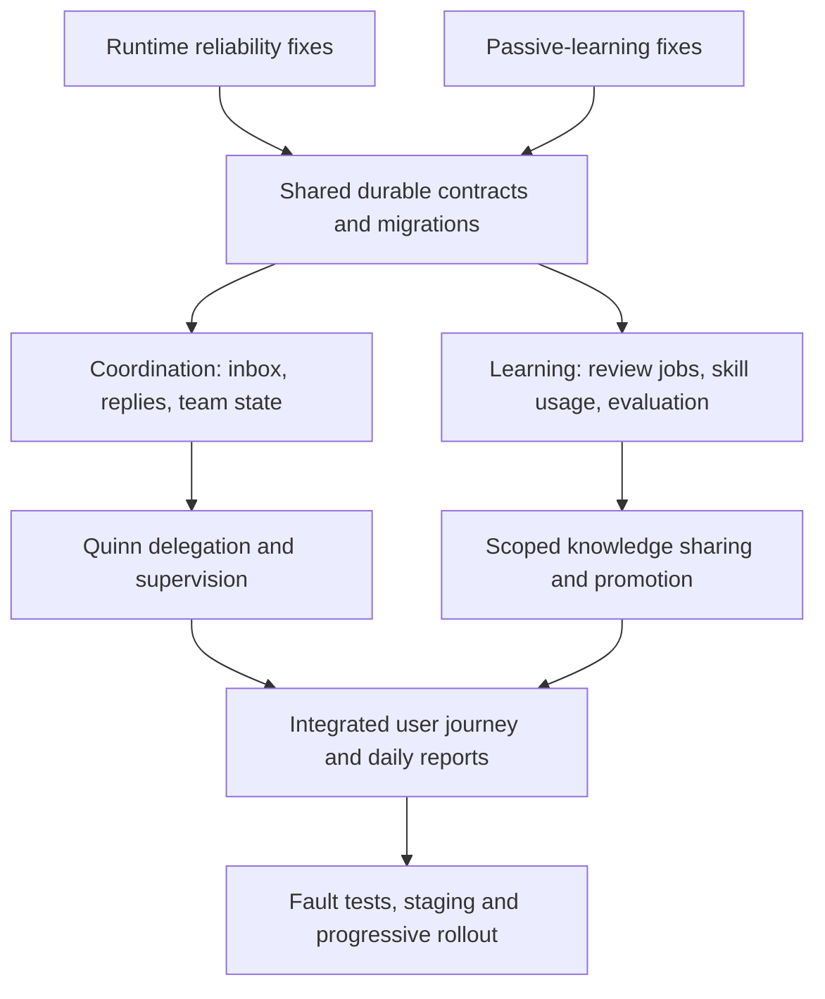

# Quinn and Hermes-derived learning: unified build plan

This is the implementation sequence for the [coordination assessment](quinn-hermes-resilience-assessment.md) and [continuous-learning plan](quinn-continuous-learning-plan.md). Those documents contain the source comparisons and diagnostic evidence; this document governs dependencies, ownership and release gates.

Baseline checked on 12 November 2026: Swarm `e27449e449966feabb49407f29a5a3c665b1d0cc`; Hermes adaptations pinned to `f0e7b68e439f8c1962fcf9dcb0341aadf1e2a898`. No implementation changes have been made by these planning passes.

**Readiness decision**

The architecture and current-state evidence are sufficient to begin implementation. Start with the reproduced reliability fixes and a shared contract/migration change. The complete system is not yet production-qualified; every later increment has an explicit exit gate below. Additional broad research is not a prerequisite for starting these first changes.

Build one native runtime initiative with two connected tracks: coordination and learning. Port the remaining Hermes mechanisms into the current TypeScript runtime. Existing jobs, workflows, knowledge revisions, permissions, artifact storage and delivery claims remain authoritative. Quinn is the coordinator and learning supervisor within that runtime. The learning worker runs background jobs with narrowly scoped tools; it does not require a separately activated user-facing coworker.

The confirmed product experience is learning through normal use: the user requests work and supplies corrections or business decisions; the system captures relevant knowledge, improves procedures and distributes them to applicable coworkers. Coworker activation retains the agreed user review.

**What is already built**

Use the [native Hermes implementation record](hermes-native-implementation.md) as the baseline inventory. Persistent goals and workflow graphs, structured child results, sourced memories, immutable skill revisions, approval handling, replay-aware tool dispatch, isolated programs and durable artifact delivery already exist. Do not open a second implementation of those features under a new Hermes service.

The new ports are concentrated on durable Bot Mode communication, completion subscriptions, background learning review, skill-use/outcome attribution and curation. Adapt their behavioral tests as well as their source patterns. Hermes's filesystem profiles and daemon-thread assumptions do not replace Swarm's tenant authorization or durable job lifecycle.

**Shared contracts to settle before parallel feature branches**

One integration owner owns the shared schema and runtime interfaces. The initial contract PR must include the migration, typed interfaces, one real producer and consumer, and restart tests. It is not a schema-only abstraction exercise.

| Contract | Decision for the first implementation |
| --- | --- |
| Change event | Tenant and actor identity stamped by the runtime; stable event ID/order; source type, ID and revision; correlation/causation; origin kind; audience; recorded time. Persist with the canonical mutation in the same transaction. |
| Source evidence | Preserve original message generation/sequence/hash and artifact/result references. Distinguish user statements, tool observations and agent hypotheses. Shared access is explicit; source existence alone is not semantic verification. |
| Internal request/result | Stable request ID, sender/recipient IDs, expected reply and original workflow/job linkage. Keep admission, execution, acceptance and notification states distinct. One request identity cannot create duplicate accepted assignments. |
| Consumer progress | Independent durable cursors for the team projection, Quinn reviews, learning reviews and report coverage. Use ordered keys with a tie-breaker. A model-input limit must not advance past omitted sources. |
| Runtime admission | Internal work waits behind unresolved decisions without cancelling them. Persist job binding before scheduling execution. Review and learning work must not enter a foreground replacement-message path. |
| Authority | Current primary role and authority revision checked at dispatch; approved coworker configuration checked at assignment; existing tool permissions still apply at execution. |
| Version usage | Record the exact skill revision read/applied by a job, with outcome and correction references. An active run does not silently switch procedures halfway through. Changed authority is still checked before later actions. |
| Learning identity and budget | Review jobs are explicit background actors with bounded cost and operations. They cannot send messages externally, perform business writes or recursively spawn reviews of their own generated notes. |
| Presentation | Internal audience survives storage, streaming, notification and final-response routing. The user sees honest queued/completed/failed coordination activity and can inspect details. |

Expose a small set of native interfaces for transactional event publication, inbox admission/result settlement, snapshot reads and learning-review scheduling. Final names and SQL layout belong in the contract PR; both tracks consume the same implementation. Reuse native jobs for review execution and existing routine/delivery records for synopsis delivery.

Migration must be additive, restartable, ownership-scoped and compatible with existing restore/migration holds. Backfill current state with provenance; do not invent historical completion events. Retain old message history and suppressions. Only one transport owner may dispatch a request during transition from legacy `send_to_bot` behavior.

**Implementation increments and merge dependencies**

| Increment | Scope and starting code | Dependencies | Exit gate |
| --- | --- | --- | --- |
| F1: coordination reliability | `agent/loop.ts`, `agent/jobs.ts`, `proactive.ts`, `routes.ts`, primary-role persistence. Preserve pending decisions, make admission/presentation consistent, distinguish human activity, preserve primary continuity; add a fault test for scheduled-slot admission. | Current baseline | The four reproduced coordination tests pass; voice assignment, ownership and queue behavior remain correct. |
| F2: passive-learning reliability | `agent/memory.ts`, `knowledge/memory.ts`, `knowledge/sessions.ts`. Ordered review cursors, complete bounded input coverage, explicit correction/supersession handling. | Current baseline; can run alongside F1 | The three learning diagnostics pass, with controls for ordinary duplicates, scoped corrections, forgetting and changed sources. |
| F3: shared contracts | Event/inbox schema and service, durable consumer/review identity, actor/audience types and additive migration. Connect actual job/configuration producers and a projection consumer. | F1 + F2 integration | Crash between commit and publication replays safely; duplicate delivery does not duplicate work; tenant and stale-generation checks pass. |
| C1: background coworker communication | Hermes Bot Mode receipt and completion patterns in native messaging; automatic final-result return, deferred admission, bounded chains, compact user activity. | F3 | A busy or approval-waiting coworker receives work later; its original reply returns without a second tool call; restart preserves requests and outcomes. |
| L1: background learning and telemetry | Hermes review/idle patterns implemented on durable native jobs; source-range capture, skill revision usage and observed outcomes; staged proposals only initially. | F3; parallel with C1 | Corrections/results reliably schedule one bounded review; replay and concurrent user edits cannot publish stale changes; user work remains responsive. |
| C2: Quinn team supervision | Team snapshot and retrieval; permanent coworker assignment through native workflows; actionable event subscription; deadlines, blockers and independent health visibility. | C1 + event coverage from F3 | Quinn answers current team-state questions from records and follows approved work through dependencies; its outage does not lose worker results. |
| L2: evaluated learning shared across the team | Scoped shared facts/procedures, provenance and forgetting propagation; candidate evaluation; auditable promotion policy and rollback. | L1 + team scope/snapshot interface from F3; integrate with C2 | User correction reaches applicable coworkers; evaluation uses fixtures/previews without replaying external effects; a harmful revision can be reverted. |
| I1: integrated reporting and maintenance | Daily synopsis using existing durable delivery; learning change record/undo; periodic curator with pinned/scheduled-skill protection. | C2 + L2 | The complete user journey below passes; reports have correct coverage and delivery state; maintenance preserves dependencies and recovery. |
| R1: qualification and rollout | Fault injection, provider staging, workload/cost measurement and per-tenant rollout controls. Build fixtures throughout earlier increments. | Each feature tested as built; final release after I1 | Demonstrated source/event coverage, recovery, bounded cost, truthful status and effective rollback under the supported workload. |

These are reviewable increments, not a requirement to put each row into a single large PR. Split primary-role changes from approval admission, for example, when that makes review clearer. Move the diagnostic contracts from `.context/quinn-resilience/` into the maintained test suite with their fixes; retain source-attributed reproduction history.

**Parallel work allocation**

Use one integration owner, one coordination owner, one learning owner and one validation/experience owner. The integration owner owns shared schema, job admission and source contracts. The coordination owner owns internal transport, workflow assignment and Quinn supervision. The learning owner owns review, correction, telemetry, evaluation and curation. The validation/experience owner builds failure tests, shared user journeys, activity presentation and learning controls against the agreed APIs.

Begin F1 and F2 in parallel with clear file ownership. Merge the common F3 contract before C1 and L1 branch from it. Coordinate edits to shared files such as `agent/loop.ts` through the integration owner rather than letting separate agents invent competing dispatch paths. Validation begins with the first fixes and runs alongside development; it is not deferred to the final rollout step.

**Activation defaults and bounded autonomy**

Immediate, sourced user preferences and explicit corrections can update their intended scope through the existing validated memory/configuration paths. Ambiguous scope remains a candidate decision. Operational state is read from canonical records rather than learned as a permanent fact.

Initially, background skill learning creates staged proposals while telemetry and evaluations establish behavior. This gives us automatic capture and review without pretending automatic promotion already exists. Add a visible standing learning policy in L2 for tested, reversible changes within existing scope. Its automatic actor, policy revision, evaluation and prior skill version must be recorded. Expanded authority, recipients, schedules, external actions and new coworker activation remain subject to the relevant user decision. The policy must not silently remove current approval requirements during migration.

Automatic promotion is enabled only after evaluation and rollback work end to end. Keep task/goal permissions independent from skill text: a skill is a procedure, not a grant of authority. Preserve API-mode admission rules and the supported subscription concurrency behavior; background work gets lower priority and its own budget without introducing an arbitrary cap on ordinary subscription jobs.

**First integrated milestone**

Use one concrete journey to prove the architecture before adding broad autonomous optimization:

1. The user asks Quinn to prepare a lead-research coworker. Quinn uses known context, prepares the brief and obtains the agreed activation review.
2. The approved coworker runs a workflow, produces an artifact and reports its result automatically. Quinn can see the workflow and evidence without asking for a status DM. The transcript shows compact coordination activity.
3. The user corrects the audience through normal chat. The correction is attributed, scoped and applied to the next relevant action; the earlier preference is superseded.
4. A durable background review identifies an applicable procedure improvement and creates an evaluated revision proposal. Initially it uses existing owner review; the standing-policy variant is tested before enabling automatic promotion.
5. The next run records the adopted revision and exposes its real outcome. Quinn's synopsis reports work, blockers and any meaningful improvement using source links.
6. Repeat the journey with a queue refusal, pending approval, worker restart and lost notification. Preserve the user's decision and original request identity; expose uncertain effects without automatic replay.

The first end-to-end milestone includes both coordination and learning. It does not require an extensive curator, automatic cross-library consolidation or autonomous promotion before the basic loop is proven.

**Release gates and rollout**

Start with event/projection comparison and staged learning; enable internal communication and Quinn supervision per tenant after their tests pass. Enable automatic skill promotion only under its implemented standing policy, following evaluation and rollback qualification. Curation and more extensive optimization follow the initial end-to-end milestone.

Test durable acceptance, restart/replay, duplicate and reordered events, source edits/deletion, memory forgetting, equal timestamps, oversized histories, pending decisions, primary transfer, permission revocation, cross-account access, notification storms and unknown external effects. Include UI checks that internal exchanges stay internal while approvals remain actionable.

Run the existing relevant native regressions, server/web typechecks and browser checks for the changed surfaces. Use disposable PostgreSQL for platform ownership/recovery changes. Earlier local test results are baseline evidence, not qualification of the new code. Live provider and workload claims require staging measurements; model-based learning quality requires representative evaluation beyond mocked transport tests.

Rollout controls must stop new coordination or learning dispatch without discarding durable work. Rollback of a procedure selects a previous immutable version; rollback of a feature preserves receipts, source events and candidates. Reconcile external effects before retrying them.

The next concrete build work is F1 and F2, followed by the common F3 contract. C1 and L1 then proceed together, with the first integrated journey as the shared product milestone.
