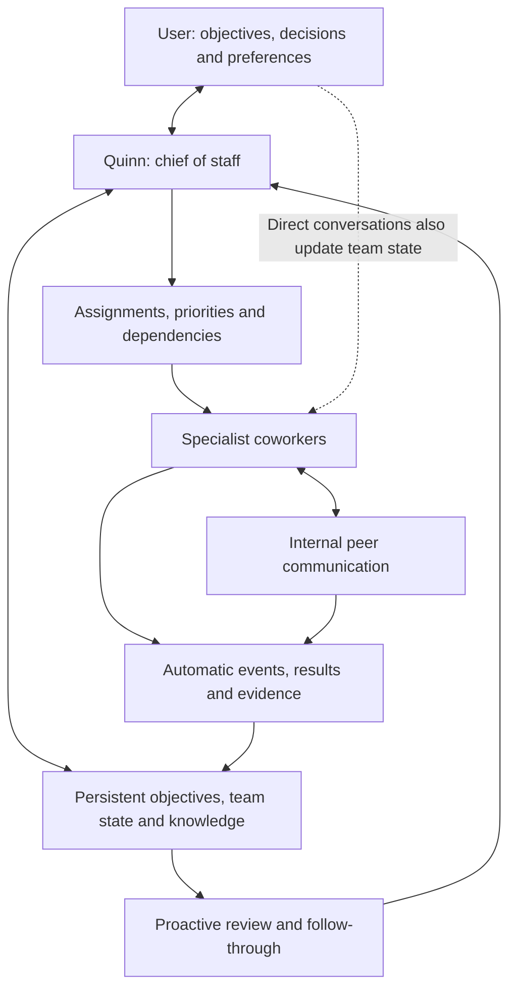

Quinn as the primary chief of staff — proposed product and implementation plan

Quinn owns the user's overall objectives, the coworker team, coordination, follow-through and consolidated reporting. Every specialist has a defined responsibility; Quinn remains accountable for how their work fits together. This plan extends the [background communication plan](cross-agent-coordination-plan.md). It proposes behavior and implementation work; it does not change the running application.

**The product contract**

The user can give Quinn an outcome, let Quinn arrange the team and work, and return later for an accurate explanation of what happened. The user can also talk directly to a specialist; that work remains visible to Quinn automatically. Opening chats, forwarding messages and asking agents to report must not be prerequisites for coordination.

“Total knowledge” means complete coverage of recorded team activity, retrievable evidence and explicit gaps. “Understanding” means connecting that activity to the user's intent, priorities, constraints, dependencies and success criteria. Model interpretation cannot be guaranteed perfect; the design makes it checkable and correctable.

For every active objective, Quinn must be able to answer: What are we trying to achieve? Why does it matter? Who owns each part? What is happening now? What is blocked? What actually succeeded? What evidence supports that? What should happen next? What do I need from the user? How current and complete is this picture?

**1. Make the primary role a durable responsibility**

Use the existing primary identity as the authority for managing this user's team. Quinn is its default name; management rights must follow the role and account, not a name match. Maintain exactly one valid primary agent per live account. Prevent deleting the primary without an explicit replacement or account deletion, and make role transfer atomic. A replacement inherits the team's operational records and report cursors; former coordinators cannot continue dispatching under stale authority.

Give Quinn a dedicated chief-of-staff charter and management tools available consistently through text, voice and background execution. Responsibilities include maintaining objectives, reusing or creating coworkers, defining responsibilities, allocating work, managing dependencies, monitoring progress, reviewing outcomes, resolving conflicts, coordinating recovery and reporting to the user.

Record the management policy separately from prose instructions: what Quinn may create, configure, schedule, reassign, pause or archive within existing user authorization. Role visibility is comprehensive within the team; delegation does not expand the user's action permissions. Quinn can coordinate ordinary authorized work without asking the user about each internal handoff.

**2. Give Quinn a durable model of the user's work**

Extend the existing data model rather than using chat history as the operational database.

| Record | Required meaning |
| --- | --- |
| User context | Confirmed preferences, working hours, time zone, notification policy, standing decisions and relevant business context |
| Objective | Desired outcome, priority, owner, constraints, success criteria, due date when supplied and source request |
| Coworker | Role, capability, current approved configuration, lifecycle state, resource access, assignments and operating schedule |
| Assignment | Objective, accountable specialist, full brief, acceptance criteria, dependencies, inputs, expected artifacts and execution references |
| Decision | User or coordinator decision, scope, source, effective revision and what it supersedes |
| Knowledge/artifact | Finding or deliverable, owner, source, observed time, revision, validation state and retrieval reference |
| Operational observation | Progress, blocker, failure, pending decision, heartbeat, resource condition or schedule change |
| Coordinator record | Events processed, last review, decisions made, next follow-up, report coverage and delivery state |

An assignment can span several existing `agent_jobs`, including pauses, retries and continuations. A job ending is execution state; the business assignment succeeds only when its acceptance criteria have supporting results. Preserve waiting, partial, failed, cancelled and uncertain outcomes explicitly.

Capture simple user requests automatically at the runtime boundary; group related work into objectives where useful. Do not require a model to remember `create_task` before work becomes observable. Give standalone requests a lightweight assignment rather than forcing users through project setup. Track recurring work under a persistent objective with a separate assignment for each occurrence.

**3. Record activity automatically from every entry point**

All relevant state mutations write an event in the same database transaction as the canonical change. Include web/API configuration, direct specialist chats, voice, messaging, scheduled routines, tool execution, approval continuations and temporary helpers. Semantic extraction from free text records its source and distinguishes a proposal from a confirmed decision.

Build a durable event journal and outbox with account, event ID, entity revision, source, assignment/job linkage, timestamp and audience. Maintain a current team view from those events and canonical records. Live UI events are a delivery mechanism; persistent state must survive closed clients and server restarts.

Quinn's view covers every coworker and open assignment. Return coverage counts, the observed event sequence, pending extraction and known omissions; paginate detailed reads. A prompt budget cannot silently remove agents from the coordinator's responsibility. Periodic reconciliation checks that canonical records and the derived view agree. Active work supplies heartbeats; stale work becomes a visible exception.

Information events update this view without invoking Quinn's model. Significant changes request a coordination review. This gives Quinn continuous access to current facts without continuously generating model responses.

**4. Build understanding through layered context and verification**

Compose Quinn's working context from stable user objectives and policy, a complete compact team overview, changes since its last review, and evidence relevant to the current decision. Provide targeted retrieval of assignments, decisions, configuration and artifact history. Keep the full records outside the model context and outside conversation compaction.

Use structured reads for current operational facts and search for narrative knowledge. A vector search result alone must not determine whether a task is done, an agent is active or an action is approved. Each significant factual claim must trace to an observed record; stale, unavailable, contradictory and unverified information stay distinguishable.

Before Quinn dispatches work, check the current objective and configuration revisions. A direct correction to a specialist invalidates affected plans and alerts dependent owners. Explicit user instructions outrank agent suggestions; conflicting instructions require scoped resolution instead of silent merging. Verify external outcomes through returned artifacts or appropriate reads rather than accepting “done” as proof.

Persist decisions with their supporting references and next follow-up. Clearing Quinn's conversation does not clear objectives or operational knowledge; intentional account or data deletion still follows the product's deletion policy.

**5. Let Quinn own coworker setup and lifecycle**

For a new use case, Quinn first checks whether an existing coworker fits. It creates a persistent coworker for a durable responsibility, or uses a temporary helper for bounded assistance within the user's authorized task. Coworker creation and retries use a stable creation request ID to prevent duplicates.

Quinn assembles the job specification from information already provided: mission, responsibilities, inputs, outputs, quality requirements, resources, workflow, handoffs and operating boundaries. It asks only for material missing decisions. Specialists can contribute domain questions internally; Quinn presents a consolidated question when the user is needed.

Present the completed role and its activation control in Quinn's conversation, with the same canonical configuration available in the specialist's Configuration panel. Preserve the existing exact-revision activation requirement and allow the user to complete it centrally. This removes the current mandatory trip to each coworker's setup chat. Any future policy permitting automatic activation is a separate explicit product setting, not something implied by delegation.

Setup answers given in Quinn's chat need durable source references accepted by the setup service. Today source validation expects answers in the specialist's conversation; adapt that contract rather than fabricating specialist user messages or bypassing provenance.

Quinn can inspect lifecycle state, update authorized responsibilities, manage schedules, pause, resume, stop or archive coworkers through shared management APIs. Define each action precisely: pause holds new assignments and routine starts; stop cancels specified work and its continuations; archive removes future routing while preserving required history. Reassign unresolved work deliberately. Track provisioning and credentials independently from activation and task success.

**6. Make delegation a complete workflow**

Each assignment carries the objective, context, inputs, expected output, acceptance criteria, relevant authorization reference, priority and dependency IDs. Record the owner and result destination. Specialists can exchange information and request scoped help directly; every exchange remains linked to the same workflow and visible in Quinn's state.

The runtime records acknowledgement, progress checkpoints, blockers and terminal results automatically. An information update does not require a reply. Resolve ordinary dependencies without involving the user, and escalate decisions that genuinely change the objective or authority.

Quinn reviews outputs against acceptance criteria, asks for a targeted correction when needed, releases dependent work and closes the objective only when the outcome is supported. Detect duplicate assignments and conflicting writes to shared resources. Reassign only after resolving the previous attempt's state, especially when an external effect may already have occurred.

Preserve the background exchange behavior from the communication plan. Audience and task provenance survive streaming, tool activity, questions, approvals and resumed work. Internal updates cannot cancel a user's pending approval. Draft or paused agents can expose stored state without executing operational work.

**7. Give Quinn a proactive management loop**

Separate operational monitoring from user notification. Quinn keeps monitoring the team even when notifications are muted or the user is currently chatting with another coworker.

| Trigger | Quinn's responsibility |
| --- | --- |
| New objective or user correction | Update the plan, assign an owner and reconcile affected dependencies |
| Coworker created, configured or activated | Check readiness and release only eligible assignments |
| Result or artifact available | Check acceptance criteria and advance dependent work |
| Blocker, failure, stale heartbeat or missed deadline | Diagnose from current state, recover within authority, or surface the exact decision needed |
| Capacity or resource conflict | Adjust dispatch order or ownership without losing assignment context |
| Scheduled team review | Detect unattended assignments, unowned work, duplicate effort and forgotten follow-ups |
| Daily synopsis slot | Deliver a consolidated report from verified changes and unresolved work |

Use durable review requests, a per-account coordinator lease, deduplication and bounded work per review. Coalesce ordinary events; prioritize urgent exceptions and direct user requests. Persist a `review_again` marker for changes that arrive during a review and revalidate revisions before dispatching its decisions. Retries are bounded and uncertain external actions are reconciled before repetition.

Status ingestion and inspection must remain responsive while specialists perform long tasks. The current API path serializes work across the account; address that constraint deliberately with supported bounded execution capacity and prompt scheduling of coordination work. Keep serialized access to each agent's conversation and approvals. Avoid solving responsiveness by starting competing model turns in one conversation.

Proposed initial monitoring policy: reconcile active work every 60 seconds, with task-specific heartbeat and deadline thresholds. Ordinary progress updates can be batched; blocking failures request prompt review. These are initial engineering settings to validate under load, not a promise about external provider response time.

**8. Make Quinn's interface show responsibility and outcomes**

Keep Quinn as the default entry point. Beside the conversation, provide a team overview: current priorities, each coworker's responsibility and status, work awaiting attention, recent deliverables and upcoming scheduled work. Offer an objective view connecting assignments, dependencies and evidence.

Let users create, review and manage coworkers through Quinn without navigating each chat. Direct specialist conversations remain available. Surface internal exchanges as compact activity entries such as “Quinn and Nia exchanged updates,” with details on demand. Delivery and completion labels must reflect actual state.

Quinn delivers the daily synopsis at the configured local time and channel: outcomes and links, active work, blockers or decisions, and next steps. Persist the report's covered events and delivery state so retries reuse the same report. Catch up missed scheduled reports according to a defined policy. Immediate alerts and the daily synopsis use the same records and notification policy, avoiding repeated asks or contradictory summaries.

For the Nia example, a direct instruction assigning lead-based content strategy and Notion delivery becomes a sourced role change. Quinn sees whether it is draft or active, updates the relevant objective, tracks research and content dependencies, and reports verified saved artifacts. If Nia lacks a target audience, Quinn owns obtaining that decision and releasing the blocked work afterward.

**Implementation sequence**

| Phase | Deliverable and principal source areas | Exit condition |
| --- | --- | --- |
| 1. Canonical ownership and visibility | Primary invariants; objective/assignment links; event journal/outbox; automatic mutation hooks. Extend [jobs.ts](../server/src/agent/jobs.ts), [bots.ts](../server/src/bots.ts), [routes.ts](../server/src/routes.ts), [bot-setup.ts](../server/src/bot-setup.ts) and store/routine entry points. | Every supported work entry point produces durable, attributable records; snapshots include all agents and open work. |
| 2. Shared inspection and context | Extract reusable inspection from [voice-controls.ts](../server/src/voice-controls.ts); add coordinator retrieval, projections and bounded context in [prompt.ts](../server/src/agent/prompt.ts). | Quinn answers operational questions from sources, including work in unopened chats, after restart and chat clearing. |
| 3. Internal workflow execution | Audience propagation, internal inbox, dependency handling, correlated results, approval-safe continuation and acceptance review in [loop.ts](../server/src/agent/loop.ts), [tools.ts](../server/src/agent/tools.ts), voice and messaging. | Peer coordination reaches a verified objective outcome without internal payloads reaching user channels or disrupting approvals. |
| 4. Central coworker management | Guided creation and exact-revision review in Quinn; shared lifecycle controls; revise [teammates.ts](../server/src/agent/teammates.ts), setup provenance and UI. | User can create and manage a specialist end to end from Quinn; retries, stale setup and resource failures remain truthful. |
| 5. Proactive operations and reporting | Durable review loop, follow-ups, capacity handling, report scheduler and delivery outbox; evolve [proactive.ts](../server/src/proactive.ts). | Quinn detects and handles unattended work and delivers complete scheduled reports across failures and restarts. |
| 6. Qualification and rollout | Integrated UI, real runtime journeys, replay tests, reconciliation checks and staged enablement. | All acceptance scenarios below pass on the actual supported execution paths. |

New modules can live under `server/src/coordination/` for records, projections, internal delivery, context and supervision. Keep a shared service contract across text, voice, routines and messaging. Reuse the existing database and durable jobs initially; an additional broker is not required for the first implementation.

Backfill existing agents, configuration, tasks and jobs with provenance. Mark uncertain historical outcomes explicitly. Run projections in observation mode and compare them with canonical state before allowing automatic coordination decisions. Enable new audience behavior only when the server and clients support it, retaining existing history without guessing which unattributed assistant replies were internal. Each phase adds focused tests for its state transitions; final qualification exercises the whole workflow.

**Acceptance and measurement**

1. Give Quinn a new recurring use case. It reuses or creates the correct coworker, prepares its role from known context, supports central activation and tracks the first assignment without a repeated interview.
2. Give a specialist a direct correction while Quinn is idle. Quinn's next answer reflects the correction and source; affected work respects the new revision.
3. Run several specialists with dependencies. Quinn identifies every owner, blocker, result and next step, including helpers and chats never opened by the client.
4. Complete a model run with an incomplete or failed external action. Quinn reports the partial or uncertain outcome and keeps unmet acceptance criteria open.
5. Leave a specialist waiting for approval while peers exchange information. The original decision and continuation survive unchanged.
6. Interrupt delivery, crash the server and replay events. Work remains attributable; internal delivery, creation and reporting do not duplicate user-visible effects. External uncertainty is reconciled.
7. Clear Quinn's conversation, rename a coworker or explicitly transfer the primary role. Objectives and evidence remain retrievable; stable IDs and role authority prevent misrouting and duplicate coordinators.
8. Disable outward notifications. Internal monitoring continues; reenabling delivery follows the user's selected catch-up policy.
9. Reach a report time while one coworker is offline. Quinn reports verified results and marks the unavailable coworker's last verified state without waiting indefinitely.
10. Exercise API and subscription execution, text and voice, direct chats and routines, with isolation between two accounts. All surfaces use the same state and permissions.

Measure event coverage and projection lag, stale or unowned assignments, missed follow-ups, duplicate dispatches, supported factual claims, successful objective completion, report coverage and delivery, user questions repeated unnecessarily, and model cost per coordination review. Use a fixed set of questions and expected records to evaluate whether Quinn understands task relationships; complete ingestion alone does not establish accurate interpretation.

Validation performed for this plan: source inspection of primary identity, coworker creation/setup, jobs/queues, prompts, check-ins and management routes, plus the preceding communication review. No production status was inferred and no runtime behavior or tests were changed.
