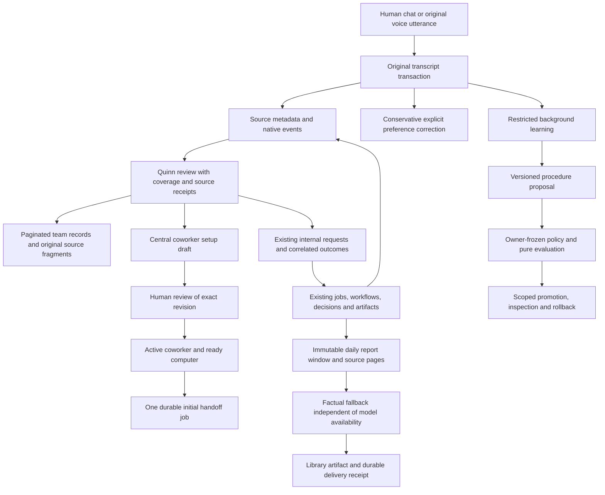

# Quinn coordinator completion implementation

Implementation dated 2026-11-18, extending repository baseline `81aa75b`. Changes are in the working tree; this document does not imply deployment, account enablement or live-provider qualification.

## Result

Quinn now has a durable path from recorded human instructions and work state to coordinator review, central coworker preparation, scoped learning and saved daily reports. The implementation extends the native Hermes-derived TypeScript runtime; it does not introduce a second Hermes daemon or a parallel execution engine.

“Team awareness” means access to recorded facts with explicit coverage and freshness. A context receipt establishes what was presented, not that a model understood it correctly. Completed execution, accepted results, saved artifacts and acknowledged delivery remain separate states.



## Implemented contracts

### Complete retrieval and honest bounded context

`server/src/coordination/state.ts` preserves bounded model context while reporting exact total, returned and omitted counts. Active and uncertain work takes priority over recent completed work. Hidden temporary helpers remain attributable to their parent. Old active records show that no recent progress was observed; they are not cancelled because of elapsed time.

`server/src/coordination/records.ts` exposes owner-scoped cursor pages for agents, jobs, workflows, standalone goals, tasks, routines, artifacts, deliveries and source references. Standalone specialist objectives and schedule changes also enter the supervisor fingerprint, even before they produce a workflow or job. Reuse the returned `through` and `nextCursor` until `hasMore` is false. Monotonic record identities preserve insertion boundaries even when SQLite reuses a deleted row ID. Canonical insertions maintain this projection transactionally; read tools remain read-only. Pages read current values rather than immutable historical content, and deleted records can leave gaps. The team board provides complete job-history paging and explicitly labels bounded overviews.

The current unique primary can use `get_team_state`, `get_team_records`, `read_team_source` and `read_team_job`. Recorded direct specialist outputs are retrieved in bounded fragments with agent attribution; absent results remain explicitly unavailable. A primary-role transfer immediately revokes the previous coordinator's source access. Missing or ambiguous primary identity fails closed. Ordinary team-board data contains source metadata rather than raw private conversation text.

### Direct specialist conversations and review coverage

`server/src/coordination/sources.ts` indexes genuine human messages in the same transaction as transcript insertion or revision. Events contain source identity, revision and hash; original text stays in the transcript. Bot-origin narration and internal messages are ineligible as human evidence.

New messages and direct user-job state changes wake Quinn without manual forwarding. Canonical cancellation and restart uncertainty are observed even when no model completion is emitted. Existing supervisor coalescing, decision serialization and rate limits remain in force. Pre-turn validation rejects changed or ambiguous primary authority. Completion consumers select independent batches and persist retry backoff, so failed learning callbacks cannot starve coordination results or healthy later work.

Original sources are read in bounded contiguous fragments. A successful review advances its cursor only across sources fully presented to that review or its continuation lineage. Omitted or truncated text remains pending. Edits invalidate old versions; deleted sources return unavailable. Historical retained messages are indexed in batches of 500 per owner without presenting them as new instructions. Source indexes support this backfill without scanning the full event history for each row.

These are presentation receipts. Live-model understanding remains a separate qualification gate.

### Coworker setup stays with Quinn

`CENTRAL_SETUP_TOOLS` supplies `inspect_teammate_setup` and `prepare_teammate_setup`. Preparation accepts original, owned human source references and preserves unresolved decisions. Creation uses an account-scoped `creation_request_id`; retries reuse the coworker and conflicting parameters are refused.

Quinn's conversation contains a configuration review card with original sources. Only authenticated human HTTP activation of the exact reviewed revision activates the coworker. A stale card cannot activate a newer unseen draft. Specialists retain their existing setup workflow for compatibility, but central creation no longer directs the user into another chat.

The initial assignment waits for both activation and computer readiness. Setup handoff admission and its existing `agent_jobs` identity commit together. Capacity refusal leaves the assignment pending; recovery retries admission. Uncertain or completed work is not replayed.

### Voice parity and genuine source attribution

Voice reuses the same setup and team-inspection services. `/voice/tool` records original spoken user lines before read tools return source references, then dispatches the requested control. Final call transcripts are also recorded even if no tool was invoked. Preparation requires a stable invocation ID and still ends at the human review card.

A model-authored `send_task` summary is attributed to the coordinating bot. It cannot become a human setup answer or preference correction. Shared voice context is labelled as context in model history; only original user utterances enter the human-source path. Stable call/utterance identity preserves repeated identical speech; a corrected caption updates the original row and invalidates superseded source hashes. Ingestion failure returns a controlled error before a tool promise is registered.

### Learning and evaluated procedural improvement

The existing restricted learning loop now stages unattended skill changes before promotion. Automatic promotion requires a direct owner-authored standing policy, immutable candidate and baseline hashes, current source grants/settings, and a passing native evaluation.

The implemented evaluator supports bounded pure decision tables in `references/procedure.json`. The exact interpreter used by `apply_procedure` is evaluated against at least five distinct frozen cases covering the triggering defect, existing behavior, out-of-scope inputs and failure behavior. Candidate rules may improve approved labels within a fixed responsibility; they cannot change instructions, applicability, sharing, recipients, permissions, schedules or budgets. No model or business tool runs inside this evaluator.

Unsupported prose, executable procedures, new packages without a rollback baseline, insufficient fixtures and approval-required settings remain staged for owner review. A model's own success assertion is never a passing evaluation. Frozen policies are currently configured through authenticated CRUD/UI; trustworthy fixtures are not automatically inferred from arbitrary artifacts.

Promotion receipts, application receipts, evaluations, revisions and source bindings remain inspectable. Rechecking a critical regression restores a still-valid baseline or suspends the procedure. This recheck is an explicit API/UI operation; there is no claim of autonomous live-business replay or general self-improvement.

Explicit, complete human preference corrections changing a recognized cadence or verbosity value in the same scope immediately supersede the old memory, including when background learning is paused. Future, temporary, conditional, inferred, scope-changing and destructive edits remain staged. Correction history and sharing grants are preserved; routine schedules and permissions are unaffected. Runtime memory retrieval also revalidates original source hashes: edited/deleted source facts leave prompts and recall immediately, while owner inspection/history and explicit owner-authored facts remain available.

### Durable daily synopsis

`server/src/proactive.ts` discovers due local-calendar slots durably and coalesces missed slots after downtime. Existing enablement, times, timezone and quiet hours remain authoritative. A daily report can say that no changes were observed; it cannot disappear because a model selected silence.

`server/src/coordination/reports.ts` freezes an observation window, source watermark, destination and source revisions. Current open work is retained even if old. Pending human-source review and stale coordinator observations are disclosed without copying private source text. Summaries are bounded and explicitly link all saved source pages. Optional narrative has a deadline; a factual template and source pages remain available without a model or an available agent queue.

Reports freeze selected current canonical projections and declare `historyComplete: false`. Intermediate transitions may no longer be available, long fields are abbreviated with explicit coverage metadata, and deadlines are not inferred from free text. Frozen pages preserve what was observed; they cannot reconstruct unrecorded history.

Materialized and delivered coverage advance separately. Artifact content hashes, original delivery identity and contiguous acknowledged report coverage survive restart. Failed/unknown external writes are not inferred as successful, and unknown sends are never automatically replayed. The scheduled destination is the existing Library channel; a linked messaging account alone does not authorize external synopsis messages. Library availability is not proof that the user read a report.

## Verification and release gates

The maintained `npm run test:hermes-native` command includes the new awareness, central setup, learning promotion, source-ingestion, synopsis and voice-control regressions, plus browser journeys. Additional voice execution and subscription regressions exercise the existing runtime around these changes.

Combined verification passed on 2026-11-18. A subsequent helper-cleanup recovery correction was verified separately against the affected runtime paths, as recorded below. Counts are per command and must not be added as unique coverage; focused suites overlap the combined suites. These checks use isolated local databases, browser fixtures and simulated providers.

| Check | Result | Workspace evidence |
| --- | --- | --- |
| `npm run test:hermes-native` | **439 passed**, zero failures/skips; server/web typechecks, production builds and all five actual-browser journeys passed | [Combined native log](../.context/quinn-completion/native.log) |
| `npm run test:cli` | **262 passed**, zero failures/skips; subscription integration smoke passed | [Subscription log](../.context/quinn-completion/cli.log) |
| Legacy background, database fences, migration inventory and package tests | **53 passed**, zero failures/skips, after the final record-index additions | [Migration-protection log](../.context/quinn-completion/migration.log) |
| Original diagnostic contracts | **8 passed**: all seven reproduced gaps plus the passing control | [Original diagnostic log](../.context/quinn-completion/original-contracts.log) |
| Additional voice execution tests | **41 passed** across voice apps and HTTP coordinator behavior | [Voice execution log](../.context/quinn-completion/voice-execution.log) |
| Follow-up after the helper-cleanup correction | **103 passed**, zero failures/skips; full server/web typecheck and server build also passed | [Affected runtime checks](../.context/quinn-completion/helper-recovery-followup.log) |
| `git diff --check` | Passed | [Whitespace check](../.context/quinn-completion/diff-check.log) |

The five browser journeys cover native knowledge/workflow UI, the full Hermes-derived experience, task budgets, central setup and synopsis delivery. They exercise real application routes and Chrome, including desktop/mobile layouts, stale-revision refusal, original source inspection, evaluated promotion/suspension, saved report identity and delivery recovery. Provider responses and accepted-business fixtures remain simulated. The subscription suite includes long-running Claude/Codex continuation, parallel/nested helper routing, native callbacks and cancellation; it is not a live-provider capacity certification.

The migration-protection command is:

```sh
node --import tsx --test --test-concurrency=1 \
  tests/legacy-background.test.mts tests/legacy-database-fence.test.mts \
  tests/migration-inventory.test.mts tests/migration-package.test.mts
```

The follow-up protects a surviving helper's return receipt when it removes a completed child. Admission freezes the correlation and consumed peer-hop budget independently of the deleted child; completion or restart recovery forwards the result once. The 439/262 combined runs preceded this last correction. These affected-path checks ran afterward against the final runtime, with file hashes unchanged through completion:

```sh
node --import tsx --test --test-concurrency=1 \
  tests/native-coordination.test.mts tests/native-coordination-boundaries.test.mts \
  tests/native-coordination-lifecycle.test.mts tests/native-workflows.test.mts \
  tests/cli-concurrency.test.mts tests/legacy-database-fence.test.mts
npm run typecheck
npm run build -w server
```

The original diagnostics live in `.context/quinn-resilience/{coordination,learning}-boundaries.test.mts`. Maintained equivalents are in `tests/native-coordination-boundaries.test.mts` and `tests/native-learning-coverage.test.mts`. Independent review additionally reproduced completion-consumer starvation, changed primary authority after review admission, and SQLite row-ID reuse across a pinned page boundary. All three now have passing maintained regressions in `tests/native-job-completions.test.mts` and `tests/quinn-awareness.test.mts`.

The live understanding harness uses frozen known-answer scenarios, exact citation/categorical grading and read-only calls on an explicitly selected staging subscription. Simulated output is labelled simulated. Missing staging identity, session or selected provider produces an unavailable receipt, never paid API fallback. See `docs/quinn-understanding-qualification.md` for the final harness contract.

A production release still requires an authorized staging account to qualify actual model understanding, real-provider behavior/usage, end-to-end delivery on explicitly approved channels and operating-load targets. Local fixtures do not establish those results.

### Status against the twelve completion criteria

| # | Criterion | Repository implementation and remaining qualification |
| --- | --- | --- |
| 1 | Account for recorded team work and identify gaps | Implemented for current canonical records, with complete paginated retrieval and explicit bounded-context omissions, stale observations and missing results. Historical transitions that were never retained cannot be reconstructed. |
| 2 | Direct specialist conversations update Quinn | Implemented for genuine human chat/voice sources and direct job/work-state changes. Review receipts prove presentation; actual model understanding is a separate gate. |
| 3 | Internal coordination and correlated results | Implemented and locally tested, including durable request/result recovery and nested subscription helper consolidation. |
| 4 | Concise activity and actionable decisions | Implemented and browser tested; internal activity is expandable and human decisions remain separate. |
| 5 | Prepare and activate coworkers through Quinn | Implemented and browser tested. The user reviews and activates the exact revision within Quinn's conversation. |
| 6 | Permanent coworkers preserve runtime controls | Existing workflow ownership, permission, budget and cancellation machinery retained and regression tested. |
| 7 | Reliable knowledge and evaluated improvements from normal use | Implemented within explicit scope: sourced knowledge, conservative preference correction and evaluated pure decision-table revisions. General prose/new procedures require owner review; arbitrary accepted-artifact fixture generation and autonomous business-outcome regression monitoring are not implemented. |
| 8 | Learning cannot expand authority and is reversible | Tested for the supported promotion path through frozen owner policy, unchanged responsibilities/authority, current source checks, immutable revisions, inspection and rollback/suspension. |
| 9 | Durable daily reports with honest coverage | Implemented and failure/browser tested for enabled schedules and Library delivery, including restart catch-up and factual fallback. External delivery still uses existing explicit authorization and receipt verification. |
| 10 | Seven reproduced gaps fixed in maintained tests | All seven pass, along with the original control. |
| 11 | Long-running subscription behavior | Retained and tested with checkpoint continuation, action replay protection, explicit budgets and cancellation. |
| 12 | Failure, understanding, browser and provider gates | Local failure tests, deterministic understanding-harness tests and browser journeys passed. **Live understanding, real-provider staging and production operating-load qualification remain outstanding.** |

The understanding harness's 13 tests are included in the native total. Its [fixture receipt](../.context/quinn-understanding-fixture/ea215e2e-ea23-4f31-b77f-0658ddb16527.json) records `simulated_pass`, zero model calls and `liveModelQualified: false`. The [unavailable receipt](../.context/quinn-understanding-unavailable/0138bdb1-264a-4248-83d3-2a6947c19e11.json) records `staging-configuration-required` and zero model calls. Neither is a live qualification, and both retain `releaseQualified: false`.

### Handoff

1. Review the working-tree implementation and the scoped learning/reporting contracts above. Agent implementation notes are in `.context/quinn-setup-result.md`, `.context/quinn-learning-result.md`, `.context/quinn-memory-provenance-result.md`, `.context/quinn-reports-result.md` and `.context/quinn-understanding-result.md`.
2. Follow [Quinn understanding qualification](quinn-understanding-qualification.md) inside the configured dedicated staging tenant. Reuse the selected subscription and exact staging identity; retain unavailable/failed receipts instead of substituting fixture success.
3. Complete [provider qualification](provider-qualification.md) and the release operating-load/delivery gates with the approved staging resources. Retain the frozen prompts, route/usage evidence, failure receipts and recovery observations.
4. Use the existing [recovery and cohort controls](hermes-build-recovery.md) for an authorized rollout. Re-run affected checks after changes and preserve additive journals during rollback.

The repository implementation is ready for this review and staging sequence. It does **not** establish that all twelve criteria are qualified in production.

## Operations and rollback

- Preserve existing long-running subscription queues, explicit budgets, cancellation and tool-dispatch journals. No new elapsed-time limit is applied to foreground work.
- Disable automatic coordination through its existing authenticated coordination settings. This stops automatic review admission; it does not erase source records or revoke the owner's access.
- Pause background learning through existing learning settings. Explicit human corrections still represent direct user instructions. Inspect/revert memory history or skill revisions; use policy revocation/suspension to prevent retrieval of an automatically promoted procedure.
- Disable check-ins through existing settings to stop scheduled report dispatch. Saved snapshots and receipt history remain inspectable.
- Setup activation and provider/tool permissions remain independent. Preparing or learning a procedure never grants external authority.
- New schema is additive. Preserve database and artifact backups before deployment; prefer application rollback with retained journals over deleting audit tables or replaying uncertain jobs. Follow `hermes-build-recovery.md` for cohort controls and restoration.

No merge, deployment, production enablement or unsolicited external messages are part of this implementation.
