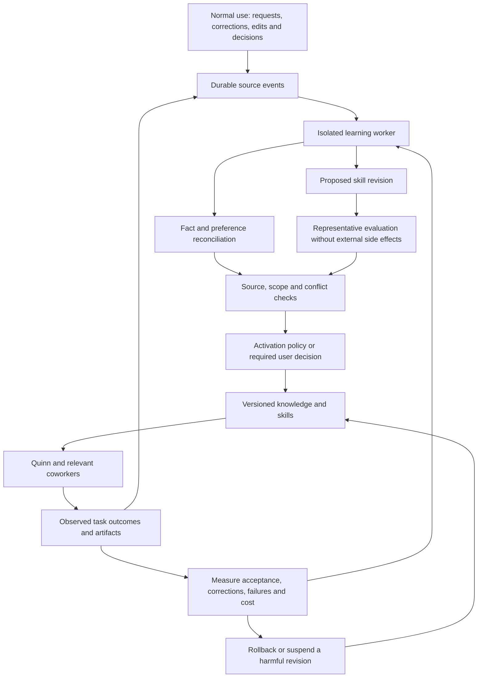

# Quinn: continuous learning through normal use

Supplement to the [Hermes coordination and resilience assessment](quinn-hermes-resilience-assessment.md), evaluated on 12 November 2026 against Swarm `e27449e449966feabb49407f29a5a3c665b1d0cc` and Hermes `f0e7b68e439f8c1962fcf9dcb0341aadf1e2a898`.

Implementation order, shared contracts and parallel work ownership are consolidated in the [unified build plan](quinn-build-plan.md). This document supplies the learning-specific rationale and evidence.

Confirmed user requirement: learning happens through normal use. The user works normally through the platform while the Hermes-derived runtime improves its knowledge, procedures and coordination in the background. The user should not need to issue learning commands, maintain skill files or repeat the same context to each coworker. Quinn coordinates this learning process. The previous assessment covered coordination thoroughly but did not establish this complete learning lifecycle. This supplement closes the design gap; it does not claim the lifecycle is already implemented.

The improvement is in persisted knowledge, reusable procedures, retrieval and coordination decisions. It does not retrain the underlying language model's weights. More saved content alone is not evidence of improvement.

**Current implementation, verified from source**

| Capability | What exists | Limit |
| --- | --- | --- |
| Automatic memory consolidation | [agent/memory.ts](../server/src/agent/memory.ts): a sweep every 60 seconds by default reviews conversations after 10 idle minutes. It skips running bots and pending tool continuations, and requires human-message sources for extracted user facts. Startup is wired in `tenant-app.ts`. | Extracts a bounded set of facts; it is not a full skill-learning or conflict-resolution service. Busy conversations can delay idle review. |
| Immediate learning tools | [agent/knowledge-tools.ts](../server/src/agent/knowledge-tools.ts): `remember`, `correct_memory`, `forget_memory`, `propose_skill`. | Foreground use depends on the agent choosing the right tool. |
| Sourced memory and correction | [knowledge/memory.ts](../server/src/knowledge/memory.ts): source references, correction history, suppression of old/forgotten facts, duplicate filtering. | Bot-scoped; similarity checks do not understand contradictory meanings. Explicit correction is stronger than passive extraction. |
| Skill revision and review | [knowledge/skills.ts](../server/src/knowledge/skills.ts): staged changes, owner approval, immutable versions, stale-edit protection and rollback. | Every agent-proposed skill requires owner approval. A low-friction automatic activation policy is not implemented. |
| Retrieval | [knowledge/sessions.ts](../server/src/knowledge/sessions.ts) and prompt assembly: original history search, bounded memory selection and skill metadata with on-demand loading. | Agent tools are scoped to their own bot. A Quinn-managed shared learning layer needs explicit sharing and provenance. |
| Outcome evidence | Existing workflows, job/tool receipts and deliverables. | They are not yet connected to a version-specific skill quality and improvement loop. Reading a skill or completing a model turn is not proof that the skill helped. |

The current prompt asks bots to propose a skill after verified success or user correction. Inspection found no native equivalent of Hermes's general background skill reviewer, curator or per-skill usage telemetry. These are concrete missing adaptations, rather than reasons to rebuild memory storage.

**Hermes mechanisms to adapt**

| Pinned upstream source | What it does | Adaptation for Quinn |
| --- | --- | --- |
| [agent/turn_finalizer.py][H-FINAL] and [agent/background_review.py][H-REVIEW] | After qualifying completed turns, starts a separate review over a copied conversation snapshot; restricted tools; independent review lifecycle and cost controls. Skill review is triggered by accumulated tool iterations, rather than unconditionally after every message. | A durable learning job after meaningful user corrections, accepted results or repeated failures. Keep the live conversation responsive and prevent the reviewer from repeating business actions. |
| [agent/review_idle_queue.py][H-IDLE] | Coalesces review snapshots, prioritizes live work, preserves original enqueue age and eventually dispatches aged work. This queue is explicitly in-memory/best-effort, primarily for the managed local runtime. | Persist source ranges and review jobs in Swarm so restart cannot lose a learning opportunity. Coalesce only when coverage of all original events is preserved. |
| [tools/skill_usage.py][H-USAGE] | Tracks usage, views, activity, provenance and lifecycle; counter updates are best-effort. | Record skill revision on execution and attach accepted outcomes, corrections, failures and cost. Usage is a signal, not a quality verdict. |
| [tools/skill_ledger.py][H-LEDGER] | Records changes and snapshots with rollback support. | Already partly adapted as native immutable revisions; extend with evaluation and promotion references. |
| [agent/curator.py][H-CURATOR] | Idle maintenance, stale/archive transitions, protected pinned/locked/scheduled skills, recoverable archival and optional model-driven consolidation. | Periodic library maintenance that preserves active dependencies and user decisions; avoid automatically merging procedures solely because their wording is similar. |
| [tools/skill_manager_guards.py][H-GUARDS] | Read-before-write and other skill mutation guards for background actors. | Check current source and skill revisions immediately before publishing; keep scope and permissions unchanged by a learned procedure. |

Hermes's documented curator defaults are a seven-day interval and two idle hours, with stale/archive thresholds of 14/30 days. Model-driven consolidation is off by default. Its automatic review and curator are separate mechanisms; copying the skill ledger alone does not provide either one. The source includes limits and best-effort paths, so transplant the behavior into Swarm's durable jobs and ownership model rather than copying daemon-thread or file-lock assumptions literally.

Hermes can allow skill writes automatically, depending on configuration. Swarm currently always stages agent proposals for owner review. Automatic promotion therefore requires an explicit product policy and implementation change; a new prompt cannot legitimately bypass the existing gate.

**The complete learning lifecycle**

Keep four kinds of information separate:

1. **Current operational state:** who is doing what, approvals, dependencies and delivery state. Read canonical records; do not teach these temporary states as permanent memories.
2. **Facts and preferences:** the user's audience, tone, timezone and confirmed business constraints. Store source, scope, authority, effective time and superseded versions.
3. **Procedures:** reusable steps, decision rules and checks for a class of work. Store conditions of applicability and expected outputs, with immutable versions.
4. **Experience:** which procedure revision was used, what happened, what the user corrected and what acceptance evidence exists. Use this to assess improvements rather than copying narrative claims of success.

Facts from the user, observations from tools and hypotheses from agents need different source labels. Another bot repeating a statement is not independent corroboration. A source reference proves where a statement came from; it does not by itself prove that the derived statement is supported by that source.

**Timing and changing knowledge**

| When | Intended behavior |
| --- | --- |
| User gives an explicit correction | Reconcile it immediately and supersede the affected preference/decision before the next relevant action. Do not wait for the nightly or idle review. Preserve scope: “for this report” is not “for all reports forever.” |
| A meaningful task finishes | Capture actual acceptance evidence, procedure versions used and any correction; enqueue an idempotent background review. An uncertain external outcome remains uncertain. |
| The runtime has spare capacity | Review bounded source batches, propose generalizable improvements and evaluate them. Record coverage and defer durably if work or budget takes priority. |
| Quinn prepares its daily synopsis | Include a short optional explanation of useful changes, such as “Nia now applies your revised audience criteria.” Surface material unresolved decisions once. |
| Periodic library maintenance | Find overlap, stale assumptions and unused procedures. Preserve pinned, locked and workflow-referenced versions; archive recoverably. |
| External information becomes stale | Mark it stale or re-check its authoritative source when relevant. A user preference does not become false merely because it is old. |

Use ordered source cursors with a stable tie-breaker, not timestamps alone. Time records should distinguish when evidence was recorded, when a preference becomes effective, and when an external fact was last verified. A statement such as “starting next Monday” must not change today's behavior prematurely. Use monotonic elapsed time for in-process idle waits and persisted due times for restart recovery.

Continuously busy use must not starve learning indefinitely: preserve original enqueue age, admit bounded maintenance under existing resource policy, and expose delayed review. Continuous improvement means repeated evidence-driven review, not an endless model call or a forced skill edit after every interaction. A no-change review is a valid result.

**Minimal effort from the user**

The user should normally just ask for work, edit an output, correct a preference or accept a result. These interactions supply learning signals without requiring the user to manage files or visit each coworker's settings.

Recommended product policy:

- Explicit preferences and corrections are captured within their intended scope without an extra confirmation for every fact.
- Under a selected standing learning policy, reversible procedural improvements can activate automatically after source checks and suitable evaluation, provided they preserve scope, permissions, recipients, schedules and budget authority. Keep the previous revision available and provide a concise change record with undo.
- New coworkers still require the agreed activation review. Expanded authority, new external actions or consequential policy changes remain decisions for the user; Quinn consolidates these decisions centrally.
- Until automatic promotion is implemented and enabled, skill proposals retain the existing owner-review requirement. Do not claim an automatic improvement is active merely because a proposal exists.

Quinn owns team-wide preference reconciliation, sharing and improvement priorities. Coworkers contribute specialist lessons. Share a canonical version with explicit applicability, rather than copying free-form memories between bots. Default sharing stays within this user's authorized team; this plan does not authorize learning across customers.

A run records the skill version it used. New approved versions become available on the next applicable run or safe continuation boundary. Revoked authority and explicit user stop/correction instructions are checked before subsequent actions even if a run began on an older skill. Forgotten knowledge must invalidate its derived shared copies and learning proposals, while respecting the product's audit/deletion policy.

For example: the user tells Quinn, “Only target founder-led SaaS companies with 10–50 employees.” Quinn records a sourced audience change and updates the relevant approved business configuration within its authority. Nia applies it to the next search. A reviewer notices that the old lead-selection procedure checked industry but omitted employee count, proposes that check, evaluates it against representative examples, and promotes a valid revision under the chosen policy. The content coworker receives the shared audience fact without another interview. Later evidence determines whether the change reduced irrelevant leads; silence from the user does not prove it did.

**Reliability checks performed for this follow-up**

The previous native knowledge tests already passed within the 149-test batch, including revision conflicts, owner review, correction, forgetting, source isolation and compaction. I added a separate isolated diagnostic for the stronger passive-learning requirements:

| Diagnostic | Result |
| --- | --- |
| Control: 75 short source messages with distinct timestamps, processed across multiple review batches | Passed: all 75 source IDs reached review. |
| 75 short messages sharing a timestamp at the batch boundary | Failed: only 60 source IDs reached review. The timestamp-only checkpoint skips the remaining same-time rows. |
| 40 long source messages in a bounded review | Failed: only 11 complete source labels remained in the model input after truncation, and subsequent review did not recover the omitted sources. |
| Passive preference correction from weekly to daily reports | Failed: the older weekly preference remained active when the extracted daily preference was rejected as similar. |

Evidence: [diagnostic fixture](../.context/quinn-resilience/learning-boundaries.test.mts) and [execution log](../.context/quinn-resilience/learning-boundaries.log). Result: one passed control and three failed proposed contracts. Model responses were mocked and network calls refused. The correction result concerns passive consolidation; the existing explicit `correct_memory` route can perform the replacement. The coverage results concern passive review, not deletion of original messages: those messages remain available for search.

These findings mean we cannot yet promise that normal use reliably teaches every relevant correction. Repair coverage and reconciliation before increasing automatic learning authority. Hermes source and regression tests were inspected; its upstream Python tests were not run in this environment.

**Implementation additions to the master plan**

1. **Repair passive learning coverage.** Replace timestamp-only checkpoints with durable ordered cursors; batch by actual input size; checkpoint only reviewed ranges; leave malformed output retryable or visibly failed. Add bounded conflict detection that routes explicit corrections through the existing supersession path.
2. **Port the background reviewer.** Reuse native jobs, model routing, metering and permission dispatch. Persist source ranges, source hashes, review identity, candidate revision and retry state. Restrict the worker to learning operations and authorized reads; give foreground work priority. Do not inherit an unrestricted external-action toolset.
3. **Connect skill versions to results.** Record which skill revision was read/applied in a job and link actual acceptance evidence, user correction and cost. A usage counter alone cannot decide promotion.
4. **Implement promotion policy and evaluations.** Keep staged proposals and stale-revision checks. Add an auditable automatic reviewer identity when standing policy permits it; do not label an automatic decision as human approval. Evaluate with frozen examples, fixtures or side-effect-free previews; never replay live sends or purchases to test a skill.
5. **Connect shared knowledge to Quinn's team events.** Propagate scoped corrections, applicability, version changes and forgetting. Invalidate derived candidates after source changes. Prevent private coworker facts from becoming universal team instructions.
6. **Port periodic curation and visible controls.** Reversible archival, pinned/locked skills, preservation of routine/workflow references, optional change digest, undo and learning-pause controls. Measure model cost and useful outcomes.

For every stage test restart/replay, duplicate learning jobs, equal timestamps, oversized source histories, concurrent user edits, stale approval, changed sources, forgotten facts, cross-bot/cross-account isolation and version rollback. Ensure learning jobs cannot recursively trigger unbounded learning about their own summaries. A bad revision must not overwrite the previous known procedure or expand tool permissions.

Evaluate improvement on representative tasks using accepted-output rate, repeated-correction rate, unsupported claims, latency and cost. Compare revisions under comparable conditions and retain negative examples. The system should be able to show “this change helped these tasks” or “we reverted it because it made these tasks worse.” It should not manufacture a growing skill library as a substitute for better outcomes.

[H-FINAL]: https://github.com/NousResearch/hermes-agent/blob/f0e7b68e439f8c1962fcf9dcb0341aadf1e2a898/agent/turn_finalizer.py#L591
[H-REVIEW]: https://github.com/NousResearch/hermes-agent/blob/f0e7b68e439f8c1962fcf9dcb0341aadf1e2a898/agent/background_review.py
[H-IDLE]: https://github.com/NousResearch/hermes-agent/blob/f0e7b68e439f8c1962fcf9dcb0341aadf1e2a898/agent/review_idle_queue.py
[H-USAGE]: https://github.com/NousResearch/hermes-agent/blob/f0e7b68e439f8c1962fcf9dcb0341aadf1e2a898/tools/skill_usage.py
[H-LEDGER]: https://github.com/NousResearch/hermes-agent/blob/f0e7b68e439f8c1962fcf9dcb0341aadf1e2a898/tools/skill_ledger.py
[H-CURATOR]: https://github.com/NousResearch/hermes-agent/blob/f0e7b68e439f8c1962fcf9dcb0341aadf1e2a898/agent/curator.py
[H-GUARDS]: https://github.com/NousResearch/hermes-agent/blob/f0e7b68e439f8c1962fcf9dcb0341aadf1e2a898/tools/skill_manager_guards.py
