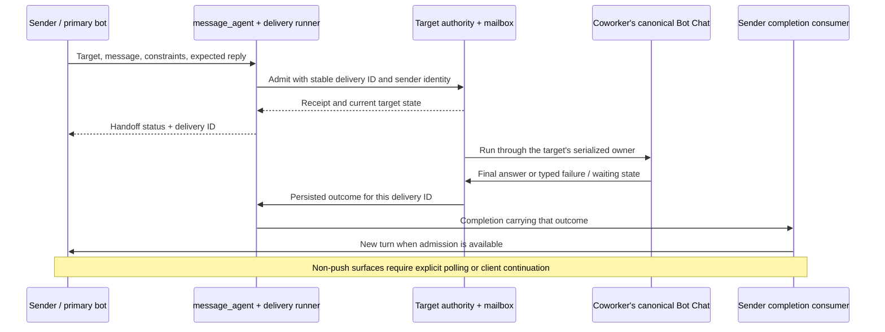
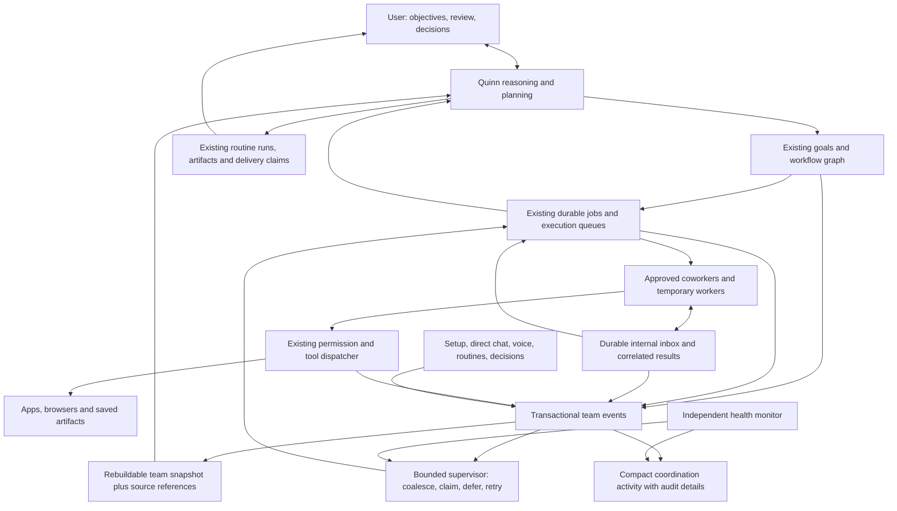

# Quinn coordination: Hermes source assessment and implementation plan

Evaluated on 12 November 2026. Swarm source: `e27449e449966feabb49407f29a5a3c665b1d0cc`. Hermes source: `f0e7b68e439f8c1962fcf9dcb0341aadf1e2a898`, inspected in `.context/hermes-research/latest`. This is the revision already credited in [THIRD_PARTY_NOTICES.md](../THIRD_PARTY_NOTICES.md), not a claim about the latest upstream release.

**Recommendation:** extend Swarm's existing Hermes-derived runtime with Hermes's durable bot receipts, automatic result return, completion admission and notification subscriptions. Add a Quinn-owned team view and bounded supervision over those mechanisms. Keep the current TypeScript/SQLite execution, permissions and tenant infrastructure. A second Python runtime would introduce another authority for queues, credentials, approvals and recovery.

This assessment refines the earlier [chief-of-staff plan](quinn-chief-of-staff-plan.md) against the current implementation. No application code was changed. Diagnostic tests and logs were added under `.context/quinn-resilience/`.

The follow-up [continuous-learning assessment and plan](quinn-continuous-learning-plan.md) traces automatic memory consolidation, Hermes's background skill reviewer and curator, low-friction learning policy, and three additional reproduced passive-learning gaps. Its coverage and correction fixes belong in the initial reliability stage; automatic skill promotion must follow evaluation and policy support.

The [unified build plan](quinn-build-plan.md) combines the implementation sequences below into one dependency order for coordination and learning. Use it for build ownership and release gates; this assessment remains the source and resilience record.

**What the screenshot reveals**

Quinn asks Nia to repeat activation, audience, outputs and blockers. Nia's answer and Quinn's request appear as full chat messages. These are two separate issues: Quinn lacks an automatically maintained operational view, and internal coordination shares the human conversation path. Collapsing the bubbles alone would leave the first issue intact.

The intended experience is: Quinn already sees that Nia is awaiting activation and which decisions remain; internal clarification runs only when the stored facts are insufficient. A completed exchange appears as “Quinn coordinated with Nia,” with an expandable audit trail. The user's request to add content strategy and Notion output updates Nia's proposed specification with source attribution. Quinn prepares the revision, the user reviews activation, and approved work then proceeds autonomously. A queued request must say “Queued for Nia”; it must not claim the agents have spoken before an exchange happens.

“Total knowledge” should mean complete coverage of recorded team activity, explicit freshness, retrievable evidence and visible uncertainty. It cannot mean that an LLM knows unobserved external changes, all workers' private reasoning, or that a generated conclusion is automatically true.

**1. What Hermes actually provides**

Hermes has three complementary coordination mechanisms. They are not interchangeable.

| Mechanism | Existing Hermes behavior | Use in Quinn |
| --- | --- | --- |
| Persistent Bot Mode | Named profiles with durable roles, memory, skills and canonical Bot Chats; roster discovery; direct messages and typed outcomes. | Permanent coworkers such as Nia. |
| Temporary delegation | Isolated child contexts; parent-supplied goal/context; final result returned to the originating parent; background completion registry. | Bounded research, analysis and specialist subtasks. |
| Kanban workflows | Persisted tasks/dependencies, dispatch, event subscriptions and origin wake-ups on results, failures and review requests. | Long-running business objectives and proactive follow-through. |

A default `@hermes` bot exists, but the inspected mechanisms do not automatically broadcast every profile's state to an omniscient chief of staff. Bot replies return to their sender; child results return to their parent; workflow events reach subscribers. Quinn must become the deliberate subscriber and supervisor for the user's team. Profiles are local isolation primitives, not a substitute for Swarm's tenant authorization.

The persistent-bot path is:



The runtime carries the reply. A local recipient trying to DM the sender again is refused because its final response already returns through the original delivery. `expects_reply=false` suppresses the reply notification. Fan-out combines outcomes into one sender wake-up, preventing a burst of full-context parent turns. These are concrete mechanisms to adapt, not just prompting advice.

The schema's `queued` acknowledgement is explicitly a handoff, not proof of execution. The local owner path may provide a stronger durable admission receipt; remote/background paths must retain their actual meaning. Hermes distinguishes a definite no-send from an ambiguous or still-pending outcome and instructs callers not to resend uncertain work.

There is an important surface distinction: `message_agent` can return `reply_delivery="poll"` when the caller cannot receive completion notifications. Separately, asynchronous delegation into the API server may persist a timeline row while leaving the next model turn to its client. Swarm must own the consumer and schedule Quinn's continuation on the server; storing a row or updating the UI is insufficient.

**2. Concrete source to reuse**

All Hermes links below are pinned to the inspected revision. Function names identify the behavior to port and its regression contract.

| Hermes source | Mechanism worth taking | Native adaptation |
| --- | --- | --- |
| [tools/bot_mode_dm.py][H-DM], `message_agent_tool`, `_start_delivery`, `_spawn_delivery` | Validated target, stable delivery ID, notification versus polling, one automatic reply path. | Extend `agent/tools.ts` and `agent/loop.ts` with durable internal requests/results. Resolve names to stable bot IDs before dispatch. |
| [tools/bot_mode_dm_coordination.py][H-FAN] | Bounded fan-out, one combined completion, per-target outcomes, cancellation of one's own request. | Aggregate coworker outcomes for a workflow/review; retain original IDs when only some targets fail. |
| [gateway/session_bot.py][H-ADMIT], `_admit`, `_publish_result`; [session_bot_mailbox.py][H-MAIL] | Pin physical destination before admission; protected receipt updates; explicit ambiguity across the file/database commit boundary. | Use one tenant SQLite transaction for local inbox/job/receipt persistence. Keep explicit unknown outcomes across remote boundaries. Never show delivery before admission. |
| [gateway/session_bot_state.py][H-STATE] | Distinguishes idle, working, approval wait, clarification wait and paused owner. | Derive live state from current jobs and decision records. Separate last heartbeat from last progress and last completed output. |
| [gateway/session_bot_outcome.py][H-OUTCOME] | Final-answer return, clearly marked fallback when no final reply was produced, interrupted-owner outcome. | Typed result/failure with evidence. A fallback narrative is not a verified task result. |
| [tools/async_delegation.py][H-ASYNC], claim/defer/complete/replay functions | Durable completion ledger, token-guarded claims, leases, restart replay and orphan sweeps. | Durable Quinn notification consumption. Admission refusal defers; retry exhaustion becomes a visible unresolved item. |
| [gateway/session_worker_delegation.py][H-WORKER] | Worker ownership bound to execution/session/generation; commit before publication; never acknowledge at publication. | Reuse Swarm job lineage and tenant ownership, plus coordinator generation checks on dispatch. |
| [gateway/kanban_watchers_notifier.py][H-NOTIFY]; [hermes_cli/kanban_db_notify.py][H-NOTIFY-DB] | Event subscriptions/cursors; separate passive ping from required agent wake; rewind on refused wake; preserve subscription through retries. | Make Quinn a team-event subscriber. Track notification admission separately from user report delivery. |
| [agent/bot_chain.py][H-CHAIN]; [tools/bot_mode_dm_chain.py][H-DM-CHAIN] | Runtime hop accounting, repeated-ask detection, sender identity and reply-loop prevention. | Bound request chains and wake cascades without forcing the worker to answer the user at the hop limit. |
| [tools/delegation_output_schema.py][H-SCHEMA] | Structured result validation with one bounded correction. | Already adapted. Preserve Swarm's distinction between output shape and verified acceptance. |
| [tools/bot_mode_probe.py][H-PROBE] | Roster/role discovery and capability revision tracking. | Keep the stable charter separate from changing team state; refresh capabilities on revision and provide bounded state deltas. |

For example, the existing Hermes completion acknowledgement is conditional on the claimant that owns the pending delivery:

```sql
-- Excerpt from tools/async_delegation.py: complete_completion_delivery
UPDATE async_delegations
SET delivery_state='delivered', delivered_at=?, updated_at=?,
    delivery_claim=NULL, delivery_claimed_at=NULL
WHERE delegation_id=? AND delivery_state='pending' AND delivery_claim=?;
```

That acknowledgement means the receiving consumer accepted the completion. It does not prove that a model processed it, a business task met its criteria, or a user received a message. Those need separate records.

Hermes also has limits worth retaining explicitly: bounded retries and replay age can stop delivery; notification routes can disappear; fan-out notification startup can fail after local work was admitted; interrupted work can have partial effects. Its code provides machinery for handling these cases, not a guarantee of perfect delivery. Preserve the MIT notice and record the upstream source for each new adaptation.

**3. What Swarm already has, and what is missing**

The current [native implementation record](hermes-native-implementation.md) documents substantial completed work. Rebuilding these capabilities would duplicate existing execution paths.

| Area | Current implementation | Remaining coordinator work |
| --- | --- | --- |
| Primary identity and coworker preparation | `bots.ts`, `agent/tools.ts`, setup modules and `voice-controls.ts`: primary-only creation, saved brief, review/activation flow. | Enforce primary continuity, transfer authority atomically, and centralize current setup/blocker visibility. |
| Durable execution | `agent/jobs.ts`, `agent/loop.ts`: persisted jobs, API admission limits, selected subscription concurrency, uncertain recovery. | General internal inbox and approval-safe admission; persisted reply correlation. |
| Goals and workflow graph | `agent/goals.ts`, `agent/workflows.ts`: criteria, budgets, dependencies, child lineage, results, pause/stop/recovery. | Assign approved permanent coworkers through the same contract; subscribe Quinn to every relevant change. |
| Knowledge | `knowledge/`: sourced memory, corrections, revisions, forgetting and archived-session search. | Team operational projection and retrieval across authorized coworker records; decisions linked to current source revisions. |
| Deliverables | `deliverables/`: immutable artifacts, durable routine runs, delivery claims, destination binding, uncertain-send reconciliation. | Use these records for daily synopsis delivery and report coverage. |
| Programs and tool execution | `agent/programs.ts`, native/MCP/connected-app dispatch: bounded execution, permissions, approval replay and tool receipts. | Preserve these gates for Quinn and all delegated work. Coordination must confer no extra external-action permission. |
| Proactivity | `proactive.ts`: timed check-ins and queries for tasks, approvals and recent routines. | Durable due slots, change cursors, complete team state, event-driven reviews and missed-report recovery. |
| User presentation | `Transcript.tsx` renders bot-origin message bodies as visible chat. | Explicit internal audience through persistence, streaming, notifications, model context and expandable audit. |

Two existing code paths explain the current behavior:

```typescript
// agent/loop.ts: current enqueueBotMessage (shortened)
appendRow(toBotId, 'message', {
  type: 'message', role: 'user', text,
  from: { kind: 'bot', id: fromBotId, name: from.name }
});
enqueue(toBotId, { type: 'bot', fromBotId, fromName: from.name, text, depth });

// Current turn admission: a bot message also enters this branch.
if (pendingRow && trigger.type !== 'resume') {
  await finishPending(ctx, st, 'denied-by-new-message');
}
```

The first writes the visible message before queue admission can fail. The second treats a background peer message as a replacement for the user's unresolved decision. Voice assignments already have stronger waiting behavior in this loop; generalize that contract to internal coordination.

There is another important constraint: `workflowToolGate` explicitly blocks untracked `send_to_bot`, `spawn_subagent` and other legacy delegation inside goal/workflow execution. `delegateWorkflowTask` currently creates temporary subagents. Extend that function/API to accept an approved permanent coworker with the same budget, stop, ownership and evidence contracts. Do not bypass the gate to make Quinn appear more capable.

**4. Target infrastructure layered over the existing runtime**



This makes Quinn central in responsibility while workers can still communicate directly. Quinn observes the durable consequences of those exchanges without relaying every message or executing a model turn for every heartbeat. Already-approved independent work can continue if Quinn's model is temporarily unavailable; new actions requiring its decision wait explicitly.

Add a small coordination persistence layer beside existing tables:

| Proposed record | Responsibility |
| --- | --- |
| `coordination_events` | Append-only change envelope written in the same transaction as canonical state; account, stable actor IDs, source type/ID/revision, sequence, time, correlation, causation and audience. Reference existing job/workflow/artifact records rather than duplicating their state machines. |
| `agent_inbox` | Durable request/result receipt; sender/recipient account binding, request ID, expected reply, payload/evidence references, admission/job ID, status, claim token and deadline. Unique delivery identity prevents a replay from creating another request. |
| `coordinator_cursors` | Per-consumer progress, authority generation, lease and review checkpoint. Keep projection progress, Quinn review progress and user report coverage distinct. |
| `team_snapshot` | Replaceable projection: each coworker's activation, approved role revision, current work, waits, last progress, output references, failures and next commitment. Includes source watermark and freshness. |

Use existing jobs for Quinn review runs and existing routine/delivery records for reports. No separate general-purpose scheduler or message broker is required for local tenant coordination initially. Cross-runtime messages must use authenticated owning-tenant routes and receipts; do not adopt Hermes's Desktop courier as a cloud dependency.

Proposed internal request contract, shown for design review rather than as implemented code:

```typescript
type InternalRequest = {
  requestId: string;
  tenantId: string;       // stamped by authenticated runtime
  fromBotId: string;      // stamped, not asserted by model text
  toBotId: string;
  workflowTaskId?: string;
  inReplyTo?: string;
  expectedReply: boolean;
  audience: 'internal';
  sourceRefs: string[];
  deadlineAt?: number;
};
```

Persist the request and corresponding event transactionally. A dispatcher checks the target's activation, ownership, decision wait and capacity. On admission, bind exactly one durable job to the request in the same database transaction; start execution after commit. Recovery scans accepted jobs if a process dies before scheduling. If busy or awaiting a decision, retain the request and defer it without cancelling the decision. When the worker finishes, persist the correlated result and parent notification before publishing any UI change. A notification's duplicate delivery must not duplicate work.

Keep delivery, execution and acceptance separate: a request can be admitted while the job is waiting; the model can finish while acceptance remains unverified; an accepted result can exist while a user-facing report is undelivered. Queue refusals are visible pending/refused states. Unknown external effects remain unknown until reconciled.

Quinn's turn context should contain the stable role/operating policy, a compact current team snapshot, changes since the last review, unresolved decisions and evidence relevant to the task. Large histories stay in retrievable storage. Canonical records settle operational facts; memory search supplies narrative context. Source-linked facts that were corrected or forgotten must not reappear through the shared projection.

Every state-changing entry point needs coverage: user and specialist chats, voice, setup UI/API, tool results, approval/question/connection continuations, schedules, workflow changes, cancellation, delivery and recovery. Structured changes are captured by code. Free-text extraction produces attributed candidate decisions until supported by the user's instruction; it must not silently overwrite approved settings or turn another bot's claim into a user instruction.

**5. How Quinn becomes more effective**

- **Preparation:** retrieve existing business context and coworker capabilities; prepare a focused specification; ask for genuinely missing decisions once; user reviews activation.
- **Allocation:** reuse the correct permanent coworker, or create a temporary worker for bounded work. Track scope, acceptance, dependencies, deadline, budget and next expected update in existing workflows.
- **Awareness:** answer who is working, what is blocked, which facts changed, what finished, and what evidence supports completion without a round of status DMs.
- **Follow-through:** react to completion/blocker/failure/review events; detect overdue commitments and stale progress; retry only actions whose safety is established.
- **Communication:** let coworkers exchange scoped inputs in the background; show concise coordination activity; keep approvals and substantive user decisions visible.
- **Reporting:** produce a daily synopsis with completed outcomes and artifact links, ongoing work, blockers, decisions required, next actions and coverage time. A routine having run is not evidence that its intended output exists.

Cheap state updates should not wake Quinn. Wake for actionable changes, user requests, significant failures, dependency readiness and scheduled summaries. Coalesce related completions, prioritize real decisions, and bound review time, tokens, retries and fan-out. Do not blindly copy Hermes's numeric defaults or impose a new global concurrency cap on subscription execution.

**6. Resilience findings from executed tests**

These results come from this evaluation, not only from reading tests.

| Test batch | Result | Evidence |
| --- | --- | --- |
| Voice coordination/assignment, bot creation, native knowledge/workflows/deliverables/runtime, storage recovery, gateway isolation and routine limits | 149 passed; no failures or skips | [core-tests.log](../.context/quinn-resilience/core-tests.log) |
| CLI concurrency/supervisor, metrics and messaging dispatch before PostgreSQL setup | 22 passed; 3 database-dependent tests skipped | [infrastructure-tests.log](../.context/quinn-resilience/infrastructure-tests.log) |
| Disposable PostgreSQL 16: directory/lifecycle, environment operations, tenant capacity, metrics, messaging dispatch and backup lifecycle | 102 passed; no failures or skips | [postgres-infrastructure-tests.log](../.context/quinn-resilience/postgres-infrastructure-tests.log) |
| Server and web TypeScript checks | Passed | [typecheck.log](../.context/quinn-resilience/typecheck.log) |
| Additional proposed coordination safety contracts | 4 failed, reproducing the gaps below | [test fixture](../.context/quinn-resilience/coordination-boundaries.test.mts), [log](../.context/quinn-resilience/coordination-boundaries.log) |

Batch counts overlap and must not be added into a unique-test total. PostgreSQL used a disposable local cluster with a private Unix socket and no TCP listener; it was stopped after the tests. External model, cloud, messaging and app providers were mocked. Passing tests establish the exercised local contracts, not live deployment or production scale qualification.

| Reproduced gap | Observation | Required correction |
| --- | --- | --- |
| Background update interrupts approval | A pending MCP approval changed to `expired`; its pending turn disappeared. No external write executed. | Preserve pending approval/question/connection state and hold internal requests until a safe admission point. |
| Rejected work looks delivered | At the API queue limit, one visible peer message remained while zero peer jobs were accepted. | Persist admission/receipt consistently and render honest queued/refused/delivered states. |
| Internal chatter suppresses check-ins | With no human message, an internal bot-origin row suppressed the check-in; the no-message control queued one. | Use explicit human-origin activity, separate from the model's `role=user` representation. |
| Coordinator can disappear | Deleting the sole primary returned HTTP 200 and left zero primaries. | Require explicit replacement before individual primary deletion; enforce role continuity and fence stale coordinators. |

The relevant locations are `agent/loop.ts` around lines 207 and 279, `proactive.ts` around line 84, and `routes.ts` around line 228. These are missing coordinator contracts; they do not invalidate the native recovery mechanisms that passed.

One additional **source-inspected risk, not dynamically reproduced here**: `proactive.ts` writes `last_fired` before attempting the check-in enqueue. An enqueue failure can consume a scheduled slot. Replace this with durable due work whose status advances after acceptance, and test the failure point.

Hermes regression code was inspected but **not executed**: this VM's available Python is 3.9 and lacks pytest; the pinned repository declares Python 3.11 or newer and a managed test environment. Useful source contracts for the port include [restart replay][H-TEST-RESTART], [orphan recovery][H-TEST-ORPHAN], [API delivery ownership][H-TEST-API], [wake failure and cursor rewind][H-TEST-WAKE], [DM outcomes][H-TEST-DM] and [chain limits][H-TEST-CHAIN]. Do not count these as passing runtime results.

**7. Failure containment and release gates**

No agent can be guaranteed never to fail. The infrastructure should keep a failure bounded, observable, recoverable and honest. The following are required tests for the new layer, not claims that the layer already passes them.

| Boundary / injected failure | Required result |
| --- | --- |
| Kill process between source commit and event publication | Replay the persisted event; snapshot reaches the same state; no lost accepted work. |
| Kill between inbox acceptance, job binding and scheduling | Recover the original job/request identity; no second assignment. |
| Duplicate/out-of-order results and stale lease holder | Idempotent processing; source revision ordering; stale owner cannot acknowledge or overwrite newer state. |
| Target awaiting approval, clarification or connection; queue full | Keep the existing decision valid, defer unrelated work, retain notification, make no unauthorized call. |
| Quinn crashes or its model/provider is unavailable | Persist results, continue already-authorized independent work, expose coordinator health without needing Quinn to report its own failure. |
| Worker/provider stalls | Distinguish long active work from no progress and approval wait; bounded recovery; do not rerun uncertain side effects. |
| Provider writes successfully but acknowledgement is lost | Preserve `unknown`; reconcile through existing tool/delivery receipts before any retry. |
| Primary transfer, rename, worker deletion or stale setup revision | Stable IDs, atomic authority transfer, explicit orphan handling; old coordinator dispatch is fenced. |
| Cross-account request, forged sender, revoked tool access | Reject at read, admission and execution boundaries; primary role never bypasses external-tool permissions. |
| Coworker ping-pong or recurring failure | Bound chain/retry/cost; coalesce updates; escalate one unresolved item instead of endless turns. |
| Context compaction or conversation reset | Reconstruct current team state from durable records; respect intentional data deletion and memory forgetting. |
| Restore/migration from an older snapshot | Rebuild projections; preserve current restore fences; reconcile potentially later external effects. |
| Daily report delivery fails, process restarts, DST changes | Durable local-time report window and exact content/destination; recover missed work; no automatic retry of ambiguous sends. |
| UI reconnect or legacy client | Internal traffic stays internal through server audience rules; completed coordination appears once; approvals remain actionable. |

Use an independent runtime/operations health monitor for coordinator lag, unconsumed events, stalled progress, unresolved unknown effects and report gaps. It must be able to expose a degraded state even if the coordinator model never runs. Do not let a failed coordinator stop telemetry or make the application falsely appear idle.

Evaluate understanding separately from plumbing: seed team scenarios with known answers, ask Quinn who owns each objective, what blocks it, what changed, and what can safely happen next. Check every significant factual claim against the source records. Include conflicting instructions, direct specialist edits, stale evidence, draft coworkers, missing usage accounting and completed jobs with unverified outputs. More messages or more context are not evidence of better understanding.

**8. Delivery sequence**

| Stage | Concrete work | Exit gate |
| --- | --- | --- |
| 1. Repair admission and role boundaries | Fix the four reproduced gaps and scheduled-slot admission; primary uniqueness/continuity plus authority revision; preserve existing voice waits. | New safety tests pass; current regression suites and typechecks remain green. |
| 2. Port durable Bot Mode communication | Inbox/receipts, stable IDs, automatic final-result return, typed outcomes, claim/defer/replay, reply-loop control, internal audience and honest activity states. | Crash, duplicate, waiting-target, revoked-access and notification-admission tests pass; no manual reply tool required. |
| 3. Build automatic team awareness | Transactional event coverage; snapshot/cursors; bounded retrieval; direct-edit and correction propagation. Backfill canonical state with honest provenance. | Shadow projection matches authoritative records across chat, voice, UI, routines, recovery and migration. |
| 4. Assign permanent coworkers through native workflows | Extend structured delegation with an approved coworker target, preserving evidence, budgets, lineage and exact-job cancellation. | End-to-end lead-to-content handoff works without duplicate coworker creation or untracked goal work. |
| 5. Enable bounded Quinn supervision | Event subscription, batched reviews, stale-progress detection, follow-up deadlines, escalation and independent health checks. | Quinn outage/restart and notification-storm tests preserve work and bounded cost. |
| 6. Deliver daily synopsis and qualify rollout | Existing routine/artifact/delivery path; durable report windows; user decisions and results surfaced centrally; rollout controls. | Crash/recovery and report-coverage gates pass, plus provider staging checks and measured workload qualification. |

Deploy by tenant in stages: first observe and compare projections without new autonomous actions; then enable internal result transport; then limited supervision under approved scope; finally scheduled summaries. A rollback disables new autonomous dispatch while retaining receipts, events and recoverable queued work. Maintain one transport owner per request during migration. Historical assistant messages with no provenance must not be silently relabeled as internal replies.

Acceptance targets should be agreed and measured during staging: 100% coverage of the enumerated state transitions; no duplicate accepted assignment for one request ID; zero lost pending decisions; explicit unknown outcomes; complete report windows; bounded snapshot/notification lag under the supported workload. A proposed healthy-runtime target is a team-state projection within five seconds and an actionable Quinn review admitted within thirty seconds when it has capacity. These are targets, not measurements from this audit; waits and provider outages must remain visible.

The first useful deliverable is stages 1–3: background communication and reliable awareness without rebuilding the runtime. Stages 4–6 turn that awareness into delegated execution, supervision and reporting. The development priority is to port the selected Hermes mechanisms and their behavioral tests into the native contracts already present, then add Quinn's team-wide subscription and chief-of-staff policy.

[H-DM]: https://github.com/NousResearch/hermes-agent/blob/f0e7b68e439f8c1962fcf9dcb0341aadf1e2a898/tools/bot_mode_dm.py#L239
[H-FAN]: https://github.com/NousResearch/hermes-agent/blob/f0e7b68e439f8c1962fcf9dcb0341aadf1e2a898/tools/bot_mode_dm_coordination.py#L72
[H-ADMIT]: https://github.com/NousResearch/hermes-agent/blob/f0e7b68e439f8c1962fcf9dcb0341aadf1e2a898/gateway/session_bot.py#L955
[H-MAIL]: https://github.com/NousResearch/hermes-agent/blob/f0e7b68e439f8c1962fcf9dcb0341aadf1e2a898/gateway/session_bot_mailbox.py#L60
[H-STATE]: https://github.com/NousResearch/hermes-agent/blob/f0e7b68e439f8c1962fcf9dcb0341aadf1e2a898/gateway/session_bot_state.py
[H-OUTCOME]: https://github.com/NousResearch/hermes-agent/blob/f0e7b68e439f8c1962fcf9dcb0341aadf1e2a898/gateway/session_bot_outcome.py
[H-ASYNC]: https://github.com/NousResearch/hermes-agent/blob/f0e7b68e439f8c1962fcf9dcb0341aadf1e2a898/tools/async_delegation.py#L599
[H-WORKER]: https://github.com/NousResearch/hermes-agent/blob/f0e7b68e439f8c1962fcf9dcb0341aadf1e2a898/gateway/session_worker_delegation.py#L198
[H-NOTIFY]: https://github.com/NousResearch/hermes-agent/blob/f0e7b68e439f8c1962fcf9dcb0341aadf1e2a898/gateway/kanban_watchers_notifier.py#L768
[H-NOTIFY-DB]: https://github.com/NousResearch/hermes-agent/blob/f0e7b68e439f8c1962fcf9dcb0341aadf1e2a898/hermes_cli/kanban_db_notify.py
[H-CHAIN]: https://github.com/NousResearch/hermes-agent/blob/f0e7b68e439f8c1962fcf9dcb0341aadf1e2a898/agent/bot_chain.py
[H-DM-CHAIN]: https://github.com/NousResearch/hermes-agent/blob/f0e7b68e439f8c1962fcf9dcb0341aadf1e2a898/tools/bot_mode_dm_chain.py
[H-SCHEMA]: https://github.com/NousResearch/hermes-agent/blob/f0e7b68e439f8c1962fcf9dcb0341aadf1e2a898/tools/delegation_output_schema.py
[H-PROBE]: https://github.com/NousResearch/hermes-agent/blob/f0e7b68e439f8c1962fcf9dcb0341aadf1e2a898/tools/bot_mode_probe.py#L337
[H-TEST-RESTART]: https://github.com/NousResearch/hermes-agent/blob/f0e7b68e439f8c1962fcf9dcb0341aadf1e2a898/tests/tools/test_async_delegation.py#L499
[H-TEST-ORPHAN]: https://github.com/NousResearch/hermes-agent/blob/f0e7b68e439f8c1962fcf9dcb0341aadf1e2a898/tests/tools/test_async_delegation_orphan_sweep.py
[H-TEST-API]: https://github.com/NousResearch/hermes-agent/blob/f0e7b68e439f8c1962fcf9dcb0341aadf1e2a898/tests/gateway/test_api_delegation_delivery_contract.py
[H-TEST-WAKE]: https://github.com/NousResearch/hermes-agent/blob/f0e7b68e439f8c1962fcf9dcb0341aadf1e2a898/tests/gateway/test_kanban_notifier_wake_only_ordering.py#L131
[H-TEST-DM]: https://github.com/NousResearch/hermes-agent/blob/f0e7b68e439f8c1962fcf9dcb0341aadf1e2a898/tests/tools/test_bot_mode_dm_outcomes.py
[H-TEST-CHAIN]: https://github.com/NousResearch/hermes-agent/blob/f0e7b68e439f8c1962fcf9dcb0341aadf1e2a898/tests/agent/test_bot_chain.py
