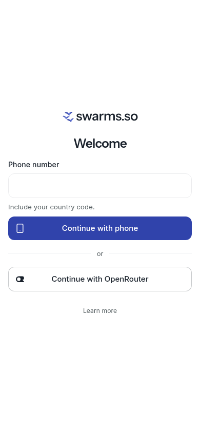
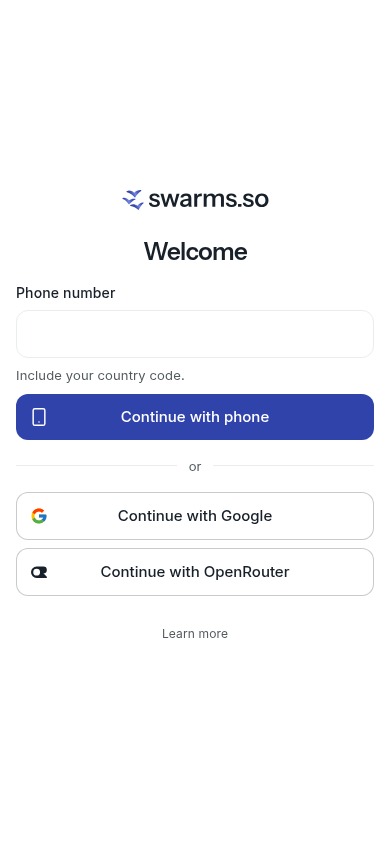
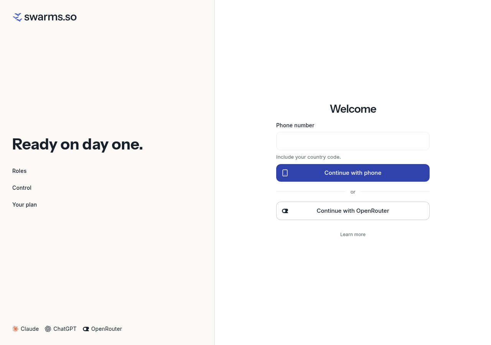
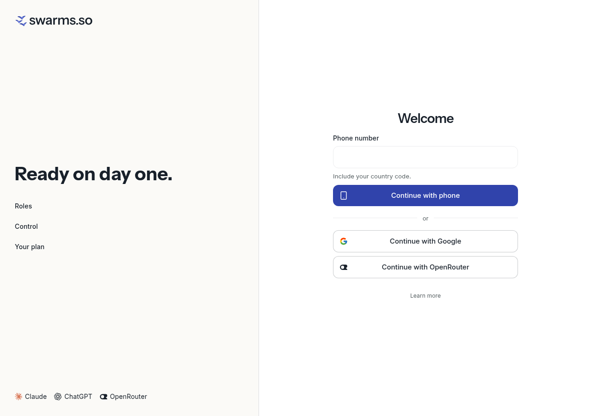

# D1 Google login fallback evidence

Baseline: main 617bf11732284518c5fdcaa0e027a800ee4b374a.
Fix: 1066485, Restore Composio Google login when native client is unset.

All captures use local development servers, a temporary database, synthetic
Composio configuration, no native Google client, and mocked provider requests.
No production credentials, real user data, or emails were used.

| Light theme | Before on main | After the fix |
| --- | --- | --- |
| 390 px |  |  |
| 1280 px |  |  |

Main hides Continue with Google and returns google_unavailable from the start
route when the native client is missing. The fix restores the button and the
previous Composio authorization flow, including its managed Gmail consent.
When both client values are nonblank, direct OIDC still requests exactly openid,
email, and profile, with no Composio authorization.

The new D1 server assertions fail twice on main (3 passed, 2 failed) and pass on
the fix (5 passed). The new welcome assertions fail at both widths on main and
pass at both widths on the fix. The complete Google auth suite passes 26 tests
on main and 29 on the fix, with successful account reuse in both directions.

Both OIDC and Composio callback UI checks pass at 390 and 1280 px. Expired links
return to Welcome with "That sign-in link expired. Please try again." and a
full-width Try again control with a target height of at least 44 px. Each retry
starts a fresh authorization. The existing brand, equal button widths, readable
meta text, and one Back control on the recovery screen are preserved.

Separate Gmail connection checks also pass at both widths. Composio error pages
can only return to Swarm if the provider sends its callback; a page with no
callback remains outside Swarm's control.
