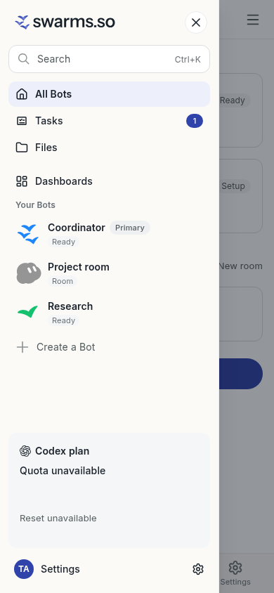
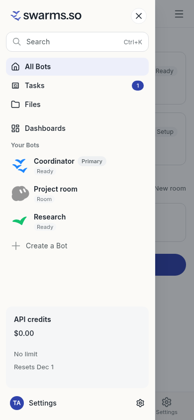
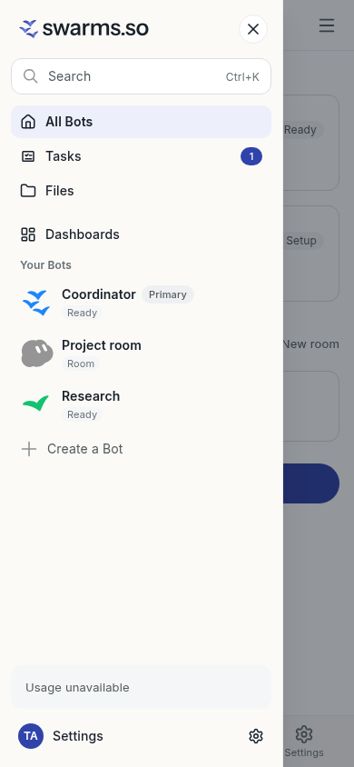

# D4 and D7 local validation report

All browser and API checks used isolated local databases and fixture accounts. No real user data was changed and no email was sent. Screenshots are uncommitted. No Dashboards code or sidebar Dashboards group changes were made.

## D4

- PR: https://github.com/agenticwizzard007/grokbot-clone/pull/292
- Status: merged.
- Merge commit: e5e7fd39ac04bf1e9941844e1da0041917862b8f
- Causes: disabled customization returned 404 on its read endpoint; jobs without output returned 404; the output response shape did not match the chat client; unrelated events repeatedly refreshed terminal jobs.
- Fix: successful disabled config reads, owned-job output envelopes with empty output and terminal status, quiet bounded exponential backoff, and terminal stopping.
- New API regressions: 0/3 pass on main 870be3de, 3/3 pass on the branch.
- New chat browser regression: fails on main; passes at 390 and 1280 with zero failed requests and zero console errors for the two routes. Active jobs back off and terminal jobs stop.
- Relevant baseline: 100/100; branch: 103/103. Typecheck passes.
- readiness-kk: main and branch pass 420 tests plus four browser scenarios. Stale Settings count and phone Bot selectors were corrected in the test harness, retaining API count, visible-row, expired-state and no-external-action assertions.
- client-defaults-ui: main and branch each pass 208/208 views, including four existing reviewed differences.

## D7

- PR: https://github.com/agenticwizzard007/grokbot-clone/pull/295
- Status: merged.
- Merge commit: dea90afb70cf0e042820af211aba5857dfed1d33
- Root cause: /api/usage/summary used the selected model connection to replace the account allowance with cached CLI quota. Missing or expired CLI observations returned percentUsed=null and resetsAt=null, producing Quota unavailable and Reset unavailable. The client was calling the correct endpoint; Google-created sessions and empty ledgers authenticated and returned valid data.
- Fix: this endpoint requests account allowance independently of the selected connection. Unset SWARM_PLAN_LIMIT_USD gives limitCents=null and percentUsed=null for No limit. Configured limits use recorded account spend. Existing connection-quota helper behavior remains available to other consumers.
- UI: unavailable data is a single 13px line in a 48px control. The meter always opens Settings > Usage, including the collapsed rail, and closes the phone drawer even from Usage itself. Only the usage component callback line in Sidebar.tsx changed.
- New API regressions: 1/4 pass on updated main e5e7fd39; 4/4 pass on D7. Covers Google sessions, zero ledger rows, API/Codex/Claude selection, unset/configured limits, recorded spend and authentication.
- Updated main relevant suite: 103/103; D7: 107/107. Zero new failures.
- Browser regression passes at 390 and 1280 in light and dark. Covers normal, no limit and unavailable states, geometry, text size, navigation, one phone Back control and drawer closure.
- Existing sidebar usage suite: main 57/57, D7 57/57. Typecheck passes.
- readiness-kk: 420 tests plus four browser scenarios pass. client-defaults-ui: 208/208 views pass, with 204 exact matches and four existing reviewed differences. Both gates passed before merge.

## Required screenshots

D4 changes network behavior, so its before and after screens visually match.

- /workspace/swarm-qa/livewalk-fix/shots/D4-before-390.png
- /workspace/swarm-qa/livewalk-fix/shots/D4-after-390.png
- /workspace/swarm-qa/livewalk-fix/shots/D4-before-1280.png
- /workspace/swarm-qa/livewalk-fix/shots/D4-after-1280.png
- /workspace/swarm-qa/livewalk-fix/shots/D7-before-390.png
- /workspace/swarm-qa/livewalk-fix/shots/D7-after-390.png
- /workspace/swarm-qa/livewalk-fix/shots/D7-before-1280.png
- /workspace/swarm-qa/livewalk-fix/shots/D7-after-1280.png

Additional unavailable-state comparisons:

- /workspace/swarm-qa/livewalk-fix/shots/D7-before-unavailable-390.png
- /workspace/swarm-qa/livewalk-fix/shots/D7-after-unavailable-390.png
- /workspace/swarm-qa/livewalk-fix/shots/D7-before-unavailable-1280.png
- /workspace/swarm-qa/livewalk-fix/shots/D7-after-unavailable-1280.png

The same images are accessible through .context/livewalk/shots. The append-only state log is /workspace/swarm-qa/livewalk-fix/LW-C-state.md. Test logs are under .context/livewalk/.

Both ready PRs were merged sequentially. PR #291 was still open at the D7 merge, so no FIX-DASH-3 merge existed to rebase onto. D7 was rebased on current main before its final checks. The root workspace remains on the D7 PR branch with a clean working tree.

DONE
